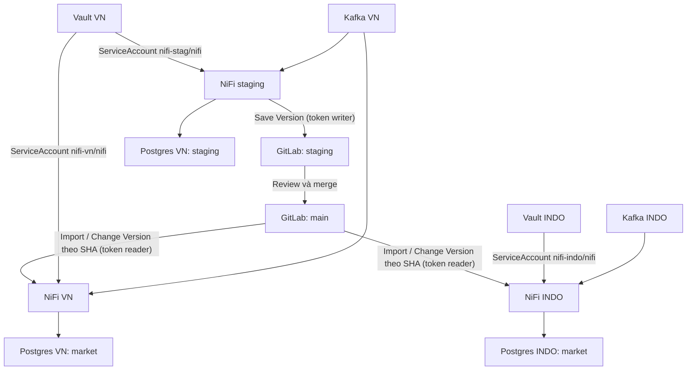
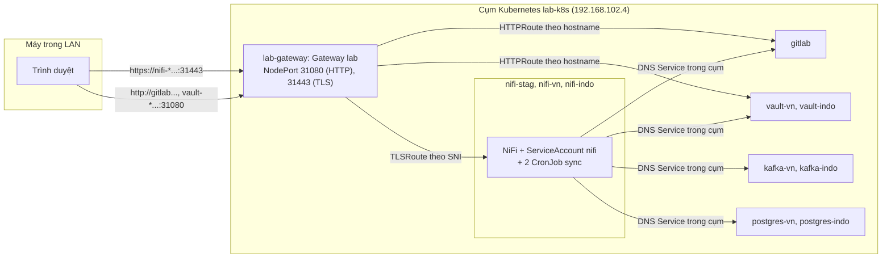
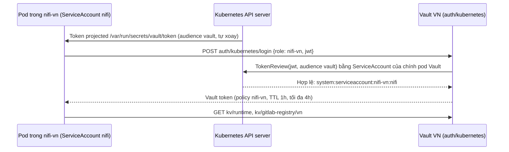
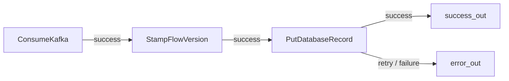

# Hướng dẫn lab trên Kubernetes từ đầu đến cuối

Bài lab này giống [GUIDE_VI.md](GUIDE_VI.md): NiFi multi-market với staging, VN và INDO. Điểm khác là toàn bộ hạ tầng chạy trên cụm **Kubernetes** của máy lab. Quy trình làm bài vẫn như cũ: dựng flow trên staging, lưu version lên GitLab, review rồi merge, import vào từng thị trường, sau đó rollout và rollback.

So với bản Docker Compose, bản Kubernetes khác ở ba điểm:

| Điểm khác | Bản Docker Compose | Bản Kubernetes (tài liệu này) |
|---|---|---|
| Vị trí service | Container dùng chung host network, mỗi service một cổng host | **Mỗi service một namespace**; trình duyệt đi qua một Gateway chung |
| NiFi đọc Vault | Token tĩnh `nifi-vn-lab-token`, `nifi-indo-lab-token` | **ServiceAccount `nifi` + Vault Kubernetes auth role**; không còn token cố định |
| NiFi đọc/ghi GitLab | Personal Access Token của user `nifi-writer`, `nifi-reader` | **Project Access Token** của project; mỗi token có một bot user riêng |

Tài liệu này đủ để làm từ đầu đến cuối mà không phải mở GUIDE_VI. Nếu mới làm quen với NiFi, nên đọc [tài liệu giải thích các thành phần](NIFI_CONCEPTS_VI.md) trước hoặc mở song song khi thực hành. Kết quả kiểm thử thực tế nằm trong [VALIDATION_K8S.md](VALIDATION_K8S.md).

## 0. Mở đúng ứng dụng và chọn điểm bắt đầu

Guide dùng giao diện tiếng Anh của **NiFi 2.6.0**, GitLab CE **18.2.1** và Vault **1.19.5**. Tên nút tiếng Anh được in đậm; nội dung trong code là giá trị cần nhập.

Mọi lệnh Bash đều chạy trong **SSH máy lab** vì `kubectl` nằm ở đó. Chạy tại thư mục `~/github/nifi-multi-market-lab`, branch `k8s-deployment`. Đừng chạy các lệnh này trên máy cá nhân hay gõ vào ô Properties của NiFi.

### 0.1 Máy lab đã dựng sẵn: bắt đầu ở đâu?

Máy `192.168.102.4` đã có sẵn:

- 11 namespace;
- Kafka topics và bảng PostgreSQL;
- Vault secrets và các Kubernetes auth role;
- project GitLab `data360/flows-nifi` cùng ba Project Access Token;
- trên mỗi NiFi: Parameter Context `shared-runtime` và một Registry Client.

Lần kiểm thử tự động cuối **để lại flow đang chạy** trên cả ba NiFi và hai MR trong GitLab. Muốn tự làm bài từ canvas trống thì phải dọn lab trước, theo các bước sau:

1. Mở `LAB_ACCESS.local.md` trong IDE để lấy credential hiện tại.
2. SSH vào máy lab (user và password nằm trong file local), rồi kiểm tra lab đã sẵn sàng chưa:

   ```bash
   cd ~/github/nifi-multi-market-lab
   python3 k8s/scripts/check-k8s.py
   ```

   Dòng cuối phải là `All checks passed`. Nếu có dòng `FAIL`, xem [mục 15](#15-troubleshooting) trước khi làm tiếp.
3. Làm **mục 3.7** để dọn ba canvas và tạo lại project GitLab.
4. Mở các URL ở bảng 0.2 và đăng nhập.
5. Làm **mục 4** để xem GitLab project và Project Access Token mà script đã tạo. Không tạo user, không tạo Personal Access Token.
6. Làm **mục 5–6** để kiểm tra parameter và Registry Client.
7. Làm **mục 7** trên staging, rồi **mục 8–11** để publish, import, rollout và rollback.
8. Mục 2 và 3.1–3.6 chỉ dùng khi dựng lại trên cụm mới. Trên máy lab hiện tại không cần chạy lại các mục này, và không xóa namespace hay PVC.

| Giai đoạn | Ứng dụng/tab cần mở | Kết quả trước khi chuyển bước |
|---|---|---|
| [3.7 Dọn lab](#37-trả-lab-về-canvas-trống-để-thực-hành-lại) | SSH máy lab | 3 canvas trống, project GitLab mới, Registry Client dùng token mới |
| [4. GitLab](#4-kiểm-tra-gitlab-project-và-project-access-token) | GitLab root | Project, branch `staging`, `main` được bảo vệ, 3 Project Access Token |
| [5. Parameters](#5-parameter-và-vault-theo-từng-thị-trường) | Vault VN/INDO + 3 NiFi | 8 parameter đúng cho mỗi môi trường, NiFi đăng nhập Vault bằng ServiceAccount |
| [6. Registry](#6-registry-client-trên-từng-nifi) | 3 NiFi | Staging dùng token writer và branch `staging`; thị trường dùng token reader và `main` |
| [7. Dựng flow](#7-dựng-flow-trên-nifi-staging-từng-thao-tác) | Chỉ NiFi staging + SSH | Event test vào đúng schema staging, audit `v1/STAG` |
| [8. Publish](#8-publish-v1-review-và-merge-trên-gitlab) | Staging + GitLab | Snapshot sạch trên `main`, đã ghi M1 |
| [9. Import](#9-import-v1-vào-vn-sau-đó-indo) | VN rồi INDO | Cùng M1, endpoint và local audit riêng |
| 10–11 | Staging/GitLab rồi từng thị trường | Rollout/rollback có bằng chứng theo SHA |

### 0.2 URL dùng trong trình duyệt

| Tab | URL | Tài khoản |
|---|---|---|
| NiFi staging | <https://nifi-stag.192.168.102.4.sslip.io:31443/nifi/> | `admin`, password NiFi trong file local |
| NiFi VN | <https://nifi-vn.192.168.102.4.sslip.io:31443/nifi/> | như staging |
| NiFi INDO | <https://nifi-indo.192.168.102.4.sslip.io:31443/nifi/> | như staging |
| GitLab | <http://gitlab.192.168.102.4.sslip.io:31080/users/sign_in> | `root`, password GitLab trong file local |
| Vault VN | <http://vault-vn.192.168.102.4.sslip.io:31080/ui/> | Method `Token`, root token Vault VN trong file local |
| Vault INDO | <http://vault-indo.192.168.102.4.sslip.io:31080/ui/> | Method `Token`, root token Vault INDO trong file local |

Ba NiFi dùng chung cổng **31443**; GitLab và hai Vault dùng chung cổng **31080**. Gateway phân biệt dịch vụ bằng **hostname**, vì vậy phải gõ đúng hostname như trong bảng.

1. Mở lần lượt ba NiFi bằng ba hostname ở bảng trên. Đóng các tab NiFi cũ của bản Compose (cổng 18443/28443/38443).
2. Khi gặp cảnh báo certificate tự ký, mở **Advanced** và chọn tiếp tục đến đúng hostname lab; trên Firefox dùng **Accept the Risk and Continue**. Mỗi NiFi có certificate riêng nên phải chấp nhận ba lần.
3. Nhập Username = `admin`, Password lấy từ file local, rồi bấm **Log In**.
4. Kiểm tra góc trên đã hiện user admin và đã vào canvas.
5. Giữ ba tab có hostname ghi rõ môi trường để không thao tác nhầm giữa VN và INDO.

Mở bằng IP sẽ không vào được dịch vụ nào. `https://192.168.102.4:31443` không mang hostname nên Gateway không biết chọn NiFi nào; `http://192.168.102.4:31080` trả **404**. Đây là hành vi đúng, không phải lỗi.

Hostname `sslip.io` tự phân giải về IP nằm trong tên. Nếu mạng chặn kiểu DNS này, thêm đúng dòng sau vào `/etc/hosts` của máy mở trình duyệt (trên Windows là file hosts tương ứng):

```text
192.168.102.4 nifi-stag.192.168.102.4.sslip.io nifi-vn.192.168.102.4.sslip.io nifi-indo.192.168.102.4.sslip.io gitlab.192.168.102.4.sslip.io vault-vn.192.168.102.4.sslip.io vault-indo.192.168.102.4.sslip.io
```

### 0.3 Ba NiFi chung một cổng: Gateway chọn đúng NiFi thế nào?

Khi bắt tay TLS tới `192.168.102.4:31443`, trình duyệt gửi kèm hostname (gọi là **SNI**). Gateway (Envoy) chỉ đọc SNI để chọn NiFi tương ứng, rồi chuyển nguyên luồng đã mã hóa vào pod mà không giải mã (**TLS passthrough**). Vì vậy certificate trình duyệt nhìn thấy là certificate tự ký của chính NiFi đó. SAN của certificate gồm hostname sslip.io, `localhost`, IP LAN và tên Service trong cụm.

Ba hostname riêng còn giữ cho phiên đăng nhập không ghi đè lẫn nhau:

- Cookie đăng nhập của NiFi luôn có cùng tên và path `/`.
- Trình duyệt phân biệt cookie theo hostname, không theo port.
- Bản Compose từng bị lỗi Session expired khi ba NiFi dùng chung IP. Trên K8s, ba NiFi còn dùng chung cả port, nên hostname riêng là bắt buộc.

**Single User của NiFi 2.6 cấp JWT có hạn 8 giờ**, tính từ lúc đăng nhập. Đăng xuất, đóng phiên trình duyệt hoặc restart pod NiFi có thể khiến phải đăng nhập lại. Kiểm tra ba phiên cùng tồn tại bằng lệnh:

```bash
cd ~/github/nifi-multi-market-lab
NIFI_GATEWAY_PORT=31443 python3 scripts/check-nifi-sessions.py
```

Script đăng nhập cả ba hostname trong cùng một cookie jar, rồi đăng nhập lại staging để phát hiện cookie bị ghi đè. Các dòng phải là `PASS`. Script không sửa flow.

### 0.4 Lệnh và script dùng trong bài

Đăng nhập máy lab bằng SSH: host `192.168.102.4`, user và password lấy trong `LAB_ACCESS.local.md`. Sau đó:

```bash
cd ~/github/nifi-multi-market-lab
git branch --show-current     # phải là k8s-deployment
```

| Lệnh | Việc làm | Dùng ở mục |
|---|---|---|
| `python3 k8s/scripts/check-k8s.py` | 57 kiểm tra chỉ đọc trên toàn bộ lab | 0.1, 3.6 |
| `bash k8s/scripts/nifi-sync.sh params stag\|vn\|indo\|all` | Job đọc Vault bằng ServiceAccount rồi apply vào `shared-runtime` | 3.5, 5.4 |
| `bash k8s/scripts/nifi-sync.sh registry stag\|vn\|indo\|all` | Job đọc Project Access Token trong Vault rồi cấu hình Registry Client | 3.5, 4.5, 6 |
| `bash k8s/scripts/produce.sh stag\|vn\|indo <event_id>` | Gửi 1 event JSON vào topic Kafka của instance | 7–11 |
| `bash k8s/scripts/query.sh stag\|vn\|indo` | Xem bảng `trip_events` mà instance ghi vào | 7–11 |
| `bash k8s/scripts/gitlab-token.sh stag\|vn\|indo` | In Project Access Token đang lưu trong Vault | 6.2, 8.2, 8.4 |
| `python3 k8s/scripts/vault-init.py --unseal-only` | Unseal hai Vault sau khi pod Vault restart | 12 |
| `python3 k8s/scripts/gitlab-bootstrap.py` | Tạo project/token; `--rotate` xoay token; `--recreate-project` tạo lại project | 3.4, 3.7, 4.6 |

### 0.5 Những thao tác NiFi sẽ dùng nhiều

- **Menu ba gạch góc phải**: Canvas, Controller Settings, Parameter Contexts, Data Provenance.
- **Breadcrumb phía trên canvas**: bấm tên PG cha để quay lên; double-click một PG để đi vào trong.
- **Kéo component từ toolbar xuống canvas**: tạo Processor, Process Group, Input Port, Output Port, Funnel hoặc Import from Registry.
- **Chuột phải component → Configure**: sửa Settings, Properties, Scheduling, Relationships của component đang chọn.
- **Chuột phải chỗ trống hoặc một PG → Controller Services**: mở danh sách service của đúng scope đó.
- **Apply**, **Start** và **Version → Commit Local Changes** là ba thao tác riêng: **Apply** lưu cấu hình runtime trong dialog, **Start** chạy component, **Commit Local Changes** tạo snapshot/commit.

Sau mỗi dialog, đọc lại breadcrumb và hostname trước khi làm tiếp. Tên menu và dialog trong guide đã được đối chiếu với source NiFi 2.6. Các bước qua API đã được chạy thử trên lab K8s (xem [VALIDATION_K8S.md](VALIDATION_K8S.md)).

## 1. Hiểu đúng mô hình trước khi chạy



- Cấu trúc flow giống nhau ở mọi nơi. Nguồn Kafka và đích DB khác nhau nhờ parameter.
- Registry Client không phải công cụ deploy. Khi GitLab có version mới, NiFi chỉ báo trạng thái, không tự Change Version.
- `Save Version` tạo commit. Chỉnh processor hoặc Apply property chỉ đổi runtime của NiFi, chưa commit vào Git.
- SHA của version là commit trong lịch sử **đường dẫn snapshot** trên branch được chọn. Không lấy branch HEAD một cách tùy tiện.
- Không phải commit Git nào cũng sinh version mới cho NiFi. Sửa file khác không tạo version flow. Squash, rebase hoặc revert làm thay đổi lịch sử snapshot có thể sinh SHA mới. Merge commit giữ nguyên snapshot chưa chắc xuất hiện thành version mới trong danh sách của NiFi. Hãy xác minh bằng API theo đường dẫn file và bằng danh sách version trong NiFi.

### 1.1 Ranh giới snapshot

| Thành phần | Nơi lưu | Theo Change Version? |
|---|---|---|
| Processor, connection, port, Controller Service nằm trong shared PG | `flows/shared/kafka-to-postgres.json` | Có |
| Tên context, tên parameter, metadata như sensitivity/description | Snapshot | Có |
| Giá trị parameter | Vault và Parameter Context local | Không, khi client đặt **Remove** |
| Literal viết thẳng vào property | Snapshot | Có, nên phải thay bằng parameter nếu giá trị phụ thuộc môi trường |
| Registry Client và Project Access Token; Vault role, ServiceAccount | Cấu hình NiFi local, Kubernetes, Vault | Không đưa vào shared PG |
| PG `LOCAL_*`, connection nối các PG trên canvas cha | NiFi local | Không |
| Queue, Kafka offsets, dữ liệu DB, runtime state | Hệ lưu trữ tương ứng | Không phải flow version |

`Remove` không biến snapshot thành file “chỉ có tên”: snapshot vẫn chứa cấu trúc flow, các property chung và metadata. `Remove` chỉ loại **giá trị parameter**, không xóa credential vô tình hard-code ở chỗ khác.

### 1.2 Lab nằm trên Kubernetes như thế nào



| Namespace | Thành phần (pod) | Endpoint trong cụm | Truy cập từ LAN |
|---|---|---|---|
| `lab-gateway` | Gateway `lab` (Envoy) | — | NodePort `31080` HTTP, `31443` TLS |
| `gitlab` | GitLab CE 18.2.1 (`gitlab-0`) | `http://gitlab.gitlab.svc.cluster.local` | `gitlab.192.168.102.4.sslip.io:31080`, SSH `31022` |
| `vault-vn` / `vault-indo` | Vault 1.19.5 (`vault-0`) | `http://vault.vault-vn.svc.cluster.local:8200` / `http://vault.vault-indo.svc.cluster.local:8200` | `vault-vn` / `vault-indo` `.192.168.102.4.sslip.io:31080` |
| `kafka-vn` / `kafka-indo` | Kafka 3.9.1 KRaft (`kafka-0`) | `kafka.kafka-vn.svc.cluster.local:9092` / `kafka.kafka-indo.svc.cluster.local:9092` | `192.168.102.4:31092` / `32092` |
| `postgres-vn` / `postgres-indo` | PostgreSQL 16.9 (`postgres-0`) | `postgres.postgres-vn.svc.cluster.local:5432` / `postgres.postgres-indo.svc.cluster.local:5432` | `192.168.102.4:31432` / `32432` |
| `nifi-stag` / `nifi-vn` / `nifi-indo` | NiFi 2.6.0 (`nifi-0`) | `https://nifi.<namespace>.svc.cluster.local:8443` | `nifi-stag` / `nifi-vn` / `nifi-indo` `.192.168.102.4.sslip.io:31443` |

- Mỗi service là một StatefulSet một replica, dữ liệu nằm trên PVC. Restart pod không làm mất flow, secret, topic hay dữ liệu.
- NiFi gọi Kafka, PostgreSQL, Vault và GitLab bằng **tên Service trong cụm**. Các tên này nằm trong Vault, không nằm trong snapshot.
- Gateway chỉ nhận route từ namespace có nhãn `nifi-market-lab/gateway-access=true`, tức `gitlab`, `vault-*` và `nifi-*`. Kafka và PostgreSQL không có giao diện web; client ngoài cụm dùng NodePort.
- Mọi pod của lab có nhãn `app.kubernetes.io/part-of=nifi-market-lab`:

```bash
kubectl get pods -A -l app.kubernetes.io/part-of=nifi-market-lab
```

### 1.3 Ai dùng gì để xác thực

| Kết nối | Cách xác thực | Secret nằm ở đâu |
|---|---|---|
| Trình duyệt → NiFi | `admin` + password (Single User) | `.env` → Secret `nifi-admin` trong namespace NiFi |
| NiFi (Job sync, Parameter Provider) → Vault | Token ServiceAccount `nifi` có audience `vault` → role trùng tên namespace | Kubernetes tự cấp và tự xoay token, không ai phải giữ |
| NiFi Registry Client → GitLab | Project Access Token | Vault `kv/gitlab-registry/<env>`; NiFi lưu dưới dạng property sensitive |
| NiFi → PostgreSQL | `admin` / `db.password` | Vault → parameter sensitive trong `shared-runtime` |
| NiFi → Kafka | Không (PLAINTEXT) | — |
| Người vận hành → Vault UI | Root token | `.private/k8s/` trên máy lab, bản sao trong `LAB_ACCESS.local.md` |

> Lab vẫn dùng HTTP cho GitLab và Vault, Kafka PLAINTEXT và certificate NiFi tự ký. Chỉ dùng trong mạng LAN tin cậy.

## 2. Chuẩn bị cụm Kubernetes

Mục này chỉ cần khi dựng lab trên một cụm mới. Máy lab hiện tại đã đủ điều kiện; đọc để biết lab cần những gì.

### 2.1 Thành phần cụm

| Yêu cầu | Trên máy lab hiện tại | Kiểm tra bằng |
|---|---|---|
| Kubernetes, `kubectl` với quyền cluster-admin | kubeadm v1.37.1, 1 node `lab-k8s` | `kubectl get nodes` |
| StorageClass mặc định | `local-path` (rancher local-path-provisioner) | `kubectl get sc` |
| Gateway API có cả `TLSRoute`, kèm controller | Envoy Gateway v1.9.3, GatewayClass `eg-lab` | `kubectl get gatewayclass`, `kubectl get crd tlsroutes.gateway.networking.k8s.io` |
| Registry chứa image NiFi custom | Registry trong cụm, NodePort `31102` | `curl -s http://localhost:31102/v2/_catalog` |
| Docker để build image NiFi | Docker Engine | `docker version` |
| Python 3 (chỉ thư viện chuẩn) | Python 3.9 | `python3 --version` |

Nếu dùng cụm khác, sửa ba chỗ:

1. `gatewayClassName` trong `k8s/gateway/gateway.yaml`.
2. Image NiFi trong `k8s/nifi/base/kustomization.yaml` và biến `NIFI_K8S_IMAGE` của `k8s/scripts/common.sh`.
3. IP `192.168.102.4`. Tìm mọi chỗ cần sửa bằng `grep -rn 192.168.102.4 k8s/`.

### 2.2 Tài nguyên

| Workload | Request CPU / RAM | Limit RAM | Ghi chú |
|---|---|---|---|
| GitLab | 500m / 2.5Gi | 5Gi | Omnibus, Puma single mode |
| NiFi × 3 | 250m / 1Gi mỗi instance | 2Gi | Heap 256m–1g |
| Kafka × 2 | 100m / 640Mi | 1Gi | Heap 384m |
| PostgreSQL × 2 | 50m / 128Mi | 512Mi | |
| Vault × 2 | 50m / 64Mi | 256Mi | |
| Envoy | 50m / 128Mi | 512Mi | |

Tổng request khoảng 1.7 CPU và 7.3 GiB RAM. Máy lab có 8 vCPU / 21 GiB và còn chạy dịch vụ khác. Khi triển khai, hai container Docker `doris-fe` và `doris-be` (không thuộc lab) đã được **dừng** để GitLab khởi động an toàn. Muốn bật lại thì chạy `docker start doris-fe doris-be` và theo dõi `free -h`.

Lab không dùng GitLab Helm chart cloud-native vì chart đó cần nhiều thành phần và RAM hơn đáng kể. GitLab Omnibus trong một StatefulSet đã đủ tính năng bài lab cần: API, MR, protected branch, Project Access Token.

### 2.3 Cổng NodePort

| NodePort | Dịch vụ | Ai dùng |
|---|---|---|
| `31080` | Gateway HTTP: GitLab, Vault VN, Vault INDO | Trình duyệt, script trên máy lab |
| `31443` | Gateway TLS passthrough: ba NiFi | Trình duyệt, script trên máy lab |
| `31022` | GitLab SSH | `git` qua SSH |
| `31092` / `32092` | Kafka VN / INDO, listener EXTERNAL | Client Kafka ngoài cụm (tùy chọn) |
| `31432` / `32432` | PostgreSQL VN / INDO | Client SQL ngoài cụm (tùy chọn) |
| `31102` | Registry image | Chỉ máy lab (`localhost`) khi build |

Trên máy lab, `firewalld` đang tắt. Nếu host mới có bật `firewalld`, mở cổng trong zone chứa NIC LAN (thay `public` nếu zone khác):

```bash
sudo firewall-cmd --permanent --zone=public --add-port={31080,31443,31022,31092,32092,31432,32432}/tcp
sudo firewall-cmd --reload
```

### 2.4 File `.env`

`.env` dùng cú pháp `KEY=value` đơn giản: không có dấu nháy, không có space quanh `=`. Bản K8s dùng các khóa sau:

| Khóa | Dùng cho |
|---|---|
| `HOST_IP` | IP LAN của node; tạo hostname `*.HOST_IP.sslip.io` |
| `NIFI_PASSWORD` | Password `admin` của cả ba NiFi; **tối thiểu 12 ký tự** |
| `DB_PASSWORD` | Password `admin` của hai PostgreSQL; được seed vào Vault |
| `GITLAB_PASSWORD` | Password `root` của GitLab |
| `NIFI_SENSITIVE_PROPS_KEY` (tùy chọn) | Khóa mã hóa property sensitive trong `flow.json` |

Bản K8s không cần token Vault nào trong `.env`. Các khóa chỉ bản Compose dùng (`COMPOSE_FILE`, `NIFI_*_HOST`, ...) được bỏ qua.

## 3. Triển khai và seed hạ tầng

Thứ tự bắt buộc: deploy hạ tầng → Vault → GitLab → đưa cấu hình vào NiFi → kiểm tra. Mỗi script đều idempotent, chạy lại không tạo bản trùng.

### 3.1 Lấy code và `.env`

```bash
cd ~/github/nifi-multi-market-lab
git fetch origin
git switch k8s-deployment
test -f .env || cp .env.example .env   # giữ .env cũ nếu đã có
vi .env                                # kiểm tra các khóa ở mục 2.4
```

### 3.2 Deploy hạ tầng

```bash
bash k8s/scripts/deploy.sh
```

Script làm lần lượt:

1. Build image `localhost:31102/nifi-market-lab/nifi:2.6.0-lab1` từ `nifi/Dockerfile` rồi push vào registry trong cụm. Image gồm NiFi 2.6.0, JDBC driver PostgreSQL và script cấu hình certificate. Thêm `SKIP_BUILD=1` để bỏ bước này khi image đã có.
2. Nạp sẵn image Kafka, PostgreSQL, Vault, GitLab từ Docker vào containerd nếu có, để khỏi tải lại. Thêm `PRELOAD_FROM_DOCKER=0` để bỏ bước này.
3. Tạo namespace và tạo Secret từ `.env`:
   - `nifi-admin` trong ba namespace NiFi;
   - `postgres-auth` trong hai namespace PostgreSQL;
   - `gitlab-root` trong namespace `gitlab`.
4. Chạy `kubectl apply -k k8s`, rồi chờ từng StatefulSet và Job tạo topic.

Lần đầu GitLab cần 5–15 phút. Theo dõi ở một terminal khác:

```bash
kubectl get pods -A -l app.kubernetes.io/part-of=nifi-market-lab
kubectl -n gitlab logs -f gitlab-0 | grep -iE 'error|reconfigured'
kubectl -n lab-gateway get gateway lab
```

**Đạt:**

- Script kết thúc không lỗi.
- Mọi pod `gitlab-0`, `vault-0`, `kafka-0`, `postgres-0`, `nifi-0` đều `1/1 Running`.
- Job `kafka-init-topics` đã hoàn tất; Job tự xóa sau 5 phút.
- Gateway `lab` có cột `PROGRAMMED=True`.

### 3.3 Khởi tạo Vault và Kubernetes auth

```bash
python3 k8s/scripts/vault-init.py
```

Kết quả mong đợi khi chạy lần đầu (rút gọn):

```text
vn: initialized; keys saved to .private/k8s/vault-vn-init.json
vn: seeded kv/runtime
vn: seeded kv/staging
vn: seeded kv/preview
vn: enabled auth/kubernetes
vn: role nifi-stag -> ServiceAccount nifi-stag/nifi, policy nifi-stag: read kv/staging, kv/gitlab-registry/staging
vn: role nifi-vn -> ServiceAccount nifi-vn/nifi, policy nifi-vn: read kv/runtime, kv/preview, kv/gitlab-registry/vn
vn: http://vault-vn.192.168.102.4.sslip.io:31080 initialized=True sealed=False
indo: ...
indo: role nifi-indo -> ServiceAccount nifi-indo/nifi, policy nifi-indo: read kv/runtime, kv/gitlab-registry/indo
```

- Script khởi tạo Vault một lần với 1 key share, sau đó unseal ở mọi lần chạy.
- Unseal key và root token **chỉ nằm trên máy lab**, trong `.private/k8s/vault-<market>-init.json` (quyền `0600`), không nằm trong cụm hay Git. Hãy backup thư mục này.
- Script không ghi đè secret đã có và không khởi tạo lại Vault đã có dữ liệu.
- Pod Vault luôn ở trạng thái sealed sau mỗi lần restart. Khi đó chạy `python3 k8s/scripts/vault-init.py --unseal-only`.

### 3.4 Tạo GitLab project và Project Access Token

```bash
python3 k8s/scripts/gitlab-bootstrap.py
```

Script chạy `gitlab-rails runner` bên trong pod `gitlab-0`, nên không cần token quản trị nào. Nó tạo những thứ mà bản Compose phải làm tay:

| Tạo | Giá trị |
|---|---|
| Group | `data360`, Private |
| Project | `flows-nifi`, Private, có README, default branch `main` |
| Bucket | file `flows/shared/.keep` trên `main` |
| Branch | `staging` tạo từ `main` |
| Bảo vệ `main` | Allowed to merge = Maintainers; Allowed to push and merge = No one; không cho force push |
| Cấu hình merge | Merge commit; squash = Do not allow; không xóa source branch mặc định |
| Project Access Token | `nifi-staging-writer`, `nifi-vn-reader`, `nifi-indo-reader`, hạn 180 ngày; giá trị ghi vào Vault |

Kết quả cuối có dạng:

```text
gitlab: ...
stored nifi-staging-writer (Developer, api, expires 2027-05-10) in Vault vn kv/gitlab-registry/staging
stored nifi-vn-reader (Reporter, read_api, expires 2027-05-10) in Vault vn kv/gitlab-registry/vn
stored nifi-indo-reader (Reporter, read_api, expires 2027-05-10) in Vault indo kv/gitlab-registry/indo
project data360/flows-nifi default=main branches=['main', 'staging']
Next: bash k8s/scripts/nifi-sync.sh registry all
```

Chạy lại script sẽ giữ token còn hiệu lực (in `keep ...`). Ý nghĩa từng thứ được giải thích ở mục 4.

### 3.5 Đưa parameter và Registry Client vào NiFi

```bash
bash k8s/scripts/nifi-sync.sh params all     # Vault -> Parameter Context shared-runtime
bash k8s/scripts/nifi-sync.sh registry all   # Project Access Token trong Vault -> Registry Client
```

Mỗi lệnh tạo một Job trong namespace NiFi từ CronJob mẫu (CronJob bị suspend, không tự chạy theo lịch). Job đăng nhập Vault bằng ServiceAccount `nifi` của namespace đó rồi gọi REST API của NiFi. Log của một instance:

```text
== nifi-vn: job/vault-param-sync-20261111150418
Vault login OK: role=nifi-vn sa=nifi-vn/nifi policies=default,nifi-vn ttl=3600s
Read kv/runtime: topic=trips group=nifi-vn schema=market bootstrap=kafka.kafka-vn.svc.cluster.local:9092
Created shared-runtime: c9a2ed6a-01a1-1000-0eeb-78e2b099c7a5
== nifi-vn: job/gitlab-registry-sync-20261111154429
Vault login OK: role=nifi-vn sa=nifi-vn/nifi policies=default,nifi-vn ttl=3600s
Read kv/gitlab-registry/vn: token name=nifi-vn-reader type=project_access_token role=Reporter scopes=read_api expires=2027-05-10
Created Registry Client gitlab-main: c9c7b41e-01a1-1000-1148-f7f6e9b6fbf9
Registry Client gitlab-main OK: branch=main branches=['main', 'staging'] buckets=['shared']
```

Ở lần chạy sau, Job `params` in `Updated shared-runtime (...)`, còn Job `registry` không in dòng `Created` mà chỉ in dòng `Registry Client ... OK`. Nếu Job lỗi, script in `FAILED: <namespace> job/<tên>` kèm log; xem [mục 15](#15-troubleshooting).

### 3.6 Kiểm tra sẵn sàng

```bash
python3 k8s/scripts/check-k8s.py
```

Script chạy 57 kiểm tra chỉ đọc:

- Pod Ready và không bị OOMKilled; Gateway ở trạng thái Programmed.
- Topic có 3 partition; bảng PostgreSQL tồn tại.
- Vault đã unseal và key file có quyền `0600`.
- Mỗi ServiceAccount NiFi đăng nhập được đúng role và chỉ đọc được secret của mình.
- Các trường hợp sai bị từ chối: sai namespace, sai ServiceAccount, thiếu audience.
- 8 parameter của mỗi NiFi khớp với Vault.
- Registry Client đọc được branch và bucket.
- GitLab readiness và cổng SSH hoạt động; ba Project Access Token active với đúng scope.

**Đạt:** dòng cuối là `All checks passed`.

### 3.7 Trả lab về canvas trống để thực hành lại

Dùng mục này trước khi tự làm bài trên lab đã có flow, chẳng hạn sau lần kiểm thử tự động.

```bash
cd ~/github/nifi-multi-market-lab
python3 k8s/tests/e2e_lab.py --reset-only
python3 k8s/scripts/gitlab-bootstrap.py --recreate-project
bash k8s/scripts/nifi-sync.sh registry all
python3 k8s/scripts/check-k8s.py
```

| Lệnh | Xóa | Tạo mới / giữ lại |
|---|---|---|
| `e2e_lab.py --reset-only` | `MARKET_RUNTIME` trên cả ba NiFi (dừng flow, xóa queue trước); trên VN còn xóa `VaultK8sClient`, `VaultK8sProvider`, context `vault-preview` | Giữ `shared-runtime`, Registry Client và Controller Settings |
| `gitlab-bootstrap.py --recreate-project` | **Xóa vĩnh viễn** project `data360/flows-nifi`: mọi snapshot, MR và token cũ | Project mới như mục 3.4, kèm ba token mới đã ghi vào Vault |
| `nifi-sync.sh registry all` | — | Registry Client chuyển sang token mới |

- Kafka offset và các row đã có trong `trip_events` vẫn còn. Dùng event ID mới, hoặc nhớ rằng gửi lại cùng ID chỉ UPSERT đúng một row.
- Token đổi nên phải cập nhật bảng Project Access Token trong `LAB_ACCESS.local.md`. Lấy giá trị mới bằng `bash k8s/scripts/gitlab-token.sh stag|vn|indo`.
- Nếu còn thư mục clone cũ `~/github/flows-nifi` từ project trước, xóa nó đi. Lịch sử của project mới khác hoàn toàn.

**Đạt:** ba canvas không còn `MARKET_RUNTIME`; project GitLab chỉ có README và `flows/shared/.keep`; `check-k8s.py` báo `All checks passed`.

## 4. Kiểm tra GitLab project và Project Access Token

Bản K8s **không có user `nifi-writer`/`nifi-reader` và không dùng Personal Access Token**. Mục 3.4 đã tạo group, project, branch, rule bảo vệ và ba Project Access Token (gọi tắt là PrAT). Mục này mở GitLab để xem tận mắt từng thứ đó, hiểu vì sao chúng được cấu hình như vậy, và biết cách tự tạo PrAT bằng tay.

Toàn bộ mục 4 dùng tài khoản `root`. Review và merge MR ở mục 8 cũng dùng `root`.

### 4.1 Đăng nhập và mở project

1. Mở <http://gitlab.192.168.102.4.sslip.io:31080/users/sign_in>.
2. Điền **Username or primary email** = `root`, lấy password GitLab trong `LAB_ACCESS.local.md`, rồi bấm **Sign in**.
3. Mở <http://gitlab.192.168.102.4.sslip.io:31080/data360/flows-nifi>.
4. Kiểm tra breadcrumb là `data360 / flows-nifi` và project có biểu tượng khóa (**Private**).

**Đạt:** project nằm trong group `data360`, không nằm trong namespace cá nhân `root`.

### 4.2 Kiểm tra branch và bucket shared

1. Chọn **Code → Repository**, dropdown branch đang là `main`. Phải thấy `README.md` và thư mục `flows`.
2. Mở `flows`, rồi `shared`; phải thấy file `.keep`.
3. Chọn **Code → Branches**. Phải có `main` (nhãn **default** và **protected**) và `staging`.
4. Chuyển dropdown branch sang `staging`, mở lại `flows/shared/.keep`.

Thư mục `flows/shared` chính là bucket `shared` mà NiFi thấy khi Registry Client đặt **Repository Path = flows**. Trong dialog NiFi, không dùng tên bucket `flows/shared`.

### 4.3 Kiểm tra bảo vệ main và cấu hình merge

1. Trong project, mở **Settings → Repository** và mở rộng **Protected branches**.
2. Ở dòng `main`, kiểm tra:
   - **Allowed to merge** = **Maintainers**;
   - **Allowed to push and merge** = **No one**, tức không ai push thẳng vào `main`;
   - **Allowed to force push** đang tắt.
3. Kiểm tra `staging` không có rule bảo vệ. Token Developer phải ghi được snapshot lên branch này.
4. Mở **Settings → Merge requests**:
   - **Merge method** = **Merge commit**;
   - **Squash commits when merging** = **Do not allow**;
   - **Enable "Delete source branch" option by default** đang bỏ chọn.
5. Chỉ xem, không bấm **Save changes** nếu không sửa gì.

Kết quả: token Developer của staging ghi được branch `staging` nhưng **không merge được vào `main`**. Chỉ Maintainer, ở đây là `root`, mới merge MR.

### 4.4 Xem ba Project Access Token

1. Mở **Settings → Access tokens**. Bảng **Active project access tokens** phải có ba dòng:

| Token name | Role | Scopes | Hết hạn | NiFi dùng | Lưu trong Vault |
|---|---|---|---|---|---|
| `nifi-staging-writer` | Developer | `api` | 180 ngày sau khi tạo | staging, Registry Client `gitlab-staging`, branch `staging` | Vault VN `kv/gitlab-registry/staging` |
| `nifi-vn-reader` | Reporter | `read_api` | 180 ngày | VN, `gitlab-main`, branch `main` | Vault VN `kv/gitlab-registry/vn` |
| `nifi-indo-reader` | Reporter | `read_api` | 180 ngày | INDO, `gitlab-main`, branch `main` | Vault INDO `kv/gitlab-registry/indo` |

2. Mở **Manage → Members**. Phải thấy ba bot user tên dạng `project_<id>_bot_<chuỗi>` với role Developer, Reporter, Reporter. Mỗi PrAT có đúng một bot user.

Khác biệt so với Personal Access Token của bản Compose:

- PrAT thuộc về **project**, không thuộc về người nào. Bot user chỉ là member của project `data360/flows-nifi`, nên thu hồi token không ảnh hưởng tài khoản của ai.
- Commit do NiFi staging tạo hiện author là `nifi-staging-writer`. Nhìn lịch sử Git là biết commit đến từ NiFi.
- Giá trị token chỉ hiện một lần lúc tạo. Script đã ghi giá trị vào Vault; khi cần xem, chạy `bash k8s/scripts/gitlab-token.sh stag|vn|indo` trên máy lab.
- Scope `read_api` đủ cho Registry Client đọc flow, nhưng **không đủ để `git clone`**, vì clone cần `read_repository`. Vì vậy mục 8.2 clone bằng token writer.

### 4.5 Tự tạo Project Access Token trên UI (tùy chọn)

Làm phần này khi muốn luyện thao tác bằng tay, hoặc khi không chạy được script. Token tạo bằng tay phải được ghi vào đúng secret trong Vault, vì Job của NiFi chỉ đọc token từ Vault.

1. Trong project, mở **Settings → Access tokens** và bấm **Add new token**.
2. Điền:
   - **Token name** = `nifi-staging-writer`;
   - **Expiration date** = sau ngày dự kiến hoàn thành lab;
   - **Select a role** = **Developer**;
   - trong **Select scopes**, chỉ chọn **api**.
3. Bấm **Create project access token**. Copy ngay giá trị ở ô **Your new project access token**, vì GitLab chỉ hiện giá trị này một lần.
4. Lặp lại cho `nifi-vn-reader` và `nifi-indo-reader`: role **Reporter**, scope **read_api**.
5. Mở Vault VN (mục 5.2), vào **Secrets Engines → kv/ → gitlab-registry/ → staging** rồi bấm **Edit secret**.
6. Thay value của key `access_token` bằng token writer vừa tạo. Sửa luôn `expires_at` và các key mô tả khác cho khớp; Job chỉ dùng `access_token`, các key còn lại chỉ để in ra log. Bấm **Save**.
7. Làm tương tự với `gitlab-registry/vn` trên Vault VN và `gitlab-registry/indo` trên **Vault INDO**.
8. Trên máy lab, chạy `bash k8s/scripts/nifi-sync.sh registry all`. Mỗi instance phải in dòng `Registry Client ... OK`.
9. Quay lại **Settings → Access tokens** và bấm **Revoke** ở các token cũ trùng tên, nếu còn.

Nếu secret chưa tồn tại, dùng **Create secret** trong `kv/` với **Path for this secret** = `gitlab-registry/staging` và key `access_token`. Chạy `gitlab-bootstrap.py` không kèm tùy chọn sẽ giữ nguyên token còn hiệu lực, nên không ghi đè token bạn đã tạo bằng tay.

### 4.6 Xoay vòng token

Token hết hạn sau 180 ngày, hoặc cần đổi khi nghi bị lộ.

```bash
python3 k8s/scripts/gitlab-bootstrap.py --rotate     # thu hồi và tạo lại 3 PrAT, ghi vào Vault
bash k8s/scripts/nifi-sync.sh registry all           # cập nhật Registry Client của 3 NiFi
```

Token cũ bị thu hồi ngay lập tức. Chạy hai lệnh liền nhau, ngoài lúc đang publish hay import. Sau đó cập nhật bảng token trong `LAB_ACCESS.local.md`.

## 5. Parameter và Vault theo từng thị trường

Mục tiêu: mỗi instance có context **`shared-runtime`** cùng tên, nhưng giá trị của staging, VN và INDO khác nhau. Giá trị lấy từ Vault, và NiFi đăng nhập Vault bằng **ServiceAccount** chứ không bằng token. Mục 3.5 đã tạo sẵn context; ở đây ưu tiên kiểm tra lại, không tạo thêm context trùng tên.

### 5.1 NiFi đăng nhập Vault bằng ServiceAccount thế nào



1. Mỗi namespace NiFi có ServiceAccount `nifi`. Pod NiFi và pod Job **không mount token Kubernetes API mặc định**. Thay vào đó, Kubernetes mount một token riêng có **audience `vault`** tại `/var/run/secrets/vault/token`. Token này chỉ dùng được với Vault, không gọi được Kubernetes API, và được kubelet tự xoay trước khi hết hạn.
2. NiFi gửi token đó cùng tên role tới Vault.
3. Vault hỏi lại Kubernetes bằng TokenReview, dùng token của chính pod Vault. ServiceAccount `vault` có ClusterRoleBinding tới `system:auth-delegator`, nên không cần cấu hình token tĩnh nào trong Vault.
4. Nếu ServiceAccount, namespace và audience khớp với role, Vault cấp một token ngắn hạn mang policy của role đó. Job thu hồi token này (`revoke-self`) ngay khi xong việc.

| Vault | Role | ServiceAccount được phép | Policy được đọc |
|---|---|---|---|
| VN | `nifi-stag` | `nifi-stag/nifi` | `kv/staging`, `kv/gitlab-registry/staging` |
| VN | `nifi-vn` | `nifi-vn/nifi` | `kv/runtime`, `kv/preview`, `kv/gitlab-registry/vn` |
| INDO | `nifi-indo` | `nifi-indo/nifi` | `kv/runtime`, `kv/gitlab-registry/indo` |

Mọi policy có thêm quyền `list` trên `kv/`, chỉ để thấy tên secret (Parameter Provider ở mục 13 cần quyền này). Token cũ của bản Compose đọc được toàn bộ `kv/*`. Trên K8s, staging không đọc được `kv/runtime` của VN, và VN không đọc được `kv/staging`.

### 5.2 Xem secrets, role và policy trên Vault UI

1. Mở Vault VN: <http://vault-vn.192.168.102.4.sslip.io:31080/ui/>.
2. Ở màn hình đăng nhập, chọn **Method = Token**.
3. Dán **root token Vault VN** lấy trong `LAB_ACCESS.local.md`, rồi bấm **Sign in**. Đây là token quản trị riêng của Vault, không phải password GitLab và không phải thứ NiFi dùng.
4. Chọn **Secrets Engines** và mở mount `kv/`. Danh sách phải có:
   - `runtime`: cấu hình cho NiFi VN;
   - `staging`: cấu hình cho NiFi staging;
   - `preview`: dành cho bài mở rộng ở mục 13;
   - thư mục `gitlab-registry/`: chứa Project Access Token. Không copy giá trị này đi chỗ khác.
5. Mở `runtime` và xem 8 key/value. Quay lại rồi mở `staging`.
6. Chọn **Access → Authentication Methods** và mở `kubernetes/`. Tab **Roles** phải có `nifi-stag` và `nifi-vn`.
7. Mở role `nifi-vn` và kiểm tra:
   - bound service account names = `nifi`;
   - bound service account namespaces = `nifi-vn`;
   - audience = `vault`;
   - token policies = `nifi-vn`;
   - TTL 1 giờ, max TTL 4 giờ.
8. Chọn **Policies → ACL Policies** và mở `nifi-vn`. Nội dung là các dòng `path "kv/..." { capabilities = ["read"] }` đúng như bảng 5.1.
9. Mở Vault INDO (<http://vault-indo.192.168.102.4.sslip.io:31080/ui/>) trong tab riêng và đăng nhập bằng root token INDO. Trong `kv/` chỉ có `runtime` và `gitlab-registry/`; role duy nhất là `nifi-indo`.

| Parameter | Staging | VN | INDO |
|---|---|---|---|
| `kafka.bootstrap` | `kafka.kafka-vn.svc.cluster.local:9092` | như staging | `kafka.kafka-indo.svc.cluster.local:9092` |
| `kafka.topic` | `trips-staging` | `trips` | `trips` |
| `kafka.group` | `nifi-staging` | `nifi-vn` | `nifi-indo` |
| `db.url` | `jdbc:postgresql://postgres.postgres-vn.svc.cluster.local:5432/market` | như staging | `jdbc:postgresql://postgres.postgres-indo.svc.cluster.local:5432/market` |
| `db.username` | `admin` | `admin` | `admin` |
| `db.password` | password PostgreSQL VN | password PostgreSQL VN | password PostgreSQL INDO |
| `db.schema` | `staging` | `market` | `market` |
| `db.table` | `trip_events` | `trip_events` | `trip_events` |

Endpoint là **tên Service trong cụm**, không phải IP:port như bản Compose. NiFi chạy trong cụm nên tự phân giải được các tên này.

### 5.3 Sửa một secret bằng UI khi cần

1. Kiểm tra đang ở đúng Vault và đúng secret của môi trường cần sửa.
2. Bấm **Edit secret**.
3. Sửa ô Value của key cần đổi. Giữ đủ 8 key như bảng trên và không đổi kiểu thành object hay array.
4. Bấm **Save** ở cuối form, rồi mở lại secret để đối chiếu.
5. Ghi nhận môi trường đã thay đổi, rồi apply sang NiFi theo mục 5.4.

Lab dùng **KV v1**, nên secret không có lịch sử version như KV v2. Đổi password trong Vault không tự đổi password của PostgreSQL; bài lab mặc định giữ nguyên credential DB.

### 5.4 Apply từ Vault sang NiFi bằng Job ServiceAccount

Nếu flow đang chạy, vào đúng NiFi, stop ConsumeKafka, đợi queue drain, rồi stop shared PG trước khi cập nhật. Nếu đang bắt đầu trên canvas trống, chạy thẳng trên máy lab:

```bash
cd ~/github/nifi-multi-market-lab
bash k8s/scripts/nifi-sync.sh params stag    # Vault VN kv/staging  -> NiFi staging
bash k8s/scripts/nifi-sync.sh params vn      # Vault VN kv/runtime  -> NiFi VN
bash k8s/scripts/nifi-sync.sh params indo    # Vault INDO kv/runtime -> NiFi INDO
```

Mỗi lệnh phải in `Vault login OK: role=<role> sa=<namespace>/nifi ...`, theo sau là `Created shared-runtime` hoặc `Updated shared-runtime`.

Job làm lần lượt:

1. Tạo pod trong namespace NiFi, chạy bằng ServiceAccount `nifi`, với token projected có hạn 10 phút.
2. Đăng nhập Vault bằng role trùng tên namespace.
3. Đọc secret và kiểm tra có đúng 8 key, giá trị đều là chuỗi.
4. Tạo hoặc cập nhật context `shared-runtime` qua REST API của NiFi. Chỉ `db.password` được đánh dấu Sensitive.
5. Thu hồi Vault token.

Job **từ chối** apply và báo lỗi trong các trường hợp sau, để không ghi sai dữ liệu:

- secret không đúng 8 key;
- context đang do Parameter Provider quản lý;
- một parameter có sensitivity khác với thiết kế;
- có hai context cùng tên.

Job không commit Git, không deploy flow và không đọc secret theo từng record.

Muốn chạy thủ công, tương đương với:

```bash
kubectl -n nifi-vn create job --from=cronjob/vault-param-sync sync-manual-1
kubectl -n nifi-vn logs -f job/sync-manual-1
kubectl -n nifi-vn get jobs        # lịch sử Job; Job tự xóa sau 24 giờ
```

### 5.5 Kiểm tra context trong NiFi UI

Làm lần lượt trên staging, VN và INDO. Trước mỗi lần, đối chiếu tên tab và hostname.

1. Mở menu ba gạch góc phải trên NiFi → **Parameter Contexts**.
2. Trong bảng, tìm dòng **shared-runtime**. Nếu không thấy, chạy lại `bash k8s/scripts/nifi-sync.sh params <stag|vn|indo>` cho đúng instance rồi refresh.
3. Mở menu thao tác của dòng → **Edit**. Hộp thoại **Edit Parameter Context** xuất hiện.
4. Tab **Settings**: Name phải là `shared-runtime`.
5. Tab **Parameters**: kiểm tra đủ 8 dòng theo bảng 5.2.
6. `db.password` phải là Sensitive; giá trị bị che là bình thường. Các key còn lại không Sensitive.
7. Đối chiếu `kafka.topic`, `kafka.group`, `db.schema` để phát hiện đang mở nhầm môi trường.
8. Nếu chỉ xem, bấm **Cancel** hoặc **Close**. Không tạo thêm context.
9. Nếu cần sửa qua UI: mở dòng parameter, nhập giá trị, xác nhận, rồi bấm **Apply** ở dialog context. Đợi update xong rồi bấm **Close**. Lần sync sau sẽ ghi đè bằng giá trị trong Vault, nên ưu tiên sửa tại Vault.
10. Dùng menu → **Canvas** để quay về flow.

**Đạt:** ba context cùng tên. Staging dùng topic `trips-staging` và schema `staging`; VN và INDO dùng endpoint và consumer group riêng. Mục 7 mới bind context này vào shared PG.

Kiểm tra máy móc trên máy lab:

```bash
python3 k8s/scripts/check-k8s.py
NIFI_GATEWAY_PORT=31443 python3 scripts/check-nifi-sessions.py
```

### 5.6 Làm hoàn toàn trên UI thay cho Job

Có hai cách khác nhau. Cách thứ nhất là **nhập tay Parameter Context**, thay đúng phần việc của Job. Cách thứ hai là dùng **Parameter Provider** để NiFi tự đọc Vault (xem mục 13). Các bước dưới là cách nhập tay, giữ cùng thiết kế snapshot của bài chính.

**Trước khi copy, chọn đúng cặp Vault / NiFi:**

| NiFi cần cấu hình | Vault UI | Secret chứa 8 giá trị |
|---|---|---|
| staging | <http://vault-vn.192.168.102.4.sslip.io:31080/ui/> | `kv/staging` |
| VN | <http://vault-vn.192.168.102.4.sslip.io:31080/ui/> | `kv/runtime` |
| INDO | <http://vault-indo.192.168.102.4.sslip.io:31080/ui/> | `kv/runtime` |

1. Nếu shared PG đang chạy, **Stop ConsumeKafka**, đợi queue downstream drain, rồi **Stop shared PG** và đợi active threads = 0. Giữ lại các record lỗi để xử lý sau.
2. Mở đúng Vault trong bảng, đăng nhập theo mục 5.2, mở `kv/` và secret tương ứng. Dùng giá trị đang thực sự lưu trong secret.
3. Mở NiFi tương ứng bằng hostname riêng → menu ba gạch → **Parameter Contexts**.
4. Nếu `shared-runtime` đã có, chọn **Edit** ở dòng đó. Nếu chưa có, bấm **+** ở trang Parameter Contexts để tạo; ở tab **Settings**, đặt Name = `shared-runtime`. Không tạo bản thứ hai khi context đã tồn tại.
5. Chọn tab **Parameters**. Bấm **+** để thêm parameter mới, hoặc chọn **Edit** ở dòng parameter đã có để sửa.
6. Trong dialog **Add Parameter** hoặc **Edit Parameter**, điền **Name**, **Value**, chọn **Sensitive Value = Yes/No** theo bảng dưới, rồi bấm **Ok**.

| Name | Value lấy từ Vault | Sensitive Value |
|---|---|---|
| `kafka.bootstrap` | Giá trị key `kafka.bootstrap` | No |
| `kafka.topic` | Giá trị key `kafka.topic` | No |
| `kafka.group` | Giá trị key `kafka.group` | No |
| `db.url` | Giá trị key `db.url` | No |
| `db.username` | Giá trị key `db.username` | No |
| `db.password` | Password DB trong key `db.password` | **Yes** |
| `db.schema` | Giá trị key `db.schema` | No |
| `db.table` | Giá trị key `db.table` | No |

7. Value là giá trị thật, ví dụ `kafka.topic=trips` trên VN, không phải `#{kafka.topic}`. Cú pháp `#{...}` chỉ dùng trong property của processor hoặc service.
8. Khi đủ 8 parameter, bấm **Apply** ở dialog **Edit Parameter Context**. Bấm **Ok** ở từng parameter chưa lưu cả context. Đợi update xong rồi bấm **Close**.
9. Mở lại context để đối chiếu topic, group và schema theo bảng 5.2. `db.password` hiện **Sensitive value set** là bình thường.
10. Menu → **Canvas**, về `MARKET_RUNTIME`, chuột phải `kafka-to-postgres` → **Configure → Settings → Parameter Context = shared-runtime** → **Apply**, nếu PG chưa bind context này.
11. Kiểm tra Controller Services đã Enabled và validation không lỗi. Start downstream trước, ConsumeKafka sau cùng. Test bằng produce/query như mục 7.9.

Nhập tay trên UI không tạo liên kết tự động với Vault. Mỗi lần Vault đổi, phải copy lại giá trị cần đổi sang NiFi. Nếu chạy lại Job sync, giá trị trong Vault sẽ được apply lại. Với context đã có Sensitivity sai, đừng chuyển đổi hay xóa parameter đang được sử dụng một cách tùy tiện: dừng flow và xử lý binding trước, rồi mới tạo lại parameter đúng.

### 5.7 Tự kiểm chứng phân quyền ServiceAccount

`check-k8s.py` đã kiểm tra tự động các trường hợp dưới đây. Chạy tay một lần trên máy lab để thấy Vault từ chối như thế nào. Lệnh `kubectl create token` cấp một token ngắn hạn giống token mà pod nhận được.

```bash
V=http://vault-vn.192.168.102.4.sslip.io:31080
login() { curl -s -X POST "$V/v1/auth/kubernetes/login" -d "{\"role\":\"$1\",\"jwt\":\"$2\"}"; }

# 1. Đúng: ServiceAccount nifi-vn/nifi đăng nhập role nifi-vn
JWT=$(kubectl -n nifi-vn create token nifi --audience vault --duration 10m)
TOKEN=$(login nifi-vn "$JWT" | python3 -c 'import json,sys; print(json.load(sys.stdin)["auth"]["client_token"])')
curl -s -H "X-Vault-Token: $TOKEN" "$V/v1/kv/runtime" | python3 -c 'import json,sys; print(sorted(json.load(sys.stdin)["data"]))'

# 2. Sai môi trường: role nifi-vn đọc secret của staging
curl -s -H "X-Vault-Token: $TOKEN" "$V/v1/kv/staging"
curl -s -X POST -H "X-Vault-Token: $TOKEN" "$V/v1/auth/token/revoke-self"

# 3. Sai namespace: ServiceAccount nifi-indo/nifi dùng role nifi-vn
login nifi-vn "$(kubectl -n nifi-indo create token nifi --audience vault --duration 10m)"

# 4. Sai ServiceAccount: nifi-vn/default dùng role nifi-vn
login nifi-vn "$(kubectl -n nifi-vn create token default --audience vault --duration 10m)"

# 5. Thiếu audience vault
login nifi-vn "$(kubectl -n nifi-vn create token nifi --duration 10m)"
```

| Trường hợp | Kết quả phải thấy |
|---|---|
| 1 | Danh sách 8 key của `kv/runtime` |
| 2 | `{"errors":["1 error occurred:\n\t* permission denied\n\n"]}` |
| 3 | `{"errors":["namespace not authorized"]}` |
| 4 | `{"errors":["service account name not authorized"]}` |
| 5 | `{"errors":["invalid audience (aud) claim: audience claim does not match any expected audience"]}` |

## 6. Registry Client trên từng NiFi

Registry Client là cấu hình của từng instance và nằm ngoài shared PG. Mục 3.5 đã cho Job `gitlab-registry-sync` tạo `gitlab-staging` trên staging và `gitlab-main` trên VN và INDO. Job lấy token từ Vault bằng ServiceAccount, nên không ai phải copy token bằng tay. Mục này kiểm tra lại trên UI và chỉ cách làm tay khi cần.

### 6.1 Kiểm tra client do Job tạo

1. Mở tab NiFi **staging** bằng hostname riêng ở mục 0.2.
2. Menu ba gạch → **Controller Settings**, chọn tab **Registry Clients**.
3. Phải có dòng `gitlab-staging`, type `GitLabFlowRegistryClient`, bundle `2.6.0`.
4. Mở thao tác **Edit** của dòng đó và chọn tab **Properties**. Đối chiếu với cột staging trong bảng dưới. **Access Token** hiện **Sensitive value set** là bình thường.
5. Bấm **Cancel** để đóng mà không sửa, rồi menu → **Canvas**.
6. Lặp lại trên **VN** và **INDO**. Ở hai instance này, client tên `gitlab-main` và Default Branch là `main`.

| Property | Staging | VN và INDO |
|---|---|---|
| Name, tab Settings | `gitlab-staging` | `gitlab-main` |
| GitLab API URL | `http://gitlab.gitlab.svc.cluster.local/` | giống staging |
| GitLab API Version | `V4` | `V4` |
| Repository Namespace | `data360` | `data360` |
| Repository Name | `flows-nifi` | `flows-nifi` |
| Repository Path | `flows` | `flows` |
| Default Branch | `staging` | `main` |
| Authentication Type | `Access Token` | `Access Token` |
| Access Token | PrAT `nifi-staging-writer` | PrAT `nifi-vn-reader` (VN) / `nifi-indo-reader` (INDO) |
| Parameter Context Values | **Remove** | **Remove** |

**Đạt:** staging dùng token writer và branch `staging`; VN và INDO dùng token reader của riêng mình và branch `main`.

### 6.2 Tạo hoặc sửa client bằng tay

NiFi 2.6 không cho Registry Client tham chiếu Parameter Context, nên token phải nằm ngay trong property của client. Job làm việc này thay người vận hành. Khi muốn tự làm:

1. Trên máy lab, lấy token của instance cần cấu hình:

   ```bash
   bash k8s/scripts/gitlab-token.sh stag     # dòng đầu là token; dòng # là mô tả, không copy
   ```

2. Mở tab NiFi tương ứng → menu ba gạch → **Controller Settings → Registry Clients**.
3. Nếu client đã tồn tại, mở **Edit** ở dòng đó và chuyển sang bước 7.
4. Nếu chưa có, bấm **+**. Trong ô lọc type, nhập `GitLabFlowRegistryClient`.
5. Chọn đúng type `GitLabFlowRegistryClient`, bundle version `2.6.0`, rồi bấm **Add**.
6. Mở **Edit** của dòng mới. Ở tab **Settings**, đặt **Name** đúng như bảng 6.1. Job tìm client theo tên; nếu có hai client trùng tên, Job sẽ dừng.
7. Ở tab **Properties**, sửa từng dòng theo bảng 6.1: mở ô Value, nhập hoặc chọn giá trị, xác nhận, rồi chuyển sang dòng kế tiếp. **Access Token** là token vừa lấy ở bước 1.
8. Bấm **Apply** ở cuối dialog.
9. Mở lại client để kiểm tra Name, Repository Path, Default Branch và Parameter Context Values.

- URL API là base URL, không thêm `/api/v4`.
- Path là `flows`, không phải `flows/shared`.
- NiFi gọi GitLab bằng tên Service trong cụm, không đi vòng qua Gateway.
- Client không tự đổi version khi GitLab có commit mới.
- Đặt **Remove** để snapshot không lưu giá trị parameter. Literal hard-code trong property vẫn có thể bị commit, nên phải review snapshot ở mục 8.

## 7. Dựng flow trên NiFi staging, từng thao tác

Toàn bộ mục 7 làm ở tab **staging**. Cách kéo/thả: giữ chuột ở icon component trên toolbar trên cùng, kéo xuống chỗ trống của canvas rồi thả. Di chuột lên icon để xem tooltip trước khi kéo.

### 7.1 Tạo cây Process Group đúng phạm vi

1. Menu → **Canvas**; kiểm tra breadcrumb đang ở root của NiFi staging.
2. Kéo icon **Process Group** từ toolbar xuống canvas.
3. Trong dialog **Create Process Group**: Name = `MARKET_RUNTIME`; Parameter Context = **No parameter context**; bấm **Add**.
4. Double-click PG `MARKET_RUNTIME` để vào bên trong. Breadcrumb phải có tên này.
5. Kéo thêm một **Process Group** vào trong `MARKET_RUNTIME`.
6. Name = `kafka-to-postgres`; Parameter Context = **shared-runtime**; bấm **Add**.
7. Kéo thêm một **Process Group** đặt bên cạnh: Name = `LOCAL_AUDIT`; Parameter Context = **No parameter context**; bấm **Add**.
8. Chuột phải `kafka-to-postgres` → **Configure**. Ở tab **Settings**, kiểm tra Parameter Context = `shared-runtime`. Bấm **Cancel** nếu không sửa gì, **Apply** nếu đã sửa.
9. Double-click `kafka-to-postgres` để vào shared PG.

Cây phải là:

```text
Root
└── MARKET_RUNTIME                 không version control
    ├── kafka-to-postgres          shared PG sẽ version control
    └── LOCAL_AUDIT                PG local, không version control
```

Không đặt `LOCAL_AUDIT` bên trong `kafka-to-postgres`. Không Start Version Control cho `MARKET_RUNTIME`.

### 7.2 Thêm ba Controller Service tại shared PG

**Trong NiFi 2.6, Controller Services là một menu riêng**, không phải một tab trong dialog Configure Process Group.

1. Khi breadcrumb đang ở `MARKET_RUNTIME / kafka-to-postgres`, chuột phải chỗ trống trên canvas → **Controller Services**.
2. Bấm **+** ở danh sách services.
3. Lọc tên `Kafka3ConnectionService`, chọn type đúng bundle `2.6.0`, rồi bấm **Add**.
4. Ở dòng service vừa thêm, chọn **Edit**.
5. Tab **Settings**: Name = `KafkaConnection`.
6. Tab **Properties**: nhập hai property theo bảng Kafka bên dưới, rồi bấm **Apply**.
7. Lặp lại thao tác thêm service với `DBCPConnectionPool`, đặt tên `PostgresPool`, điền theo bảng PostgreSQL.
8. Thêm `JsonTreeReader`, đặt tên `TripJsonReader`, điền theo bảng reader và schema bên dưới.

| KafkaConnection — property | Value |
|---|---|
| Bootstrap Servers | `#{kafka.bootstrap}` |
| Security Protocol | `PLAINTEXT` |

| PostgresPool — property | Value |
|---|---|
| Database Connection URL | `#{db.url}` |
| Database Driver Class Name | `org.postgresql.Driver` |
| Database Driver Location(s) | `/opt/nifi/drivers/postgresql.jar` (đã có sẵn trong image NiFi của lab) |
| Database User | `#{db.username}` |
| Password | `#{db.password}` |

| TripJsonReader — property | Value |
|---|---|
| Schema Access Strategy | `Use 'Schema Text' Property` |
| Schema Text | Toàn bộ JSON Avro dưới đây |

```json
{
  "type": "record",
  "name": "TripEvent",
  "fields": [
    {"name": "event_id", "type": "string"},
    {"name": "customer_id", "type": "string"},
    {"name": "amount", "type": "double"},
    {"name": "event_time", "type": "string"}
  ]
}
```

9. Ở bảng Controller Services, kiểm tra cột trạng thái của cả ba dòng không còn báo thiếu cấu hình hay invalid.
10. Mở thao tác **Enable** ở dòng `KafkaConnection`.
11. Trong dialog **Enable Controller Service**, bấm **Enable**, đợi xong rồi **Close**. Chưa chọn start các processor tham chiếu, vì flow vẫn đang dựng.
12. Lặp lại cho `PostgresPool` và `TripJsonReader`. Mỗi service phải hiện **Enabled**.
13. Bấm liên kết **Back to ...** trên trang settings, hoặc menu → **Canvas**, để quay lại đúng shared PG.

Nếu service invalid, mở Edit và đọc lỗi trong dialog trước khi enable. Đừng nhập literal endpoint hay password thay cho parameter chỉ để mất cảnh báo. Service phải được tạo ở shared PG để đi theo snapshot; còn giá trị của ba resource mạng vẫn lấy từ context local.

`amount` dùng double chỉ để minh họa, `event_time` dùng string để bài tập trung vào promotion. Với tiền thật, cần thiết kế decimal và precision riêng.

### 7.3 Thêm ConsumeKafka và cấu hình

1. Trên canvas shared PG, kéo icon **Processor** xuống phía bên trái.
2. Trong ô lọc type, nhập `ConsumeKafka`; chọn type **ConsumeKafka** của bundle Kafka `2.6.0`, rồi bấm **Add**.
3. Double-click processor, hoặc chuột phải → **Configure**.
4. Tab **Settings**: giữ Name là `ConsumeKafka`.
5. Tab **Properties**: điền lần lượt theo bảng.

| Property | Value |
|---|---|
| Kafka Connection Service | chọn `KafkaConnection` |
| Topic Format | giữ lựa chọn danh sách tên topic, không dùng regex |
| Topics | `#{kafka.topic}` |
| Group ID | `#{kafka.group}` |
| Auto Offset Reset | `earliest` |
| Commit Offsets | `true` |
| Processing Strategy | `FLOW_FILE` (mô tả: ghi một FlowFile cho mỗi Kafka Record) |

6. Tab **Scheduling**: đặt **Concurrent Tasks** = `1`, giữ nguyên các cấu hình scheduling còn lại.
7. Bấm **Apply**. Processor có thể vẫn invalid vì chưa nối relationship; mục 7.5 sẽ xử lý.

Không chọn processor đời NiFi 1.x tên `ConsumeKafka_2_6`. Với `FLOW_FILE`, không cấu hình Record Reader/Writer ở ConsumeKafka; JsonTreeReader dùng cho PutDatabaseRecord. Vì ConsumeKafka không có reader, bản 2.6 chỉ cần nối relationship `success`. Relationship `parse failure` chỉ xuất hiện khi dùng Record Reader.

### 7.4 Thêm StampFlowVersion và PutDatabaseRecord

**StampFlowVersion:**

1. Kéo **Processor**, lọc `UpdateAttribute`, chọn rồi bấm **Add**.
2. Mở Configure, tab **Settings**: Name = `StampFlowVersion`.
3. Tab **Properties**: bấm **+** để thêm dynamic property.
4. Trong dialog **Add Property**: **Property Name** = `flow.release`, bấm **Ok**.
5. Nhập Value = `v1` cho dòng `flow.release` vừa xuất hiện; giữ non-sensitive.
6. Bấm **Apply**.

**PutDatabaseRecord:**

1. Thêm Processor type `PutDatabaseRecord` và mở Configure.
2. Tab **Properties**: điền theo bảng dưới. Chọn các service đã tạo; không tạo service mới từ dropdown để tránh sai scope.
3. Bấm **Apply**.

| Property | Value |
|---|---|
| Record Reader | `TripJsonReader` |
| Database Connection Pooling Service | `PostgresPool` |
| Database Type | `PostgreSQL` |
| Statement Type | `UPSERT` |
| Schema Name | `#{db.schema}` |
| Table Name | `#{db.table}` |
| Update Keys | `event_id` |
| Translate Field Names | `false` |
| Unmatched Field Behavior | `Fail on Unmatched Fields` |
| Rollback On Failure | `false` |

Nếu một property chỉ hiện ra khi đã chọn property khác, chọn Statement Type và Database Type trước rồi tìm lại. Không điền **Database Name** = `market` thay cho Schema Name, vì database đã nằm trong JDBC URL.

Sau khi Apply, mở lại Configure → Properties để xác nhận **Statement Type vẫn là UPSERT** và Update Keys = `event_id`. Nếu lỡ chọn **UPDATE**, event ID mới chưa có trong bảng sẽ không tạo row. PostgreSQL có thể hoàn tất UPDATE với 0 row mà không báo lỗi, nên FlowFile vẫn đi nhánh success. Vì vậy nhánh success chưa phải bằng chứng dữ liệu đã được ghi.

### 7.5 Tạo Output Port và nối connection

1. Kéo icon **Output Port** vào bên phải PutDatabaseRecord.
2. Điền tên `success_out`, bấm **Add**.
3. Kéo thêm một Output Port tên `error_out`, bấm **Add**.
4. Di chuột lên ConsumeKafka, kéo mũi tên kết nối hiện trên component sang StampFlowVersion.
5. Trong dialog **Create Connection**, tab **Details**: chọn relationship **success**.
6. Tab **Settings**: Name = `KAFKA_TO_STAMP`; FlowFile Expiration = `0 sec`. Giữ Back Pressure Object Threshold `10000` và Data Size Threshold `1 GB` nếu đó là giá trị đang có.
7. Bấm **Add** để tạo connection.
8. Lặp lại theo bảng dưới. Tên connection giúp tìm nhanh khi kiểm tra queue.

| Source | Destination | Relationships chọn | Tên connection |
|---|---|---|---|
| ConsumeKafka | StampFlowVersion | `success` | `KAFKA_TO_STAMP` |
| StampFlowVersion | PutDatabaseRecord | `success` | `STAMP_TO_DB` |
| PutDatabaseRecord | success_out | `success` | `DB_SUCCESS` |
| PutDatabaseRecord | error_out | **cả `retry` và `failure`** | `DB_ERROR` |

Ở connection `DB_ERROR`, chọn cả hai checkbox `retry` và `failure` trong cùng một dialog. Không auto-terminate hai relationship này. Double-click connection để mở lại và kiểm tra các relationship đã chọn.



Chưa Start flow. Hai Output Port còn cần connection ở canvas cha; làm tiếp phần local ở mục sau.

### 7.6 Tạo LOCAL_AUDIT

1. Bấm breadcrumb **MARKET_RUNTIME** để ra canvas cha. Phải thấy hai PG nằm cạnh nhau.
2. Double-click **LOCAL_AUDIT**.
3. Kéo icon **Input Port**, tạo `in_success`.
4. Tạo Input Port thứ hai tên `in_error`.
5. Thêm Processor **UpdateAttribute**, đổi Name = `LocalMarketTag`.
6. Trong Properties, bấm **+**, **Add Property → Property Name** = `local.market` → **Ok**; nhập Value = `STAG`, rồi bấm **Apply**.
7. Thêm Processor **LogAttribute**, đổi Name = `AuditSuccess`.
8. Trong Properties của AuditSuccess: **Log Payload** = `false`.
9. Tab **Relationships**: đánh dấu **terminate** cho relationship `success`, rồi bấm **Apply**. Đây là điểm kết thúc hợp lệ của nhánh audit thành công.
10. Tạo connection `in_success` → `LocalMarketTag`. Input port không cần chọn relationship.
11. Tạo connection `LocalMarketTag` → `AuditSuccess`, chọn `success`.
12. Kéo icon **Funnel** vào gần `in_error`. Funnel không có Name để đổi như processor; guide gọi nó là điểm `ERROR_HOLD` theo vai trò.
13. Tạo connection `in_error` → Funnel. Ở tab Settings: Name = **FAILED_RECORDS**, FlowFile Expiration = `0 sec`.
14. Để Funnel không có output, để queue **FAILED_RECORDS** giữ lại lỗi phục vụ điều tra và replay. Không nối nhánh lỗi vào AuditSuccess và không auto-terminate lỗi.

Funnel giữ lỗi có thể báo thiếu outgoing connection. Đây là điểm giữ có chủ đích, không cần chạy để tiêu thụ dữ liệu lỗi. Khi khởi động phần local, start hai Input Port và hai processor của nhánh thành công. Đừng cố làm queue lỗi biến mất bằng cách nối nó vào nhánh terminate.

### 7.7 Nối hai PG ở canvas cha

1. Bấm breadcrumb **MARKET_RUNTIME**.
2. Kéo mũi tên kết nối từ PG `kafka-to-postgres` sang PG `LOCAL_AUDIT`.
3. Trong dialog **Create Connection**, ở phía Source chọn Output Port **success_out**.
4. Ở phía Destination chọn Input Port **in_success**; tab Settings đặt Name = `SHARED_SUCCESS_TO_LOCAL`; bấm **Add**.
5. Kéo thêm một connection nữa giữa hai PG.
6. Source = **error_out**, Destination = **in_error**; Name = `SHARED_ERROR_TO_LOCAL`; bấm **Add**.
7. Double-click lại từng connection để đối chiếu tên port, tránh nối nhầm success vào in_error.

Các connection này nằm trên `MARKET_RUNTIME`, nên nằm ngoài shared snapshot. Giữ nguyên ID và tên port ở v2: xóa rồi tạo lại port cùng tên vẫn làm đổi ID và có thể làm hỏng connection bên ngoài PG.

### 7.8 Kiểm tra valid và start đúng thứ tự

1. Vào `LOCAL_AUDIT`, chuột phải từng port `in_success`, `in_error` → **Start**.
2. Start `LocalMarketTag`, rồi `AuditSuccess`. Nhánh thành công phải hiện biểu tượng đang chạy.
3. Quay lại shared PG; xác nhận ba Controller Service đều Enabled.
4. Kiểm tra bulletin và biểu tượng invalid của ba processor. Với processor invalid, mở Configure để đọc validation error, rồi sửa đúng property hoặc connection còn thiếu.
5. Start `success_out` và `error_out`.
6. Start `PutDatabaseRecord`, rồi `StampFlowVersion`, cuối cùng mới Start `ConsumeKafka`.
7. Đợi vài giây rồi refresh canvas. Queue ban đầu phải là `0`, và không có lỗi kết nối Kafka/DB lặp đi lặp lại.

### 7.9 Gửi dữ liệu và xem bằng chứng trên UI

Trên máy lab:

```bash
cd ~/github/nifi-multi-market-lab
bash k8s/scripts/produce.sh stag stag-v1-001
bash k8s/scripts/query.sh stag
bash k8s/scripts/query.sh vn
bash k8s/scripts/query.sh indo
```

`produce.sh` gửi một event JSON vào topic `trips-staging` của Kafka VN, rồi in `Sent event_id=stag-v1-001 to kafka-vn/trips-staging`. `query.sh` đọc trực tiếp PostgreSQL trong pod. Với `stag`, lệnh đọc schema `staging` của PostgreSQL VN; với `vn`/`indo`, lệnh đọc schema `market` của DB tương ứng.

1. Query staging phải có `event_id=stag-v1-001`. Bản tin này không được xuất hiện trong schema `market` của VN hay INDO.
2. Trên NiFi staging, xem lần lượt các queue `KAFKA_TO_STAMP`, `STAMP_TO_DB`, `DB_SUCCESS`. Chúng có thể tăng rồi giảm rất nhanh; không kịp thấy queue tăng không có nghĩa là mất bản tin.
3. Vào LOCAL_AUDIT, chuột phải **AuditSuccess → View data provenance** để xem các event của processor đó.
4. Mở chi tiết event mới, tab **Attributes**, tìm `flow.release=v1` và `local.market=STAG`. Ghi lại event ID và thời gian làm bằng chứng.
   - Event **DROP** tại AuditSuccess với Details **Auto-Terminated by success Relationship** là kết quả đúng như đã cấu hình ở mục 7.6.
   - Event này chỉ cho biết nhánh audit đã kết thúc, không thay cho việc kiểm tra row trong database.
5. Có thể xem log của pod NiFi mà không in payload. LogAttribute in mỗi attribute thành hai dòng `Key: '...'` và `Value: '...'`:

   ```bash
   kubectl -n nifi-stag logs nifi-0 -c nifi --since=5m | grep -A1 -E "Key: '(flow.release|local.market)'"
   ```

6. Nếu queue lỗi tăng: về LOCAL_AUDIT, chuột phải connection **FAILED_RECORDS → List queue**; mở một FlowFile để xem Attributes/Content và `putdatabaserecord.error` nếu có. Không chọn **Empty queue** để bỏ lỗi.
7. Gửi lại cùng event ID: query staging vẫn chỉ có một row theo khóa chính. Đây là UPSERT idempotent ở sink mẫu, chưa chứng minh được exactly-once phân tán.

Nếu thấy AuditSuccess/DROP mà query staging vẫn rỗng:

1. Vào shared PG, chuột phải **PutDatabaseRecord → Stop**; đợi active threads = 0.
2. Mở Configure → Properties và kiểm tra **Statement Type = UPSERT**, **Update Keys = event_id**, Schema Name = `#{db.schema}`, Table Name = `#{db.table}`. Bấm **Apply** nếu có sửa.
3. Mở Parameter Context, đối chiếu `db.schema=staging` và `db.url=jdbc:postgresql://postgres.postgres-vn.svc.cluster.local:5432/market`.
4. Start lại PutDatabaseRecord.
5. Gửi lại bằng `bash k8s/scripts/produce.sh stag stag-v1-001`, rồi chạy `bash k8s/scripts/query.sh stag`. Kafka đã commit offset của lần trước, nên đổi processor không làm nó tự đọc lại bản tin cũ.
6. Chỉ publish tiếp khi query thấy đúng row. Đừng dùng một event SEND/DROP làm tiêu chí duy nhất.

**Đạt trước mục 8:** row staging đúng, audit `v1/STAG`, nhánh success drain về 0, nhánh lỗi không còn record nào chưa giải thích được.

## 8. Publish v1, review và merge trên GitLab

### 8.1 Dừng nguồn và lưu version lần đầu

1. Trên shared PG staging, chuột phải **ConsumeKafka → Stop** trước để ngừng nhận dữ liệu mới.
2. Giữ các processor downstream chạy đến khi queue của shared PG và nhánh success local về `0`. Kiểm tra cả canvas cha.
3. Nếu FAILED_RECORDS còn dữ liệu, điều tra và ghi nhận. Không Empty queue để ép deploy.
4. Quay về MARKET_RUNTIME, chuột phải PG **kafka-to-postgres → Stop**; đợi active threads về `0`.
5. Chuột phải **đúng PG kafka-to-postgres → Version → Start Version Control**.
6. Trong dialog **Save Flow Version**, nhập theo bảng dưới rồi bấm **Save**.

| Field | Value |
|---|---|
| Registry | `gitlab-staging` |
| Branch | `staging` |
| Bucket | `shared` |
| Flow Name | `kafka-to-postgres` |
| Flow Description | `Shared Kafka to PostgreSQL flow` |
| Version Comments | `v1: kafka to postgres` |

7. Đợi thao tác lưu kết thúc. Nếu lỗi 403:
   - kiểm tra client `gitlab-staging` đang dùng token `nifi-staging-writer` (chạy lại `bash k8s/scripts/nifi-sync.sh registry stag`);
   - kiểm tra branch đang chọn là `staging`;
   - không đổi sang token root để vượt qua phân quyền.
8. PG phải hiện thông tin version control. Ghi SHA version đang hiển thị là **S1**; copy đủ 40 ký tự khi dialog hiện giá trị đầy đủ.

Khi đăng ký flow lần đầu, NiFi tạo hai commit trên `staging`: `Registering Flow [kafka-to-postgres]` và `v1: kafka to postgres`. Version cần theo dõi là commit có comment `v1: ...`.

### 8.2 Review snapshot trên GitLab

1. Chuyển sang tab GitLab, vào project `data360/flows-nifi` → **Code → Repository**.
2. Chọn branch **staging** và mở `flows/shared`.
3. Mở file JSON mới của flow. Với tên lab, file dự kiến là `kafka-to-postgres.json`. Nếu registry sinh identifier khác, dùng đúng tên file thực tế cho mọi lệnh sau.
4. Tìm `parameterContexts`: tên và metadata parameter được phép có, nhưng field `value` phải là null hoặc không tồn tại.
5. Tìm `LOCAL_AUDIT`, `LocalMarketTag`, `local.market`: shared snapshot không được chứa các component local này.
6. Các property phụ thuộc môi trường phải ở dạng `#{...}`. Không được có endpoint, tên Service `*.svc.cluster.local`, password hay token hard-code.
7. Dùng **History** của chính file để xem các commit đã thay đổi file đó, và phân biệt với HEAD của branch ở trang project.
8. Mở **Code → Commits** của branch `staging`: author của commit snapshot là `nifi-staging-writer`, tức bot user của Project Access Token.

Kiểm tra bằng script trên máy lab. Clone vào thư mục riêng, ngoài repo hạ tầng. Nếu đã clone rồi thì fetch/switch thay vì clone lại:

```bash
cd ~/github
git clone http://gitlab.192.168.102.4.sslip.io:31080/data360/flows-nifi.git
cd flows-nifi
git fetch origin
git switch staging
python3 ~/github/nifi-multi-market-lab/repo-template/scripts/check_snapshot.py flows/shared
```

Khi Git hỏi:

- **Username**: nhập một giá trị bất kỳ không rỗng, ví dụ `nifi-staging-writer`. Project Access Token không cần username thật.
- **Password**: dán token writer. Lấy token bằng lệnh `bash ~/github/nifi-multi-market-lab/k8s/scripts/gitlab-token.sh stag` ở một terminal khác; chỉ copy dòng đầu.

Token reader chỉ có `read_api`, chỉ dành cho NiFi REST, và không đủ scope để clone qua HTTP. Không đưa token vào URL và không commit file chứa token. Script kiểm tra snapshot cũng báo lỗi nếu thấy tên Service trong cụm hoặc chuỗi `glpat-`. Dù script PASS, vẫn phải review diff bằng mắt. Nếu lịch sử cũ từng commit secret, phải xử lý cả lịch sử đó.

### 8.3 Tạo và merge MR

1. Trong project, chọn **Code → Merge requests → New merge request**.
2. **Source branch** = `staging`, **Target branch** = `main`.
3. Bấm **Compare branches and continue**.
4. Title = `Promote kafka-to-postgres v1`.
5. Description ghi test ID `stag-v1-001`, kết quả query và audit, SHA S1, kết quả snapshot check. Không ghi credential.
6. Bỏ chọn **Delete source branch when merge request is accepted**; giữ squash tắt.
7. Bấm **Create merge request**.
8. Bằng phiên root (người review), mở MR → tab **Changes** và xem diff file JSON. Xác nhận diff chỉ có shared PG, không có parameter values hay local PG.
9. Khi diff và test đạt, bấm **Merge**. Nếu checkbox xóa branch xuất hiện ở merge widget, bỏ chọn trước khi merge.
10. Sau khi merge, vào Repository, chọn branch **main**, mở đúng file snapshot và kiểm tra nội dung v1 đã có.

Token `nifi-staging-writer` là Developer nên không merge được vào `main`; chỉ `root` (Maintainer trở lên) merge được. Merge chỉ cập nhật Git: VN và INDO chưa có flow mới chỉ vì MR đã merge.

### 8.4 Chốt SHA trên main để rollout

Trên máy lab, từ thư mục hạ tầng, dùng token **reader** để đọc lịch sử snapshot trên `main`:

```bash
cd ~/github/nifi-multi-market-lab
set -a
source .env
set +a
export GITLAB_URL="http://gitlab.$HOST_IP.sslip.io:31080"
GITLAB_TOKEN="$(bash k8s/scripts/gitlab-token.sh vn)" python3 scripts/release-sha.py flows/shared/kafka-to-postgres.json
```

Kết quả có dạng:

```text
# nifi-vn-reader (Reporter, read_api, expires 2027-05-10)
<SHA 40 ký tự> v1: kafka to postgres
<SHA 40 ký tự> Registering Flow [kafka-to-postgres]
```

Ghi SHA của dòng `v1: kafka to postgres` là **M1**. Đối chiếu M1 với danh sách version trong dialog import của NiFi ở mục 9. Không lấy SHA của merge commit hay branch HEAD làm version khi chưa đối chiếu. S1 và M1 có thể giống hoặc khác nhau.

## 9. Import v1 vào VN, sau đó INDO

### 9.1 Chuẩn bị VN

1. Chuyển sang tab **NiFi VN**, kiểm tra hostname `nifi-vn...`.
2. Menu → **Parameter Contexts**, kiểm tra `shared-runtime`: topic `trips`, group `nifi-vn`, schema `market`, endpoint `kafka.kafka-vn...` và `postgres.postgres-vn...`.
3. Menu → **Controller Settings → Registry Clients**, kiểm tra `gitlab-main`: Default Branch `main`, Parameter Context Values = Remove. Access Token là token `nifi-vn-reader`; nếu nghi ngờ, chạy lại `bash k8s/scripts/nifi-sync.sh registry vn`.
4. Quay về root Canvas. Tạo PG **MARKET_RUNTIME** như bước 7.1, không bật version control.
5. Double-click MARKET_RUNTIME để vào canvas cha còn trống.

### 9.2 Import bằng đúng công cụ Flow

Trong NiFi 2.6, nút **Browse** của dialog Create Process Group dùng để tải file JSON từ máy tính. Import từ Registry dùng công cụ **Flow** riêng trên toolbar.

1. Trên toolbar, tìm icon có tooltip **Import from Registry** (component kiểu Flow). Kéo thả vào chỗ trống bên trong MARKET_RUNTIME để mở dialog **Import From Registry**.
2. Chọn **Registry = gitlab-main**.
3. Chọn **Branch = main**.
4. Chọn **Bucket = shared**.
5. Chọn **Flow = kafka-to-postgres**.
6. Đánh dấu **Keep existing Parameter Contexts**.
7. Trong bảng **Version**, chọn dòng có đúng SHA **M1** đã duyệt. Không chọn dòng mới nhất theo thời gian khi chưa đối chiếu SHA, và không chọn dòng `Registering Flow`.
8. Bấm **Import**, đợi PG xuất hiện. Để flow ở trạng thái stopped.
9. Chuột phải PG vừa import → **Configure → Settings**; kiểm tra hoặc bind **Parameter Context = shared-runtime** của VN; bấm **Apply** nếu có đổi.
10. Nếu import sinh thêm context có hậu tố hoặc context trống, không xóa context đang có binding. Bind PG vào đúng context của VN, rồi tìm nguyên nhân bị trùng trước khi làm tiếp.
11. Vào shared PG, mở Configure của từng processor và service để kiểm tra property vẫn ở dạng `#{...}` và service đúng scope. Enable ba Controller Service như mục 7.2.

### 9.3 Tạo phần local tại VN và chạy thử

1. Quay lại MARKET_RUNTIME. Tạo PG **LOCAL_AUDIT** ngang hàng với shared PG.
2. Làm toàn bộ mục 7.6, nhưng đặt **local.market = VN** ở LocalMarketTag.
3. Nối hai PG theo mục 7.7, đối chiếu success_out → in_success và error_out → in_error.
4. Start Input Port và processor của phần local, rồi Output Port và downstream của shared PG, cuối cùng là ConsumeKafka, theo mục 7.8.
5. Chạy trên máy lab:

```bash
cd ~/github/nifi-multi-market-lab
bash k8s/scripts/produce.sh vn vn-v1-001
bash k8s/scripts/query.sh vn
bash k8s/scripts/query.sh indo
```

6. Schema market của VN có `vn-v1-001`; INDO không có ID đó.
7. Mở View data provenance của AuditSuccess: tab Attributes có `flow.release=v1`, `local.market=VN`.
8. Mở thông tin version của shared PG; ghi branch `main` và SHA M1 vào biên bản `CASES.md`.

### 9.4 Lặp lại ở INDO

Làm mục 9.1–9.3 trên tab INDO với các giá trị sau:

| Mục | Giá trị INDO |
|---|---|
| Registry / branch / version | `gitlab-main` / `main` / **cùng M1** |
| Registry Client token | `nifi-indo-reader` (Vault INDO) |
| Context | `shared-runtime` của INDO |
| Kafka group | `nifi-indo` |
| Kafka / DB | `kafka.kafka-indo.svc.cluster.local:9092` / `postgres.postgres-indo.svc.cluster.local:5432` |
| local.market | `INDO` |
| Test ID | `indo-v1-001` |

```bash
bash k8s/scripts/produce.sh indo indo-v1-001
bash k8s/scripts/query.sh indo
bash k8s/scripts/query.sh vn
```

**Đạt:** VN và INDO cùng ở SHA M1; mỗi ID chỉ vào DB của thị trường tương ứng, và mỗi audit có `local.market` riêng. Không import thêm shared PG thứ hai để cập nhật version.

## 10. Publish v2 và Change Version từng thị trường

### 10.1 Tạo thay đổi nhỏ trên staging

1. Mở shared PG trên staging. Stop ConsumeKafka, đợi queue drain, rồi stop StampFlowVersion trước khi sửa.
2. Configure **StampFlowVersion → Properties → flow.release**: đổi `v1` thành `v2`, bấm **Apply**.
3. Start lại downstream và ConsumeKafka. Gửi `bash k8s/scripts/produce.sh stag stag-v2-001`, query staging và kiểm tra provenance có marker v2.
4. Dừng nguồn, drain queue, stop shared PG và đợi active threads = 0.
5. Ở canvas cha, chuột phải shared PG → **Version → Show Local Changes**. Diff chỉ được phản ánh property marker vừa đổi.
6. Đóng bảng diff, chọn **Version → Commit Local Changes**.
7. Trong dialog **Save Flow Version**, kiểm tra Registry `gitlab-staging`, Branch `staging`; điền **Version Comments** = `v2: release marker`; bấm **Save**.
8. Ghi SHA staging mới là **S2**.
9. Kiểm tra snapshot, tạo MR staging → main, review và merge theo mục 8.2–8.3. Giữ lại branch staging.
10. Chạy lại lệnh `release-sha.py` ở mục 8.4 và đối chiếu với danh sách version của NiFi để ghi SHA main mới là **M2**.

Nếu NiFi báo local changes hoặc out-of-date vì lịch sử Git bị sửa, xem diff và xử lý qua review; không dùng force overwrite. Chỉ một NiFi staging làm writer, và không squash hay rebase trong bài chính.

### 10.2 Drain VN và chọn version mới

1. Ghi lại trạng thái hiện tại của VN: version **M1**, marker v1, context VN và trạng thái LOCAL_AUDIT.
2. Tạm ngừng gửi dữ liệu test vào VN.
3. Vào shared PG của VN → chuột phải ConsumeKafka → **Stop**.
4. Giữ downstream chạy đến khi các queue của shared PG, canvas cha và nhánh audit thành công về 0.
5. Nếu nhánh lỗi còn record, điều tra và ghi nhận; không chọn Empty queue để ép rollout.
6. Ra MARKET_RUNTIME, chuột phải shared PG → **Stop**; đợi active threads = 0.
7. Chuột phải shared PG → **Version → Change Version**.
8. Dialog **Change Version** hiển thị Registry, Bucket, Flow và Branch hiện tại. **Branch chỉ để đọc trong dialog này** và phải đang là `main` từ lần import đầu.
9. Trong bảng versions, chọn đúng dòng **M2**. Đối chiếu SHA, comment và thời gian; không chọn chỉ theo thứ tự dòng.
10. Bấm **Change** và theo dõi dialog tiến trình đến khi hoàn tất, rồi đóng.
11. Nếu thông báo hoặc diff có thay đổi nằm ngoài release đã review, dừng lại và đối chiếu snapshot trước khi start.

### 10.3 Kiểm tra sau Change Version

1. Mở Configure của shared PG: context vẫn là **shared-runtime** của VN.
2. Mở Controller Services: cấu hình và đường dẫn JDBC đúng; enable lại service nếu quá trình update đã disable chúng.
3. Vào shared PG, mở Configure của StampFlowVersion: `flow.release=v2`.
4. Ra canvas cha: hai connection local vẫn còn và nối đúng port.
5. Vào LOCAL_AUDIT: `local.market=VN` vẫn giữ nguyên.
6. Nếu context thiếu giá trị, giữ shared PG ở trạng thái stopped. Sửa Vault rồi chạy `bash k8s/scripts/nifi-sync.sh params vn`, sau đó kiểm tra lại.
7. Start theo thứ tự ở mục 7.8; gửi `vn-v2-001`, query DB và xem provenance có marker `v2/VN`.
8. Ghi vào biên bản: SHA VN sau thay đổi = M2, kết quả kiểm tra và thời gian.

### 10.4 Chứng minh merge không tự rollout INDO

1. Chưa Change Version trên INDO.
2. Trên INDO, version vẫn là **M1** và StampFlowVersion vẫn là `v1`.
3. Gửi `indo-still-v1-001`; query INDO và provenance phải cho thấy `v1`, `local.market=INDO`.
4. Khi đã có bằng chứng này và VN đạt, lặp lại mục 10.2–10.3 cho INDO và chọn cùng M2.
5. Gửi `indo-v2-001` và kiểm tra marker `v2/INDO`.

Nếu shared PG của một thị trường có local modifications, mở Show Local Changes, backup và review trước. Không dùng Revert Local Changes khi chưa biết phần nào sẽ mất; thay đổi riêng của thị trường nên nằm trong LOCAL_AUDIT.

## 11. Rollback và lần phát hành tiếp theo

### 11.1 Rollback riêng VN bằng NiFi UI

1. Ghi version hiện tại của VN là M2, và đích rollback là M1 đã duyệt.
2. Stop nguồn, drain queue, stop shared PG và đợi active threads = 0 như mục 10.2.
3. Chuột phải shared PG → **Version → Change Version**.
4. Trong bảng versions của branch main, chọn đúng SHA **M1**, bấm **Change** và đợi hoàn tất.
5. Kiểm tra StampFlowVersion = v1, context VN vẫn đúng, connection và `local.market` không đổi.
6. Enable service và start theo thứ tự đã hướng dẫn; gửi `vn-rollback-v1-001`.
7. Query VN và xem provenance: marker `v1/VN`. Kiểm tra INDO vẫn ở M2/v2.
8. Ghi trạng thái trước, sau và bằng chứng rollback vào biên bản.

Rollback flow không quay ngược Kafka offset, row trong DB, queue hay tác động ra hệ thống ngoài. Không reset consumer offset trong thao tác rollback này. Bản v2 chỉ đổi marker nên không có migration schema DB.

### 11.2 Rollback chung qua Git

1. Trong GitLab, mở MR hoặc commit đã đưa marker v2 lên main.
2. Dùng thao tác **Revert** và tạo merge request cho thay đổi revert; kiểm tra target branch là `main`.
3. Review tab Changes: chỉ revert đúng nội dung dự kiến, không thêm parameter values hay local PG.
4. Merge MR revert, rồi dùng file history hoặc `release-sha.py` (mục 8.4) để lấy SHA snapshot mới là **M3**.
5. M3 có thể có nội dung giống M1 nhưng là một SHA khác; đối chiếu nó trong danh sách versions của NiFi.
6. Change Version VN rồi INDO sang M3, theo quy trình drain/check/test riêng cho từng instance.
7. Không reset hay force-push main để rollback lab.

## 12. Restart, diễn tập sự cố, backup và phục hồi

### 12.1 Restart pod và reboot host

- Mọi service là StatefulSet nên pod tự khởi động lại. PVC giữ dữ liệu của NiFi (flow, context, Registry Client, queue, provenance), Kafka, PostgreSQL, Vault và GitLab.
- **Vault luôn sealed sau khi pod khởi động lại.** Khi đó chạy:

  ```bash
  python3 k8s/scripts/vault-init.py --unseal-only
  ```

  Trong lúc Vault sealed, Job sync và Parameter Provider nhận lỗi 503. Flow đang chạy không bị ảnh hưởng, vì giá trị parameter đã nằm sẵn trong NiFi.
- Sau khi reboot host, chờ mọi pod Ready, unseal Vault, rồi chạy `python3 k8s/scripts/check-k8s.py`.

### 12.2 Diễn tập sự cố

Các bài 15–17 trong [CASES.md](CASES.md) làm trên K8s như sau.

**DB outage (case 15):**

```bash
kubectl -n postgres-vn scale statefulset postgres --replicas=0
bash k8s/scripts/produce.sh vn vn-db-outage-001
# Xem bulletin, queue STAMP_TO_DB/DB_ERROR và FAILED_RECORDS trên NiFi VN
kubectl -n postgres-vn scale statefulset postgres --replicas=1
kubectl -n postgres-vn rollout status statefulset postgres
bash k8s/scripts/query.sh vn
```

Record không được bị terminate: nó nằm ở queue đầu vào PutDatabaseRecord (processor retry) hoặc ở FAILED_RECORDS. Khi DB trở lại, xử lý và replay theo hướng dẫn trong CASES.md. Kết quả cuối phải là đúng một row `vn-db-outage-001`.

**Vault restart (case 16):**

```bash
kubectl -n vault-vn delete pod vault-0
kubectl -n vault-vn get pod vault-0 -w          # đợi READY 1/1 rồi bấm Ctrl+C
curl -s http://vault-vn.192.168.102.4.sslip.io:31080/v1/sys/seal-status   # "sealed":true
bash k8s/scripts/nifi-sync.sh params vn          # phải lỗi vì Vault sealed
python3 k8s/scripts/vault-init.py --unseal-only  # vn: unsealed
bash k8s/scripts/nifi-sync.sh params vn          # chạy lại: Updated shared-runtime
```

Secret, role và policy vẫn còn sau restart vì dữ liệu Vault nằm trên PVC. Pod Vault vẫn hiện Ready khi đang sealed; đây là chủ đích của readiness probe, để script unseal gọi được Vault qua Gateway.

**NiFi restart (case 17):**

```bash
kubectl -n nifi-vn delete pod nifi-0
kubectl -n nifi-vn get pod nifi-0 -w            # đợi READY 1/1 (khoảng 1–3 phút) rồi Ctrl+C
```

Đăng nhập lại NiFi VN. Kiểm tra PG local và shared, context, version (vẫn đúng SHA), Registry Client, queue và trạng thái chạy. Gửi một event mới để xác nhận.

### 12.3 Backup PVC

PVC `local-path` nằm trên đĩa node, tại `/opt/local-path-provisioner/<pv>_<namespace>_<pvc>`. Ví dụ: `pvc-44d5…_nifi-vn_data-nifi-0`. Cách backup offline đơn giản cho lab là làm từng workload:

```bash
kubectl get pvc -A | grep -E 'nifi|kafka|postgres|vault|gitlab'
# Dừng workload để dữ liệu nhất quán, ví dụ NiFi VN:
kubectl -n nifi-vn scale statefulset nifi --replicas=0
kubectl -n nifi-vn wait --for=delete pod/nifi-0 --timeout=120s
dir=$(sudo ls /opt/local-path-provisioner | grep '_nifi-vn_data-nifi-0$')
sudo tar czf ~/backup-nifi-vn-$(date +%Y%m%d).tgz -C /opt/local-path-provisioner "$dir"
kubectl -n nifi-vn scale statefulset nifi --replicas=1
```

- Luôn backup kèm `.env` và `.private/k8s/`, nơi chứa unseal key và root token của Vault.
- Backup chứa secret. Chỉ lưu ở nơi hạn chế truy cập và không commit vào Git.
- PG local không được registry lưu, nên chỉ backup PVC NiFi mới giữ được nó. Download flow definition qua UI có thể dùng để review cấu trúc, nhưng **không phải backup đầy đủ**.
- StorageClass `local-path` có reclaim policy **Delete**: xóa PVC hoặc namespace là xóa luôn dữ liệu.

### 12.4 Phục hồi

1. Scale workload về 0 và đợi pod bị xóa.
2. Giải nén archive đè vào đúng thư mục PVC, cùng namespace và cùng PVC.
3. Scale lại về 1.
4. Với Vault, unseal bằng key trong `.private/k8s/` khớp với dữ liệu đã backup.
5. Kiểm tra PG local, connection, version, context; test từng thị trường và chạy `check-k8s.py`.

Không trộn `conf/` mới với repository cũ của cùng một NiFi. Thủ tục phục hồi chưa được chạy thử thực tế trên lab (xem [VALIDATION_K8S.md](VALIDATION_K8S.md)), nên hãy diễn tập trước khi dựa vào nó.

### 12.5 Cập nhật cấu hình hoặc image

- Sửa manifest rồi chạy `kubectl apply -k k8s`, hoặc `SKIP_BUILD=1 bash k8s/scripts/deploy.sh`.
- Đổi script trong `nifi/`: tăng tag (ví dụ `2.6.0-lab2`) ở `k8s/nifi/base/kustomization.yaml` và ở `NIFI_K8S_IMAGE` trong `k8s/scripts/common.sh`, rồi chạy `bash k8s/scripts/deploy.sh`.
- Thư mục `conf/` của NiFi nằm trên PVC và chỉ được seed từ image ở lần đầu (init container). Đổi image không ghi đè `nifi.properties` đã có.
- Hostname và SAN của NiFi lấy từ ConfigMap `nifi-env`. ConfigMap có hash trong tên, nên đổi giá trị sẽ làm pod tự restart, và script tạo lại certificate (giữ nguyên store password và các trust anchor khác).

### 12.6 Gỡ lab K8s

```bash
kubectl delete -k k8s        # xóa toàn bộ, kể cả namespace và PVC: MẤT DỮ LIỆU
```

Docker Compose cũ không bị ảnh hưởng: volume `nifi-market-lab_*` và `.private/vault-*-init.json` vẫn còn. Hai bản dùng cổng khác nhau.

## 13. Bài mở rộng: NiFi tự đọc Vault bằng Parameter Provider với KUBERNETES

Bài chính dùng Job sync để `shared-runtime` không mang liên kết với Parameter Provider vào snapshot. Bài mở rộng cho NiFi **tự đọc Vault**, bằng chính token ServiceAccount của pod NiFi: **không có bước nhập token**. Bài làm trên **NiFi VN**, dùng secret **kv/preview** và context riêng **vault-preview**, không bind vào PG đang xử lý dữ liệu.

### 13.1 Kiểm tra secret preview trên Vault VN

1. Đăng nhập Vault VN bằng root token (mục 5.2).
2. Mở **Secrets Engines → kv/ → preview**. `vault-init.py` đã seed sẵn secret này với 8 key giống `runtime`, chỉ khác `kafka.group=nifi-vn-preview`.
3. Nếu secret chưa có: quay lại `kv/`, bấm **Create secret**, đặt **Path for this secret** = `preview`, thêm 8 key/value như `runtime` nhưng `kafka.group=nifi-vn-preview`, rồi bấm **Save**.

Role `nifi-vn` đã có quyền đọc `kv/preview` (bảng 5.1). Main runtime vẫn dùng secret `runtime`.

### 13.2 Tạo Vault client ở scope quản lý

1. Trên NiFi VN, menu → **Controller Settings → Management Controller Services**.
2. Bấm **+**, lọc `StandardHashiCorpVaultClientService`, chọn type bản 2.6.0 → **Add**.
3. Mở **Edit**; tab Settings: Name = `VaultK8sClient`.
4. Tab Properties, nhập:

| Property | Value |
|---|---|
| Configuration Strategy | `Direct Properties` |
| Vault URI | `http://vault.vault-vn.svc.cluster.local:8200` |
| Vault Authentication | `KUBERNETES` |

5. Bấm **+** hai lần để thêm hai dynamic property. Ở dialog **Add Property**, đặt **Sensitive Value** = **No**:

| Property Name | Value |
|---|---|
| `vault.kubernetes.role` | `nifi-vn` |
| `vault.kubernetes.service-account-token-file` | `/var/run/secrets/vault/token` |

   `vault.kubernetes.kubernetes-path` mặc định là `kubernetes` nên không cần nhập.
6. Bấm **Apply**. Ở dòng service, chọn **Enable**, bấm Enable trong dialog rồi Close khi xong.
7. Kiểm tra service hiện **Enabled** trong Management Controller Services. Không tạo service này bên trong shared PG.

So với bài Compose: không còn property `vault.token`. File `/var/run/secrets/vault/token` là token ServiceAccount do Kubernetes mount vào pod NiFi (mục 5.1), có audience `vault` và được kubelet tự xoay.

### 13.3 Tạo provider và fetch parameters

1. Vẫn trong Controller Settings, chọn tab **Parameter Providers**.
2. Bấm **+**, chọn `HashiCorpVaultParameterProvider` bản 2.6.0 → **Add**.
3. Edit provider; tab Settings: Name = `VaultK8sProvider`.
4. Tab Properties, điền:

| Property | Value |
|---|---|
| HashiCorp Vault Client Service | `VaultK8sClient` |
| Key/Value Path | `kv` |
| Key/Value Version | **KV_1** |
| Secret Name Pattern | `^preview$` |

5. Bấm **Apply**.
6. Ở dòng provider, mở thao tác **Fetch Parameters**.
7. Trong dialog **Fetch Parameters**, đợi danh sách Parameter Groups tải xong rồi chọn dòng **preview**.
8. Đánh dấu **Create Parameter Context**; **Parameter Context Name** = `vault-preview`.
9. Ở phần **Select Parameters To Be Set As Sensitive**, chỉ chọn `db.password`.
10. Bấm **Apply**, đợi update hoàn tất rồi **Close**.
11. Menu → **Parameter Contexts**, mở `vault-preview` → Parameters: đủ 8 key, `kafka.group=nifi-vn-preview`, password ở dạng Sensitive.
12. Kiểm tra Settings/metadata của context có liên kết với provider. Không chạy `nifi-sync.sh params` lên context do provider quản lý; Job cũng sẽ từ chối.

NiFi 2.6 có cả lựa chọn KV_1 và KV_2. Lab chọn **KV_1 vì mount đã tạo là KV v1**. Đừng chọn KV_2 chỉ vì nghĩ đó là phiên bản mới hơn.

### 13.4 Thử cập nhật có kiểm soát

1. Trên Vault VN, mở `kv/preview` → **Edit secret**.
2. Đổi `kafka.group` thành `nifi-vn-preview-2`, bấm **Save**.
3. Quay lại NiFi VN → Controller Settings → Parameter Providers.
4. Ở VaultK8sProvider, chọn **Fetch Parameters** → group preview → **Apply**, đợi xong rồi Close.
5. Vào Parameter Contexts → vault-preview → Parameters: giá trị phải là `nifi-vn-preview-2`.
6. Kiểm tra `shared-runtime` vẫn dùng group `nifi-vn`, và shared PG vẫn bind `shared-runtime`.
7. Đặt lại `kafka.group=nifi-vn-preview` trên Vault rồi Fetch lại. Kiểm thử tự động ở mục 14 dựa vào giá trị này.

### 13.5 Thử phân quyền (tùy chọn)

1. Ở Management Controller Services, **Disable** `VaultK8sClient`.
2. Edit, đổi `vault.kubernetes.role` thành `nifi-stag`, **Apply**, rồi **Enable**.
3. Chạy **Fetch Parameters** ở VaultK8sProvider. Thao tác phải lỗi, vì ServiceAccount `nifi-vn/nifi` không được phép dùng role `nifi-stag`. Phía Vault trả `namespace not authorized`, giống trường hợp 3 ở mục 5.7.
4. Disable, đặt lại `nifi-vn`, rồi Enable.

Nếu sau này chuyển shared PG sang context do provider quản lý, cần review metadata và mapping của provider trong snapshot ở từng version. `Remove` loại giá trị parameter, nhưng không tự xóa mọi liên kết với provider.

## 14. Kiểm thử tự động end-to-end

`k8s/tests/e2e_lab.py` chạy toàn bộ bài thực hành qua REST API của NiFi và GitLab, không thao tác UI. Dùng để chứng minh lab hoạt động, hoặc để so với kết quả bạn tự làm. Script cần canvas trống, một project GitLab chưa có flow, và một token Maintainer tạm thời để merge MR:

```bash
cd ~/github/nifi-multi-market-lab
python3 k8s/tests/e2e_lab.py --reset-only                   # dọn 3 canvas (mục 3.7)
python3 k8s/scripts/gitlab-bootstrap.py --recreate-project --release-token
bash k8s/scripts/nifi-sync.sh registry all
python3 k8s/tests/e2e_lab.py
python3 k8s/scripts/gitlab-bootstrap.py --revoke-release-token
```

`--release-token` tạo PrAT `lab-release-maintainer` (Maintainer, hạn 1 ngày), chỉ dùng để merge MR tự động; nhớ thu hồi ngay sau khi chạy. Script kiểm tra:

1. Staging: dựng `MARKET_RUNTIME/{kafka-to-postgres, LOCAL_AUDIT}` đúng mục 7. Event `stag-k8s-v1-*` vào đúng `postgres-vn/staging`; provenance có `v1/STAG`.
2. Save Version v1 qua `gitlab-staging` lên branch `staging`, author `nifi-staging-writer`. `check_snapshot.py` PASS.
3. Token reader ghi repo bị từ chối; token writer merge `main` bị từ chối; MR được merge bằng Maintainer.
4. VN rồi INDO import đúng M1 từ `main`, giữ `shared-runtime` local, thêm LOCAL_AUDIT; event của mỗi thị trường chỉ vào DB của nó.
5. v2 → M2; VN Change Version sang M2 trong khi INDO vẫn ở M1; sau đó rollback VN về M1.
6. Job `vault-param-sync` cập nhật `shared-runtime` của VN khi flow đang chạy; event tiếp theo vẫn vào DB.
7. NiFi VN: Parameter Provider với `KUBERNETES` fetch `kv/preview` thành `vault-preview`.

Bằng chứng (SHA, event ID, provenance event) được ghi vào `.private/k8s/e2e-evidence-<run>.json`; kết quả lần chạy được ghi trong [VALIDATION_K8S.md](VALIDATION_K8S.md). Chạy xong, flow của e2e sẽ nằm trên ba canvas. Muốn tự làm bài thì dọn lại theo mục 3.7.

## 15. Troubleshooting

| Hiện tượng | Kiểm tra / xử lý |
|---|---|
| Không mở được NiFi bằng IP, hoặc GitLab/Vault trả 404 | Phải dùng hostname `*.192.168.102.4.sslip.io`; Gateway chọn route theo hostname (mục 0.2) |
| Hostname không phân giải được | Thêm dòng hosts ở mục 0.2, hoặc dùng DNS hỗ trợ sslip.io |
| Session expired ngay sau khi đăng nhập NiFi khác | Đóng tab cũ, mở ba hostname riêng; chạy `NIFI_GATEWAY_PORT=31443 python3 scripts/check-nifi-sessions.py` |
| NiFi báo `Invalid SNI` hoặc HTTP 400 về Host header | Hostname và port phải nằm trong `NIFI_WEB_PROXY_HOST` và SAN (`k8s/nifi/<env>/kustomization.yaml`). Xem SAN: `openssl s_client -connect 192.168.102.4:31443 -servername nifi-vn.192.168.102.4.sslip.io </dev/null 2>/dev/null \| openssl x509 -noout -ext subjectAltName` |
| NiFi dùng credential ngẫu nhiên | `NIFI_PASSWORD` dưới 12 ký tự; sửa `.env`, chạy lại `SKIP_BUILD=1 bash k8s/scripts/deploy.sh`, rồi xóa pod `nifi-0` của từng namespace NiFi để nạp lại Secret |
| Pod `CreateContainerConfigError` | Secret chưa có; chạy `deploy.sh` để tạo Secret từ `.env` |
| Pod NiFi restart liên tục hoặc OOMKilled | `kubectl -n nifi-vn describe pod nifi-0`, `kubectl top pods -A`; tạm dừng workload không thuộc lab, hoặc giảm heap |
| GitLab pod chưa Ready rất lâu | Lần đầu cần 5–15 phút; xem `kubectl -n gitlab logs gitlab-0` và RAM bằng `free -h` |
| Gateway không `PROGRAMMED` | `kubectl -n lab-gateway describe gateway lab`; kiểm tra pod Envoy trong `envoy-gateway-system` và NodePort 31080/31443 còn trống |
| GitLab API/UI trả 302 rồi 404 với đường dẫn có `%2F` | Thiếu `ClientTrafficPolicy lab-keep-encoded-paths`; `kubectl -n lab-gateway get clienttrafficpolicy` phải Accepted |
| Job sync báo `FAILED` với HTTP 503 | Vault sealed → `python3 k8s/scripts/vault-init.py --unseal-only` |
| Job sync báo `permission denied` hoặc `... not authorized` khi login | Sai role, namespace hoặc audience, hoặc thiếu ClusterRoleBinding `vault-<market>-tokenreview`; so với bảng mục 5.7; xem `kubectl -n vault-vn logs vault-0` |
| Job sync báo `keys/types differ from the 8-key contract` | Secret Vault thiếu/thừa key hoặc sai kiểu; sửa theo bảng mục 5.2 |
| Job sync báo `managed by a Parameter Provider` | Context do provider quản lý; không trộn hai cơ chế (mục 13) |
| Job sync báo `Sensitivity mismatch` | Parameter có cờ Sensitive khác thiết kế; dừng flow, xử lý binding rồi tạo lại parameter |
| Registry Client lỗi 401 | Token hết hạn hoặc bị thu hồi → `gitlab-bootstrap.py --rotate` rồi `nifi-sync.sh registry all` |
| Save Version lỗi 403 | Staging phải dùng `gitlab-staging` (token writer, Developer, `api`) và branch `staging`; không push hay merge thẳng `main` |
| `git clone` báo xác thực sai | Dùng token writer (`gitlab-token.sh stag`); token reader `read_api` không clone được |
| Không thấy bucket `shared` | `flows/shared/.keep` phải có trên đúng branch; Repository Path = `flows` |
| Không thấy flow trên `main` | MR chưa merge, hoặc chọn sai branch/path/namespace |
| SHA trên NiFi khác MR | Lấy lịch sử commit theo đường dẫn file (`release-sha.py`), không dùng SHA merge của MR hay branch HEAD |
| Parameter thiếu sau import/update | Bind context local; sync khi flow đã stop; kiểm tra cờ sensitive |
| `No suitable JDBC driver` | JAR nằm ở `/opt/nifi/drivers/postgresql.jar` trong image lab; kiểm tra pod đang chạy đúng image tag |
| `relation does not exist` | Parameter schema sai, hoặc PVC PostgreSQL có sẵn dữ liệu nên init SQL không chạy lại |
| Kafka có message nhưng không thêm row | Trùng event_id (UPSERT), consumer group đã đọc offset, processor invalid, pool bị disable hoặc record nằm ở queue lỗi |
| Queue lỗi tăng | Xem content và `putdatabaserecord.error`; sửa nguyên nhân rồi replay, không terminate lỗi |
| PG local xuất hiện trong snapshot | Đã version PG cha, hoặc đặt PG local bên trong shared PG; sửa ranh giới rồi review version mới |
| Client Kafka ngoài cụm không kết nối được | Dùng listener EXTERNAL `192.168.102.4:31092`/`32092`; NiFi trong cụm dùng `kafka.<ns>.svc.cluster.local:9092` |
| `kubectl apply` báo Forbidden trên StatefulSet | `volumeClaimTemplates`, `serviceName`, `selector` không đổi được; xóa bằng `kubectl delete sts <name> --cascade=orphan` rồi apply lại |

## 16. Nguồn kỹ thuật

Các link tài liệu web có thể hiển thị phiên bản mới hơn. Bộ lab pin NiFi 2.6.0 và đã đối chiếu source tag cho hành vi của registry và processor.

**Kubernetes, Vault, GitLab:**

- Vault Kubernetes auth: https://developer.hashicorp.com/vault/docs/auth/kubernetes
- Kubernetes projected ServiceAccount token: https://kubernetes.io/docs/concepts/storage/projected-volumes/#serviceaccounttoken
- Vault init/unseal: https://developer.hashicorp.com/vault/docs/concepts/seal
- GitLab Project Access Tokens: https://docs.gitlab.com/user/project/settings/project_access_tokens/
- GitLab protected branches: https://docs.gitlab.com/user/project/repository/branches/protected/
- Gateway API TLS passthrough / TLSRoute: https://gateway-api.sigs.k8s.io/guides/tls/
- Envoy Gateway EnvoyProxy (NodePort, patch Service): https://gateway.envoyproxy.io/docs/tasks/operations/customize-envoyproxy/
- Kustomize: https://kubectl.docs.kubernetes.io/references/kustomize/

**NiFi 2.6:**

- GitLab registry client: https://nifi.apache.org/components/org.apache.nifi.gitlab.GitLabFlowRegistryClient/
- Registry implementation 2.6.0 (REMOVE, getFlowVersions/getLatestVersion): https://github.com/apache/nifi/blob/rel/nifi-2.6.0/nifi-extension-bundles/nifi-extension-utils/nifi-git-flow-registry/src/main/java/org/apache/nifi/registry/flow/git/AbstractGitFlowRegistryClient.java
- GitLab path-scoped commits: https://github.com/apache/nifi/blob/rel/nifi-2.6.0/nifi-extension-bundles/nifi-gitlab-bundle/nifi-gitlab-extensions/src/main/java/org/apache/nifi/gitlab/GitLabRepositoryClient.java
- ConsumeKafka: https://nifi.apache.org/components/org.apache.nifi.kafka.processors.ConsumeKafka/
- PutDatabaseRecord: https://nifi.apache.org/components/org.apache.nifi.processors.standard.PutDatabaseRecord/
- Vault client (Vault Authentication, dynamic Spring Vault properties): https://nifi.apache.org/components/org.apache.nifi.vault.hashicorp.StandardHashiCorpVaultClientService/
- Spring Vault Kubernetes authentication (`vault.kubernetes.*`): https://docs.spring.io/spring-vault/reference/vault/authentication.html#vault.authentication.kubernetes
- Vault provider: https://nifi.apache.org/components/org.apache.nifi.vault.hashicorp.HashiCorpVaultParameterProvider/
- [Single User: JWT có hạn 8 giờ](https://github.com/apache/nifi/blob/rel/nifi-2.6.0/nifi-framework-bundle/nifi-framework-extensions/nifi-single-user-iaa-providers-bundle/nifi-single-user-iaa-providers/src/main/java/org/apache/nifi/authentication/single/user/SingleUserLoginIdentityProvider.java); [cookie theo hostname/path](https://github.com/apache/nifi/blob/rel/nifi-2.6.0/nifi-framework-bundle/nifi-framework/nifi-web/nifi-web-security/src/main/java/org/apache/nifi/web/security/cookie/StandardApplicationCookieService.java); [RFC 6265: cookie không tách theo port](https://www.rfc-editor.org/rfc/rfc6265.html#section-8.5).
- [Menu canvas: Controller Services, Commit Local Changes, Change Version](https://github.com/apache/nifi/blob/rel/nifi-2.6.0/nifi-frontend/src/main/frontend/apps/nifi/src/app/pages/flow-designer/service/canvas-context-menu.service.ts); [toolbar Import from Registry](https://github.com/apache/nifi/blob/rel/nifi-2.6.0/nifi-frontend/src/main/frontend/apps/nifi/src/app/pages/flow-designer/ui/canvas/header/header.component.html); [dialog Save Flow Version](https://github.com/apache/nifi/blob/rel/nifi-2.6.0/nifi-frontend/src/main/frontend/apps/nifi/src/app/pages/flow-designer/ui/canvas/items/flow/save-version-dialog/save-version-dialog.component.html); [dialog Change Version](https://github.com/apache/nifi/blob/rel/nifi-2.6.0/nifi-frontend/src/main/frontend/apps/nifi/src/app/pages/flow-designer/ui/canvas/items/flow/change-version-dialog/change-version-dialog.html).
