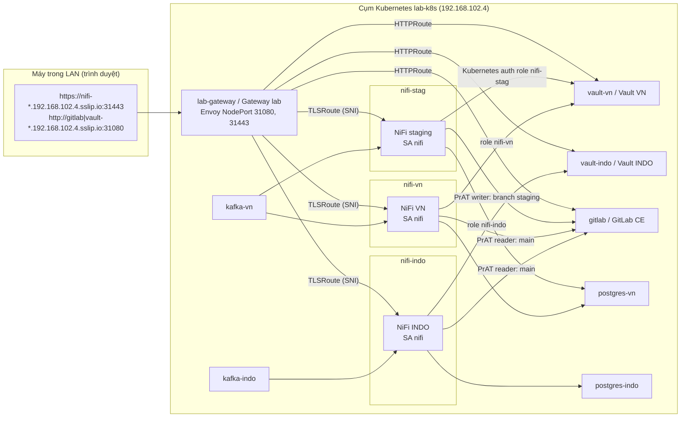
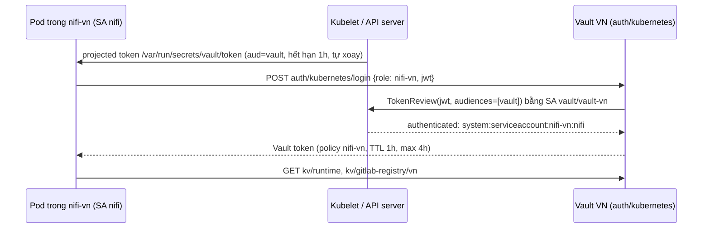

# Triển khai lab trên Kubernetes

Tài liệu này mô tả bản triển khai **Kubernetes** của lab NiFi multi-market (staging / VN / INDO). Mô hình flow, snapshot, review, rollout và rollback giữ nguyên như [GUIDE_VI.md](GUIDE_VI.md); phần khác là hạ tầng chạy trên cụm K8s, NiFi xác thực Vault bằng **ServiceAccount + role**, và NiFi kết nối GitLab bằng **Project Access Token**.

Nếu mới học NiFi, đọc [NIFI_CONCEPTS_VI.md](NIFI_CONCEPTS_VI.md) trước. Kết quả kiểm thử thực tế nằm ở [VALIDATION_K8S.md](VALIDATION_K8S.md).

## 0. Tóm tắt thay đổi so với bản Docker Compose

| Chủ đề | Docker Compose (cũ) | Kubernetes (bản này) |
|---|---|---|
| Đóng gói | `compose.yaml`, host network, cổng riêng trên host | Kustomize trong `k8s/`, `kubectl apply -k k8s` |
| Cô lập | 10 container chung một host network | **Mỗi service một namespace** (11 namespace kể cả Gateway) |
| Kết nối nội bộ | `192.168.102.4:<port>` | DNS Service: `kafka.kafka-vn.svc.cluster.local:9092`, ... |
| Truy cập LAN | Cổng host 18443/28443/38443, 18080, 18200/28200 | Gateway API (Envoy) NodePort **31443** (NiFi, TLS passthrough) và **31080** (GitLab, Vault) theo hostname |
| NiFi → Vault | Token tĩnh `nifi-vn-lab-token` / `nifi-indo-lab-token` | **ServiceAccount `nifi` của từng namespace + Vault Kubernetes auth role** `nifi-stag` / `nifi-vn` / `nifi-indo`; token SA projected, audience `vault`, TTL ngắn |
| NiFi → GitLab | Personal Access Token của user `nifi-writer` / `nifi-reader` | **Project Access Token** `nifi-staging-writer` (Developer, `api`), `nifi-vn-reader`, `nifi-indo-reader` (Reporter, `read_api`), lưu trong Vault |
| Đưa cấu hình vào NiFi | Script `sync-params.py` chạy trên host bằng token | Job trong namespace NiFi (`vault-param-sync`, `gitlab-registry-sync`) chạy bằng ServiceAccount |
| Secret hạ tầng | `.env` + biến môi trường container | `.env` → Kubernetes Secret do `deploy.sh` tạo, không commit; Vault keys trong `.private/k8s/` |
| Dữ liệu | Docker named volumes | PVC (`local-path`) theo `volumeClaimTemplates` |

Không thay đổi: NiFi 2.6.0 single-node, Kafka 3.9.1 KRaft single-broker, PostgreSQL 16.9, Vault 1.19.5 KV v1, GitLab CE 18.2.1; context `shared-runtime` 8 parameter; snapshot `flows/shared/kafka-to-postgres.json`; staging ghi branch `staging`, thị trường đọc `main`.

> Lab vẫn dùng HTTP cho GitLab/Vault, Kafka PLAINTEXT và certificate NiFi tự ký. Chỉ dùng trong mạng LAN tin cậy.

## 1. Kiến trúc



### 1.1 Namespace và endpoint nội bộ

| Service | Namespace | Workload | Endpoint trong cụm | PVC |
|---|---|---|---|---|
| Gateway (Envoy) | `lab-gateway` | Gateway `lab` (pod Envoy do Envoy Gateway tạo trong `envoy-gateway-system`) | — | — |
| GitLab CE | `gitlab` | StatefulSet `gitlab` | `http://gitlab.gitlab.svc.cluster.local/` | config 1Gi, data 20Gi |
| Vault VN | `vault-vn` | StatefulSet `vault` | `http://vault.vault-vn.svc.cluster.local:8200` | 1Gi |
| Vault INDO | `vault-indo` | StatefulSet `vault` | `http://vault.vault-indo.svc.cluster.local:8200` | 1Gi |
| Kafka VN | `kafka-vn` | StatefulSet `kafka` | `kafka.kafka-vn.svc.cluster.local:9092` | 5Gi |
| Kafka INDO | `kafka-indo` | StatefulSet `kafka` | `kafka.kafka-indo.svc.cluster.local:9092` | 5Gi |
| PostgreSQL VN | `postgres-vn` | StatefulSet `postgres` | `postgres.postgres-vn.svc.cluster.local:5432` | 5Gi |
| PostgreSQL INDO | `postgres-indo` | StatefulSet `postgres` | `postgres.postgres-indo.svc.cluster.local:5432` | 5Gi |
| NiFi staging | `nifi-stag` | StatefulSet `nifi` | `https://nifi.nifi-stag.svc.cluster.local:8443` | 10Gi (conf, state, repositories qua subPath) |
| NiFi VN | `nifi-vn` | StatefulSet `nifi` | `https://nifi.nifi-vn.svc.cluster.local:8443` | 10Gi |
| NiFi INDO | `nifi-indo` | StatefulSet `nifi` | `https://nifi.nifi-indo.svc.cluster.local:8443` | 10Gi |

Mọi object của lab có nhãn `app.kubernetes.io/part-of=nifi-market-lab`, ví dụ:

```bash
kubectl get pods -A -l app.kubernetes.io/part-of=nifi-market-lab
```

### 1.2 Tài nguyên

| Workload | Request CPU / RAM | Limit RAM | Ghi chú |
|---|---|---|---|
| GitLab | 500m / 2.5Gi | 5Gi | Omnibus, Puma single mode, Sidekiq 5 |
| NiFi × 3 | 250m / 1Gi mỗi instance | 2Gi | Heap 256m–1g như profile `compose.lab.yaml` |
| Kafka × 2 | 100m / 640Mi | 1Gi | Heap 384m |
| PostgreSQL × 2 | 50m / 128Mi | 512Mi | |
| Vault × 2 | 50m / 64Mi | 256Mi | |
| Envoy | 50m / 128Mi | 512Mi | |

Tổng request khoảng 1.7 CPU / 7.3 GiB. Máy lab 8 vCPU / 21 GiB đang chạy cả Doris, ArgoCD, MinIO...; khi triển khai đã **dừng hai container Docker `doris-fe`, `doris-be`** (không thuộc lab) để GitLab khởi động an toàn. Bật lại khi cần: `docker start doris-fe doris-be` (theo dõi `free -h`).

Không dùng GitLab Helm chart cloud-native vì cần nhiều thành phần và RAM hơn đáng kể; Omnibus trong một StatefulSet vẫn có đủ tính năng lab cần (API, MR, protected branch, Project Access Token).

## 2. Truy cập giao diện từ LAN

| Tab | URL | Đăng nhập |
|---|---|---|
| NiFi staging | <https://nifi-stag.192.168.102.4.sslip.io:31443/nifi/> | `admin` / `NIFI_PASSWORD` trong `.env` |
| NiFi VN | <https://nifi-vn.192.168.102.4.sslip.io:31443/nifi/> | như trên |
| NiFi INDO | <https://nifi-indo.192.168.102.4.sslip.io:31443/nifi/> | như trên |
| GitLab | <http://gitlab.192.168.102.4.sslip.io:31080/users/sign_in> | `root` / `GITLAB_PASSWORD` |
| Vault VN | <http://vault-vn.192.168.102.4.sslip.io:31080/ui/> | Method **Token**, root token trong `.private/k8s/vault-vn-init.json` |
| Vault INDO | <http://vault-indo.192.168.102.4.sslip.io:31080/ui/> | root token trong `.private/k8s/vault-indo-init.json` |

| Dịch vụ không phải web (tùy chọn, NodePort) | Địa chỉ LAN |
|---|---|
| GitLab SSH | `ssh://git@gitlab.192.168.102.4.sslip.io:31022/data360/flows-nifi.git` |
| Kafka VN / INDO (listener EXTERNAL) | `192.168.102.4:31092` / `192.168.102.4:32092` |
| PostgreSQL VN / INDO | `192.168.102.4:31432` / `192.168.102.4:32432`, database `market`, user `admin` |

Cách hoạt động:

- Không có LoadBalancer trên cụm bare-metal này, nên Envoy được publish bằng **NodePort**. Gateway `lab-gateway/lab` có hai listener: `http` (cổng 80 → NodePort 31080) và `nifi-tls` (cổng 443 → NodePort 31443, `tls.mode: Passthrough`).
- NiFi giữ HTTPS của chính nó: Envoy chỉ đọc SNI để chọn `TLSRoute` của namespace NiFi tương ứng, không giải mã. Certificate tự ký của mỗi NiFi có SAN gồm hostname trình duyệt, `localhost`, IP LAN và DNS Service nội bộ (`nifi.nifi-vn.svc.cluster.local`, ...), vì Jetty kiểm tra SNI.
- Ba NiFi vẫn dùng **ba hostname riêng** để cookie đăng nhập không ghi đè nhau (cùng lý do như mục 0.3 của GUIDE_VI).
- Gateway chỉ nhận route từ namespace có nhãn `nifi-market-lab/gateway-access=true` (`gitlab`, `vault-*`, `nifi-*`). Kafka/PostgreSQL không có route web.
- `ClientTrafficPolicy lab-keep-encoded-paths` giữ nguyên `%2F` trong URL. Mặc định Envoy Gateway redirect `%2F` thành `/`, làm hỏng API/UI GitLab (`/api/v4/projects/data360%2Fflows-nifi`, đường dẫn file).

Nếu mạng chặn DNS sslip.io, thêm vào file hosts của máy mở trình duyệt:

```text
192.168.102.4 nifi-stag.192.168.102.4.sslip.io nifi-vn.192.168.102.4.sslip.io nifi-indo.192.168.102.4.sslip.io gitlab.192.168.102.4.sslip.io vault-vn.192.168.102.4.sslip.io vault-indo.192.168.102.4.sslip.io
```

Mở NiFi bằng IP (`https://192.168.102.4:31443`) sẽ không vào được: không có SNI hostname để Gateway chọn route.

## 3. Cấu trúc thư mục `k8s/`

```text
k8s/
├── kustomization.yaml          # gom toàn bộ lab
├── namespaces/                 # 11 namespace + nhãn gateway-access
├── gateway/                    # EnvoyProxy (NodePort 31080/31443), Gateway lab, ClientTrafficPolicy
├── kafka/{base,vn,indo}/       # StatefulSet KRaft, Service, Job tạo topic
├── postgres/{base,vn,indo}/    # StatefulSet, init.sql (ConfigMap), NodePort
├── vault/{base,vn,indo}/       # StatefulSet, vault.hcl, SA + ClusterRoleBinding TokenReview, HTTPRoute
├── gitlab/                     # StatefulSet Omnibus, Service, SSH NodePort, HTTPRoute
├── nifi/
│   ├── base/                   # StatefulSet, SA nifi, Service, TLSRoute, 2 CronJob sync, nifi_k8s_sync.py
│   └── {stag,vn,indo}/         # hostname, SAN, Vault role/path, branch Registry Client
├── scripts/                    # deploy, vault-init, gitlab-bootstrap, nifi-sync, produce/query, check
└── tests/e2e_lab.py            # kiểm thử end-to-end qua API
```

Base giữ cấu hình chung; overlay chỉ khác namespace và các giá trị môi trường (ConfigMap sinh bởi `configMapGenerator`, có hash nên đổi giá trị sẽ rolling restart đúng workload).

## 4. Triển khai từ đầu

Thực hiện trên máy lab (`ssh ducph7@192.168.102.4`), thư mục `~/github/nifi-multi-market-lab`, branch `k8s-deployment`.

### 4.1 Điều kiện

| Yêu cầu | Trên máy lab hiện tại |
|---|---|
| Kubernetes, `kubectl` có quyền cluster-admin | kubeadm v1.37.1, 1 node `lab-k8s` |
| StorageClass mặc định | `local-path` (rancher local-path-provisioner) |
| Gateway API + controller | Envoy Gateway v1.9.3, GatewayClass `eg-lab` |
| Registry image cho NiFi custom | Registry trong cụm, NodePort `31102` (`localhost:31102`) |
| Docker để build image NiFi | Docker Engine có sẵn |
| NodePort trống | 31080, 31443, 31022, 31092, 32092, 31432, 32432 |

Nếu dùng cụm khác: đổi `gatewayClassName` trong `k8s/gateway/gateway.yaml`, image NiFi trong `k8s/nifi/base/kustomization.yaml` và `NIFI_K8S_IMAGE`, và IP `192.168.102.4` (tìm bằng `grep -rn 192.168.102.4 k8s/`).

### 4.2 Lấy code và `.env`

```bash
cd ~/github/nifi-multi-market-lab
git fetch origin
git switch k8s-deployment
test -f .env || cp .env.example .env   # giữ .env cũ nếu đã có
```

`deploy.sh` dùng các khóa `HOST_IP`, `NIFI_PASSWORD` (≥ 12 ký tự), `DB_PASSWORD`, `GITLAB_PASSWORD`, tùy chọn `NIFI_SENSITIVE_PROPS_KEY`. Bản K8s không dùng các token Vault cố định.

### 4.3 Deploy hạ tầng

```bash
bash k8s/scripts/deploy.sh
```

Script thực hiện theo thứ tự:

1. Build image `localhost:31102/nifi-market-lab/nifi:2.6.0-lab1` từ `nifi/Dockerfile` (NiFi 2.6.0 + PostgreSQL JDBC driver + script certificate SAN) và push vào registry trong cụm.
2. Nạp sẵn image Kafka/PostgreSQL/Vault/GitLab từ Docker vào containerd nếu có (tránh tải lại; bỏ bằng `PRELOAD_FROM_DOCKER=0`).
3. Tạo namespace, rồi tạo Secret từ `.env`: `nifi-admin` (3 namespace NiFi), `postgres-auth` (2 namespace PostgreSQL), `gitlab-root`.
4. `kubectl apply -k k8s` và chờ từng StatefulSet, Job tạo topic.

Lần đầu GitLab cần 5–15 phút. Theo dõi:

```bash
kubectl get pods -A -l app.kubernetes.io/part-of=nifi-market-lab
kubectl -n gitlab logs -f gitlab-0 | grep -iE 'error|reconfigured'
kubectl -n lab-gateway get gateway lab        # PROGRAMMED=True
```

### 4.4 Khởi tạo Vault và Kubernetes auth

```bash
python3 k8s/scripts/vault-init.py
```

Kết quả mong đợi (rút gọn):

```text
vn: initialized; keys saved to .private/k8s/vault-vn-init.json
vn: seeded kv/runtime / kv/staging / kv/preview
vn: enabled auth/kubernetes
vn: role nifi-stag -> ServiceAccount nifi-stag/nifi, policy nifi-stag: read kv/staging, kv/gitlab-registry/staging
vn: role nifi-vn -> ServiceAccount nifi-vn/nifi, policy nifi-vn: read kv/runtime, kv/preview, kv/gitlab-registry/vn
indo: role nifi-indo -> ServiceAccount nifi-indo/nifi, policy nifi-indo: read kv/runtime, kv/gitlab-registry/indo
```

Script idempotent: không khởi tạo lại Vault đã có dữ liệu, không ghi đè secret đã có. Unseal key và root token chỉ nằm trên máy lab (`.private/k8s/`, quyền 0600), không nằm trong cụm. Sau mỗi lần pod Vault restart, chạy `python3 k8s/scripts/vault-init.py --unseal-only` (mục 9.1).

### 4.5 GitLab project và Project Access Token

```bash
python3 k8s/scripts/gitlab-bootstrap.py
```

Script chạy `gitlab-rails runner` trong pod `gitlab-0` (không cần PAT quản trị) để tạo idempotent: group `data360` (Private), project `flows-nifi` có README, default branch `main`, `flows/shared/.keep`, branch `staging`, protect `main` (merge: Maintainers, push: No one, không force push), merge method **Merge commit**, squash **Do not allow**, không xóa source branch. Sau đó tạo ba Project Access Token và ghi vào Vault (mục 6). Chạy lại sẽ giữ token còn hiệu lực.

### 4.6 Đưa parameter và Registry Client vào NiFi

```bash
bash k8s/scripts/nifi-sync.sh params all     # Vault -> Parameter Context shared-runtime
bash k8s/scripts/nifi-sync.sh registry all   # PrAT trong Vault -> Registry Client
```

Mỗi lệnh tạo một Job từ CronJob template trong namespace NiFi, Job đăng nhập Vault bằng ServiceAccount `nifi` của namespace đó. Log mẫu:

```text
== nifi-vn: job/vault-param-sync-20261111150418
Vault login OK: role=nifi-vn sa=nifi-vn/nifi policies=default,nifi-vn ttl=3600s
Read kv/runtime: topic=trips group=nifi-vn schema=market bootstrap=kafka.kafka-vn.svc.cluster.local:9092
Created shared-runtime: c9a2ed6a-01a1-1000-0eeb-78e2b099c7a5
== nifi-vn: job/gitlab-registry-sync-20261111154429
Read kv/gitlab-registry/vn: token name=nifi-vn-reader type=project_access_token role=Reporter scopes=read_api expires=2027-05-10
Created Registry Client gitlab-main: c9c7b41e-01a1-1000-1148-f7f6e9b6fbf9
Registry Client gitlab-main OK: branch=main branches=['main', 'staging'] buckets=['shared']
```

### 4.7 Kiểm tra sẵn sàng

```bash
python3 k8s/scripts/check-k8s.py
```

57 kiểm tra (chỉ đọc): pod Ready/không OOM, Gateway Programmed, topic 3 partition, bảng PostgreSQL, Vault unsealed, đăng nhập Vault đúng/sai ServiceAccount, 8 parameter của mỗi NiFi khớp Vault, Registry Client đọc được branch/bucket, GitLab readiness/SSH, ba PrAT active với đúng scope. Dòng cuối phải là `All checks passed`.

## 5. NiFi → Vault bằng ServiceAccount và role

### 5.1 Cơ chế



- Pod NiFi và Job sync dùng ServiceAccount `nifi`, **không mount token Kubernetes API mặc định** (`automountServiceAccountToken: false`); thay vào đó mount token projected có `audience: vault`. Token này không dùng được để gọi Kubernetes API.
- Vault dùng token của chính pod Vault (ServiceAccount `vault`, ClusterRoleBinding `system:auth-delegator`) để gọi TokenReview; không cấu hình `token_reviewer_jwt` tĩnh.
- Không còn token Vault cố định nào cho NiFi. Token Vault cấp sau login có TTL 1 giờ; Job thu hồi token (`revoke-self`) khi xong.

| Vault | Role | Bound ServiceAccount | Policy được đọc |
|---|---|---|---|
| VN | `nifi-stag` | `nifi-stag/nifi` | `kv/staging`, `kv/gitlab-registry/staging` |
| VN | `nifi-vn` | `nifi-vn/nifi` | `kv/runtime`, `kv/preview`, `kv/gitlab-registry/vn` |
| INDO | `nifi-indo` | `nifi-indo/nifi` | `kv/runtime`, `kv/gitlab-registry/indo` |

Mọi policy có `list` trên `kv/` (chỉ tên secret, cần cho Parameter Provider). So với token cũ (`kv/*` read), staging không còn đọc được `kv/runtime` của VN và ngược lại.

### 5.2 Xem cấu hình trên Vault UI

1. Mở Vault VN, **Method = Token**, dán root token từ `.private/k8s/vault-vn-init.json` (`python3 -c 'import json;print(json.load(open(".private/k8s/vault-vn-init.json"))["root_token"])'`).
2. **Access → Authentication Methods**: có `kubernetes/`. Mở → tab **Roles**: `nifi-stag`, `nifi-vn`. Mở role để xem Bound service account names/namespaces, Audience `vault`, Token policies.
3. **Policies → ACL Policies**: `nifi-stag`, `nifi-vn` (nội dung như bảng trên).
4. **Secrets → kv/**: `runtime`, `staging`, `preview`, `gitlab-registry/`.
5. Vault INDO tương tự với role `nifi-indo`.

### 5.3 Đồng bộ Vault → `shared-runtime` (cách chính)

Giữ thiết kế của bài chính: `shared-runtime` là context local, không gắn Parameter Provider, để snapshot di chuyển được giữa môi trường.

| NiFi | Lệnh | Vault / secret |
|---|---|---|
| staging | `bash k8s/scripts/nifi-sync.sh params stag` | Vault VN `kv/staging` |
| VN | `bash k8s/scripts/nifi-sync.sh params vn` | Vault VN `kv/runtime` |
| INDO | `bash k8s/scripts/nifi-sync.sh params indo` | Vault INDO `kv/runtime` |

Tương đương thủ công: `kubectl -n nifi-vn create job --from=cronjob/vault-param-sync sync-$(date +%s)` rồi `kubectl -n nifi-vn logs job/sync-...`.

Giá trị sau khi seed:

| Parameter | Staging | VN | INDO |
|---|---|---|---|
| `kafka.bootstrap` | `kafka.kafka-vn.svc.cluster.local:9092` | như staging | `kafka.kafka-indo.svc.cluster.local:9092` |
| `kafka.topic` | `trips-staging` | `trips` | `trips` |
| `kafka.group` | `nifi-staging` | `nifi-vn` | `nifi-indo` |
| `db.url` | `jdbc:postgresql://postgres.postgres-vn.svc.cluster.local:5432/market` | như staging | `jdbc:postgresql://postgres.postgres-indo.svc.cluster.local:5432/market` |
| `db.username` / `db.password` | `admin` / `DB_PASSWORD` (Sensitive) | như staging | như staging |
| `db.schema` | `staging` | `market` | `market` |
| `db.table` | `trip_events` | `trip_events` | `trip_events` |

Sửa giá trị: sửa secret trên Vault UI (**Edit secret** → **Save**) rồi chạy lại lệnh sync của đúng instance. NiFi tự dừng/khởi động lại component tham chiếu parameter đổi; vẫn nên stop ConsumeKafka và drain queue trước như GUIDE_VI mục 5.3. Job từ chối áp dụng nếu secret không đúng 8 key string hoặc nếu context đang do Parameter Provider quản lý.

### 5.4 NiFi tự đọc Vault: Parameter Provider với `KUBERNETES` (thay mục 13 GUIDE_VI)

Bài mở rộng trên **NiFi VN**, dùng secret `kv/preview` và context riêng `vault-preview` (không bind vào PG đang xử lý dữ liệu). Không có bước nhập token: NiFi dùng token ServiceAccount của chính pod.

1. NiFi VN → menu ba gạch → **Controller Settings → Management Controller Services** → **+**.
2. Lọc `StandardHashiCorpVaultClientService` (2.6.0) → **Add** → **Edit**; Settings → Name = `VaultK8sClient`.
3. Tab **Properties**:

| Property | Value |
|---|---|
| Configuration Strategy | `Direct Properties` |
| Vault URI | `http://vault.vault-vn.svc.cluster.local:8200` |
| Vault Authentication | `KUBERNETES` |

4. Bấm **+** thêm hai dynamic property (Sensitive = No):

| Property Name | Value |
|---|---|
| `vault.kubernetes.role` | `nifi-vn` |
| `vault.kubernetes.service-account-token-file` | `/var/run/secrets/vault/token` |

   `vault.kubernetes.kubernetes-path` mặc định `kubernetes`, không cần nhập.
5. **Apply** → **Enable** → Close; trạng thái phải **Enabled**.
6. Tab **Parameter Providers** → **+** → `HashiCorpVaultParameterProvider` → Name `VaultK8sProvider`; Properties: HashiCorp Vault Client Service = `VaultK8sClient`, Key/Value Path = `kv`, Key/Value Version = **KV_1**, Secret Name Pattern = `^preview$` → **Apply**.
7. **Fetch Parameters** → chọn group `preview` → **Create Parameter Context** tên `vault-preview` → chỉ `db.password` Sensitive → **Apply** → Close.
8. **Parameter Contexts → vault-preview**: 8 parameter, `kafka.group=nifi-vn-preview`.

Thử phân quyền (tùy chọn): Disable `VaultK8sClient`, đổi `vault.kubernetes.role` thành `nifi-stag`, Enable rồi Fetch lại → Vault phải từ chối vì ServiceAccount `nifi-vn/nifi` không thuộc role đó (trường hợp này đã được `check-k8s.py` kiểm chứng ở mức Vault API). Đặt lại `nifi-vn` sau khi thử.

### 5.5 Kiểm thử phủ định

`check-k8s.py` dùng `kubectl create token` để chứng minh các trường hợp sau **bị từ chối**: SA `nifi-indo/nifi` dùng role `nifi-vn`; SA `nifi-vn/nifi` dùng role `nifi-stag`; SA `nifi-vn/default` dùng role `nifi-vn`; token thiếu audience `vault`; Vault INDO không có role cho NiFi VN; role `nifi-stag` đọc `kv/runtime`, role `nifi-vn` đọc `kv/staging`.

Tự thử một lần:

```bash
JWT=$(kubectl -n nifi-indo create token nifi --audience vault --duration 10m)
curl -s -X POST http://vault-vn.192.168.102.4.sslip.io:31080/v1/auth/kubernetes/login \
  -d "{\"role\":\"nifi-vn\",\"jwt\":\"$JWT\"}"
# {"errors":["namespace not authorized"]}
```

## 6. NiFi → GitLab bằng Project Access Token

### 6.1 Token và phân quyền

| PrAT | Role trong project | Scope | Hết hạn | Lưu ở | NiFi dùng |
|---|---|---|---|---|---|
| `nifi-staging-writer` | Developer | `api` | 180 ngày | Vault VN `kv/gitlab-registry/staging` | staging, Registry Client `gitlab-staging`, branch `staging` |
| `nifi-vn-reader` | Reporter | `read_api` | 180 ngày | Vault VN `kv/gitlab-registry/vn` | VN, `gitlab-main`, branch `main` |
| `nifi-indo-reader` | Reporter | `read_api` | 180 ngày | Vault INDO `kv/gitlab-registry/indo` | INDO, `gitlab-main`, branch `main` |

- Mỗi PrAT gắn với một **bot user** riêng của project (`project_<id>_bot_<hash>`), chỉ là member của `data360/flows-nifi`; thu hồi token không ảnh hưởng tài khoản người nào. Không còn user `nifi-writer` / `nifi-reader` và không còn PAT.
- Commit do NiFi staging tạo có author là `nifi-staging-writer`.
- Developer không merge được vào `main` (protected, chỉ Maintainer merge, không ai push trực tiếp); Reporter + `read_api` không ghi được repo. `e2e_lab.py` kiểm tra cả hai.
- Mỗi Vault secret chứa `access_token` và metadata (`token_name`, `token_type=project_access_token`, `access_level`, `scopes`, `expires_at`, `bot_user`, `project`).

### 6.2 Tạo PrAT trên GitLab UI (thay cho bootstrap tự động)

1. Đăng nhập root → project `data360/flows-nifi` → **Settings → Access tokens** → **Add new token**.
2. Token name `nifi-staging-writer`; Expiration date sau ngày kết thúc lab; **Select a role = Developer**; scope **api** → **Create project access token**; copy giá trị ngay (chỉ hiện một lần).
3. Lặp lại: `nifi-vn-reader` và `nifi-indo-reader`, role **Reporter**, scope **read_api**.
4. Ghi token vào Vault bằng UI: Vault VN → **Secrets → kv/ → Create secret**, path `gitlab-registry/staging`, key `access_token` = token writer (thêm `token_name` nếu muốn); tương tự `gitlab-registry/vn`; Vault INDO path `gitlab-registry/indo`.
5. Chạy `bash k8s/scripts/nifi-sync.sh registry all`.

### 6.3 Registry Client do Job cấu hình

Job `gitlab-registry-sync` (SA `nifi` → Vault → PrAT) tạo hoặc cập nhật Registry Client với:

| Property | Staging | VN / INDO |
|---|---|---|
| Name | `gitlab-staging` | `gitlab-main` |
| GitLab API URL | `http://gitlab.gitlab.svc.cluster.local/` | như staging |
| GitLab API Version | `V4` | `V4` |
| Repository Namespace / Name / Path | `data360` / `flows-nifi` / `flows` | như staging |
| Default Branch | `staging` | `main` |
| Authentication Type / Access Token | Access Token / PrAT `nifi-staging-writer` | Access Token / PrAT reader của instance |
| Parameter Context Values | **Remove** | **Remove** |

Rồi kiểm tra client đọc được branch và bucket `shared`. NiFi 2.6 Registry Client không nhận Parameter Context, nên token phải được nhập vào chính client; Job làm việc đó thay người vận hành (cách 2 trong [OPS_HANDOVER_VI.md](OPS_HANDOVER_VI.md) mục 3.4). Muốn làm tay theo GUIDE_VI mục 6: lấy token bằng `bash k8s/scripts/gitlab-token.sh stag|vn|indo` rồi dán vào Access Token.

### 6.4 Xoay vòng token

```bash
python3 k8s/scripts/gitlab-bootstrap.py --rotate     # thu hồi + tạo lại 3 PrAT, ghi Vault
bash k8s/scripts/nifi-sync.sh registry all           # cập nhật Registry Client
```

Token cũ bị revoke ngay, nên chạy hai lệnh liền nhau ngoài giờ publish/import.

## 7. Thực hành GUIDE_VI trên Kubernetes

Làm theo [GUIDE_VI.md](GUIDE_VI.md) từ mục 5 trở đi với các thay thế sau.

| Mục GUIDE_VI | Trên K8s |
|---|---|
| 0.2 URL | Dùng bảng mục 2 tài liệu này (cổng 31443/31080) |
| 2–3 Chuẩn bị, khởi động | Mục 4 tài liệu này |
| 4 GitLab project, user, PAT | Đã làm bởi `gitlab-bootstrap.py`; không tạo user `nifi-writer`/`nifi-reader`, không tạo PAT. Review/merge MR bằng `root` |
| 5.1 Xem secret | Vault UI mục 2; giá trị theo bảng 5.3 tài liệu này |
| 5.3 Apply Vault → NiFi | `bash k8s/scripts/nifi-sync.sh params stag|vn|indo` |
| 5.4–5.5 | Giữ nguyên trên UI NiFi |
| 6 Registry Client | `bash k8s/scripts/nifi-sync.sh registry all` (đã chạy ở mục 4.6), hoặc tạo tay với bảng 6.3 |
| 7.2 Service PostgresPool | Driver vẫn tại `/opt/nifi/drivers/postgresql.jar` (đã có trong image) |
| 7.9 / 9.3 / 9.4 produce, query | `bash k8s/scripts/produce.sh stag|vn|indo <event_id>`, `bash k8s/scripts/query.sh stag|vn|indo` |
| 7.9 log | `kubectl -n nifi-stag logs nifi-0 -c nifi --since=5m \| grep -A1 -E "Key: '(flow.release\|local.market)'"` (LogAttribute in `Key:` rồi `Value:` ở dòng sau) |
| 8.2 Clone repo | `git clone http://gitlab.192.168.102.4.sslip.io:31080/data360/flows-nifi.git`; username bất kỳ (ví dụ `nifi-staging-writer`), password = `$(bash k8s/scripts/gitlab-token.sh stag)` |
| 8.4 SHA trên main | `GITLAB_URL=http://gitlab.192.168.102.4.sslip.io:31080 GITLAB_TOKEN=$(bash k8s/scripts/gitlab-token.sh vn 2>/dev/null) python3 scripts/release-sha.py`. Danh sách có cả commit `Registering Flow [kafka-to-postgres]` do NiFi tạo khi đăng ký flow; chọn đúng SHA có comment `v1: ...` |
| 12 Backup | Mục 9.4 tài liệu này |
| 13 Parameter Provider | Mục 5.4 tài liệu này (KUBERNETES thay cho TOKEN) |
| 14 Troubleshooting | Thêm mục 10 tài liệu này |
| Case 15 (DB outage) | `kubectl -n postgres-vn scale statefulset postgres --replicas=0`, sau đó `--replicas=1` |
| Case 16 (Vault restart) | `kubectl -n vault-vn delete pod vault-0`, rồi `python3 k8s/scripts/vault-init.py --unseal-only` |
| Case 17 (NiFi restart) | `kubectl -n nifi-vn delete pod nifi-0` |

## 8. Kiểm thử end-to-end tự động

`k8s/tests/e2e_lab.py` chạy toàn bộ bài thực hành qua REST API của NiFi/GitLab (không thao tác UI), từ máy lab:

```bash
python3 k8s/scripts/gitlab-bootstrap.py --release-token   # PrAT Maintainer 1 ngày, chỉ để merge MR tự động
python3 k8s/tests/e2e_lab.py
python3 k8s/scripts/gitlab-bootstrap.py --revoke-release-token
```

Các bước kiểm tra:

1. Staging: dựng `MARKET_RUNTIME/{kafka-to-postgres, LOCAL_AUDIT}` đúng mục 7 GUIDE_VI; event `stag-k8s-v1-*` vào đúng `postgres-vn/staging`, không lọt sang schema khác; provenance của AuditSuccess có `flow.release=v1`, `local.market=STAG`.
2. Save Version v1 qua `gitlab-staging` → branch `staging` (author `nifi-staging-writer`); `check_snapshot.py` PASS, snapshot không chứa LOCAL_AUDIT, DNS service hay password.
3. Reader PrAT ghi repo → bị từ chối; writer PrAT merge `main` → bị từ chối; MR staging → main merge bằng Maintainer.
4. VN rồi INDO import đúng SHA M1 từ `main`, giữ `shared-runtime` local, thêm LOCAL_AUDIT; event của mỗi thị trường chỉ vào DB của nó; audit `v1/VN`, `v1/INDO`.
5. v2 trên staging → M2; VN Change Version sang M2 (audit `v2/VN`), INDO vẫn M1 (audit `v1/INDO`); VN rollback về M1 (audit `v1/VN`).
6. Job `vault-param-sync` cập nhật `shared-runtime` của VN khi flow đang chạy; NiFi tự dừng/khởi động lại component bị ảnh hưởng, event tiếp theo vẫn vào DB.
7. NiFi VN: Parameter Provider native với `KUBERNETES` auth fetch `kv/preview` → `vault-preview`.

Bằng chứng (SHA, event ID, provenance event) ghi vào `.private/k8s/e2e-evidence-<run>.json`. Kết quả lần chạy ghi trong [VALIDATION_K8S.md](VALIDATION_K8S.md).

Chạy lại từ đầu, hoặc trả lab về trạng thái sạch để tự thực hành trên UI:

```bash
python3 k8s/tests/e2e_lab.py --reset-only                     # xóa MARKET_RUNTIME ở 3 NiFi + bài provider
python3 k8s/scripts/gitlab-bootstrap.py --recreate-project    # project mới: không snapshot, không MR, PrAT mới
bash k8s/scripts/nifi-sync.sh registry all
```

Dữ liệu cũ trong bảng `trip_events` và offset Kafka không bị xóa; event ID của e2e có hậu tố thời gian nên không trùng.

## 9. Vận hành

### 9.1 Restart và reboot host

- Pod tự khởi động lại (StatefulSet). PVC giữ dữ liệu NiFi (flow, context, Registry Client, queue), Kafka, PostgreSQL, Vault, GitLab.
- Vault luôn **sealed** sau khi pod khởi động lại → `python3 k8s/scripts/vault-init.py --unseal-only`. Trong lúc sealed, Job sync và Parameter Provider trả lỗi 503; flow đang chạy không bị ảnh hưởng vì giá trị đã nằm trong NiFi.
- Kiểm tra lại: `python3 k8s/scripts/check-k8s.py`.

### 9.2 Cập nhật cấu hình hoặc image

- Sửa manifest rồi `kubectl apply -k k8s` (hoặc `SKIP_BUILD=1 bash k8s/scripts/deploy.sh`).
- Đổi script NiFi (`nifi/`): tăng tag (`2.6.0-lab2`) ở `k8s/nifi/base/kustomization.yaml` và `NIFI_K8S_IMAGE` trong `k8s/scripts/common.sh`, rồi `bash k8s/scripts/deploy.sh`.
- `conf/` của NiFi nằm trên PVC và chỉ được seed từ image ở lần đầu (init container). Đổi image không ghi đè `nifi.properties` đã có.
- Hostname/SAN NiFi lấy từ ConfigMap `nifi-env`; đổi xong pod restart và script tạo lại certificate (giữ store password và trust anchor khác).

### 9.3 Log và trạng thái

```bash
kubectl -n nifi-vn logs nifi-0 -c nifi --tail=100
kubectl -n nifi-vn get jobs                 # lịch sử sync (tự xóa sau 24h)
kubectl -n kafka-vn exec kafka-0 -- /opt/kafka/bin/kafka-consumer-groups.sh --bootstrap-server localhost:9092 --describe --group nifi-vn
kubectl top pods -A -l app.kubernetes.io/part-of=nifi-market-lab
```

### 9.4 Backup và phục hồi

PVC `local-path` nằm trên đĩa node tại `/opt/local-path-provisioner/<pv>_<namespace>_<pvc>`, ví dụ `pvc-44d5…_nifi-vn_data-nifi-0`. Backup offline đơn giản cho lab, từng workload:

```bash
kubectl get pvc -A | grep -E 'nifi|kafka|postgres|vault|gitlab'
# Dừng workload để dữ liệu nhất quán, ví dụ NiFi VN:
kubectl -n nifi-vn scale statefulset nifi --replicas=0
kubectl -n nifi-vn wait --for=delete pod/nifi-0 --timeout=120s
dir=$(sudo ls /opt/local-path-provisioner | grep '_nifi-vn_data-nifi-0$')
sudo tar czf ~/backup-nifi-vn-$(date +%Y%m%d).tgz -C /opt/local-path-provisioner "$dir"
kubectl -n nifi-vn scale statefulset nifi --replicas=1
```

Phục hồi: scale workload về 0, giải nén archive đè vào đúng thư mục PVC (cùng namespace/PVC), scale lại 1. Với Vault, sau khi khởi động lại phải unseal bằng key trong `.private/k8s/` tương ứng với dữ liệu đã backup.

Luôn backup kèm `.env` và `.private/k8s/` (unseal key/root token Vault). Backup chứa secret; không commit vào Git. Lưu ý StorageClass `local-path` có reclaim policy **Delete**: xóa PVC hoặc namespace là xóa dữ liệu.

### 9.5 Gỡ lab K8s

```bash
kubectl delete -k k8s        # xóa toàn bộ, kể cả namespace và PVC (mất dữ liệu)
```

Docker Compose cũ không bị ảnh hưởng: volume `nifi-market-lab_*` và `.private/vault-*-init.json` vẫn còn; hai bản dùng cổng khác nhau.

## 10. Troubleshooting

| Hiện tượng | Kiểm tra / xử lý |
|---|---|
| Trình duyệt không mở được NiFi qua IP | Bắt buộc dùng hostname `nifi-*.192.168.102.4.sslip.io:31443` (Gateway route theo SNI) |
| `Invalid SNI` hoặc HTTP 400 Host header | Hostname/port phải có trong `NIFI_WEB_PROXY_HOST` và SAN (`k8s/nifi/<env>/kustomization.yaml`); xem log `Configured lab TLS certificate` |
| GitLab API/UI trả 302 rồi 404 với đường dẫn có `%2F` | Thiếu `ClientTrafficPolicy lab-keep-encoded-paths` (`k8s/gateway/clienttrafficpolicy.yaml`); `kubectl -n lab-gateway get clienttrafficpolicy` phải Accepted |
| Gateway không PROGRAMMED | `kubectl -n lab-gateway describe gateway lab`; pod Envoy trong `envoy-gateway-system`; NodePort 31080/31443 chưa bị dùng |
| Job sync báo `permission denied` khi login Vault | Role/namespace sai, token thiếu audience `vault`, hoặc ClusterRoleBinding `vault-<market>-tokenreview` thiếu; `kubectl -n vault-vn logs vault-0` |
| Job sync báo HTTP 503 | Vault sealed → `vault-init.py --unseal-only` |
| Registry Client lỗi 401 | PrAT hết hạn/bị revoke → `gitlab-bootstrap.py --rotate` rồi `nifi-sync.sh registry all` |
| Save Version lỗi 403 | Staging phải dùng `gitlab-staging` (Developer, `api`) và branch `staging`; không merge/push trực tiếp `main` |
| Pod `CreateContainerConfigError` | Secret chưa có: chạy `deploy.sh` (tạo Secret từ `.env`) |
| GitLab pod chưa Ready lâu | Lần đầu 5–15 phút; `kubectl -n gitlab logs gitlab-0`; kiểm tra RAM `free -h` |
| `kubectl apply` báo Forbidden trên StatefulSet | `volumeClaimTemplates`, `serviceName`, `selector` bất biến; cần `kubectl delete sts <name> --cascade=orphan` rồi apply lại |
| Kafka client ngoài cụm không kết nối | Dùng listener EXTERNAL `192.168.102.4:31092/32092`; NiFi trong cụm dùng `kafka.<ns>.svc.cluster.local:9092` |
| Hết RAM / pod OOMKilled | `kubectl top pods -A`; tạm dừng workload không thuộc lab; giảm heap trong StatefulSet NiFi/Kafka |

## 11. Nguồn kỹ thuật

- Vault Kubernetes auth: https://developer.hashicorp.com/vault/docs/auth/kubernetes
- Kubernetes projected ServiceAccount token: https://kubernetes.io/docs/concepts/storage/projected-volumes/#serviceaccounttoken
- NiFi StandardHashiCorpVaultClientService (Vault Authentication, dynamic Spring Vault properties): https://nifi.apache.org/components/org.apache.nifi.vault.hashicorp.StandardHashiCorpVaultClientService/
- Spring Vault Kubernetes authentication (`vault.kubernetes.*`): https://docs.spring.io/spring-vault/reference/vault/authentication.html#vault.authentication.kubernetes
- GitLab Project Access Tokens: https://docs.gitlab.com/user/project/settings/project_access_tokens/
- Gateway API TLSRoute / TLS passthrough: https://gateway-api.sigs.k8s.io/guides/tls/
- Envoy Gateway EnvoyProxy (NodePort, patch Service): https://gateway.envoyproxy.io/docs/tasks/operations/customize-envoyproxy/
- Kustomize: https://kubectl.docs.kubernetes.io/references/kustomize/
