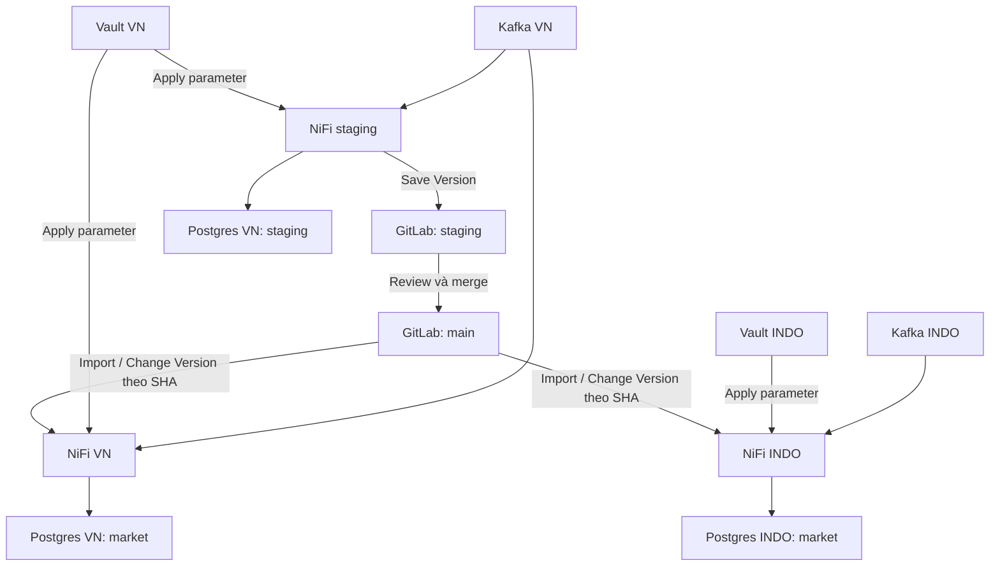
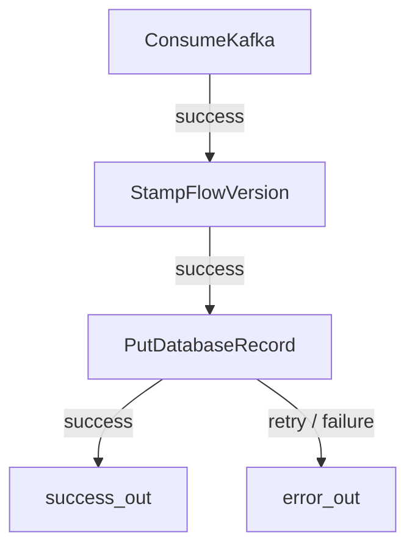

# Hướng dẫn lab từ đầu đến cuối

## 1. Hiểu đúng mô hình trước khi chạy



- Flow cấu trúc giống nhau, nguồn Kafka/đích DB khác nhau theo parameter.
- Registry client không phải deploy agent. Kiểm tra version mới chỉ báo trạng thái, không Change Version tự động.
- `Save Version` tạo commit. Chỉnh processor hoặc Apply property chỉ thay đổi runtime NiFi, chưa commit Git.
- SHA của version là commit trong lịch sử **đường dẫn snapshot** trên branch được chọn. Không dùng branch HEAD tùy tiện.
- Nhận định “mọi commit Git đều sinh version mới cho NiFi” quá rộng: sửa file khác không tạo version flow. Squash/rebase/revert làm thay đổi lịch sử snapshot có thể sinh SHA mới. Merge commit giữ nguyên snapshot chưa chắc xuất hiện thành version mới trong danh sách NiFi. Dùng API path-scoped và danh sách version NiFi để xác minh.

### Ranh giới snapshot

| Thành phần | Nơi lưu | Theo Change Version? |
|---|---|---|
| Processor, connection, port, Controller Service nằm trong shared PG | flows/shared/kafka-to-postgres.json | Có |
| Tên context, tên parameter, metadata như sensitivity/description | Snapshot | Có |
| Giá trị parameter | Vault và Parameter Context local | Không, khi client đặt Remove |
| Literal viết thẳng vào property | Snapshot | Có — nên phải thay bằng parameter nếu phụ thuộc môi trường |
| Client GitLab, token GitLab; Vault endpoint/token | NiFi cấu hình local / script local | Không đưa vào shared PG |
| PG LOCAL_*, connection nối các PG trên canvas cha | NiFi local | Không |
| Queue, Kafka offsets, dữ liệu DB, runtime state | Hệ lưu trữ tương ứng | Không phải flow version |

`Remove` không biến snapshot thành file “chỉ có tên”: snapshot vẫn chứa cấu trúc flow, properties chung và metadata. Nó loại **giá trị parameter**; không xóa credential vô tình hard-code ở chỗ khác.

## 2. Chuẩn bị máy RHEL 9

Khuyến nghị cho toàn bộ stack: 8 vCPU, 24–32 GB RAM, 100 GB SSD trống. Đây là dự trù lab, phụ thuộc lượng queue/log. Đăng nhập shell trên máy RHEL; giải nén bộ lab vào một thư mục riêng.

Nếu Docker Engine/Compose đã có thì bỏ qua bước cài. Nếu chưa có, theo hướng dẫn RHEL chính thức tại https://docs.docker.com/engine/install/rhel/; các lệnh cơ bản:

```bash
sudo dnf install -y dnf-plugins-core
sudo dnf config-manager --add-repo https://download.docker.com/linux/rhel/docker-ce.repo
sudo dnf install -y docker-ce docker-ce-cli containerd.io docker-buildx-plugin docker-compose-plugin
sudo systemctl enable --now docker
sudo usermod -aG docker "$USER"
```

Đăng xuất/đăng nhập lại để nhận group docker. Không xóa Podman/runc đang dùng trên host một cách máy móc nếu package conflict; xử lý theo tài liệu Docker trước.

```bash
sudo dnf install -y python3 git curl unzip
cd nifi-market-lab
cp .env.example .env
vi .env
# Đổi HOST_IP thành IP LAN thực của máy, ví dụ 10.9.193.206
bash scripts/preflight.sh
```

`.env` dùng cú pháp KEY=value đơn giản, không dấu nháy, không space quanh `=`. Các script Python đọc trực tiếp định dạng này. Không dùng IP public, 127.0.0.1 hay 0.0.0.0 làm HOST_IP.

Máy lab dùng chung với dịch vụ khác có thể bật profile giảm RAM bằng cách thêm
`COMPOSE_FILE=compose.yaml:compose.lab.yaml` vào `.env`. Profile đặt heap NiFi
256 MB–1 GB mỗi instance và GitLab Puma chạy một process. Đây là cấu hình cho
bài thực hành nhỏ; theo dõi `free -h` và `docker stats --no-stream` khi tăng tải.

### Cổng

| Dịch vụ | Endpoint trên host |
|---|---|
| GitLab web/API | http://HOST_IP:18080 |
| GitLab SSH | HOST_IP:18022 |
| NiFi staging | https://HOST_IP:18443/nifi |
| NiFi VN | https://HOST_IP:28443/nifi |
| NiFi INDO | https://HOST_IP:38443/nifi |
| Kafka VN broker / controller | HOST_IP:19092 / 19093 |
| Kafka INDO broker / controller | HOST_IP:29092 / 29093 |
| PostgreSQL VN / INDO | HOST_IP:15432 / 25432 |
| Vault VN / INDO UI/API | http://HOST_IP:18200/ui / http://HOST_IP:28200/ui |
| NiFi Site-to-Site reserved | 18000 / 28000 / 38000 |
| NiFi management nội bộ staging / VN / INDO | 127.0.0.1:52020 / 52021 / 52022 |

Compose dùng `network_mode: host`, vì vậy **không có `ports:`**: service bind trực tiếp lên host, không qua NAT/publish. Listener ứng dụng đặt 0.0.0.0; địa chỉ client và Kafka advertised listener phải là IP LAN. Host mode ở đây chỉ dành cho Linux, không dùng nguyên cấu hình cho Docker Desktop.

Mở firewall trong zone chứa NIC LAN (xem `firewall-cmd --get-active-zones`; thay public nếu zone khác):

```bash
sudo firewall-cmd --permanent --zone=public --add-port={18080,18022,18443,28443,38443,19092,19093,29092,29093,15432,25432,18200,28200,18000,28000,38000}/tcp
sudo firewall-cmd --reload
```

Nếu có Security Group/network ACL, mở các cổng cần truy cập từ subnet LAN tin cậy. Không cần tắt SELinux: bind mount có `:Z`, dữ liệu dùng named volumes. Local IPC trong một service, ví dụ GitLab bundled Redis/DB, vẫn là nội bộ; không expose các dependency đóng gói bên trong GitLab.

## 3. Khởi động và seed hạ tầng

```bash
docker compose pull kafka-vn kafka-indo postgres-vn postgres-indo vault-vn vault-indo gitlab
docker compose build nifi-stag
docker compose up -d
docker compose ps
docker compose logs --tail=80 nifi-stag gitlab kafka-vn
```

Lần đầu có thể mất 5–15 phút, nhất là GitLab. `running` chưa có nghĩa ứng dụng đã sẵn sàng. Kiểm tra đến khi các bước sau thành công:

```bash
set -a
source .env
set +a
curl -k "https://$HOST_IP:18443/nifi/"
curl "http://127.0.0.1:18080/-/readiness?all=1"
bash scripts/init-topics.sh
python3 scripts/init-vault.py
bash scripts/query.sh stag
bash scripts/query.sh vn
bash scripts/query.sh indo
```

- Nếu init-topics connection refused, chờ Kafka sẵn sàng rồi chạy lại; script tạo topic idempotent.
- SQL init chạy khi volume Postgres rỗng lần đầu. Kết quả query là bảng rỗng, không phải “relation does not exist”.
- GitLab giới hạn endpoint readiness ở loopback theo mặc định; chạy lệnh trên tại máy Docker host. Trang đăng nhập vẫn truy cập từ LAN qua `http://HOST_IP:18080/users/sign_in`.
- Vault chạy server persistent, không dev mode; secret không mất khi restart. Sau restart Vault bị sealed: chạy lại `init-vault.py` để unseal. Script không overwrite secret đã có.
- Root token/unseal key trong `.private/vault-*-init.json`; bảo quản cùng backup. Có thể lấy root token để đăng nhập UI bằng `python3 -c 'import json; print(json.load(open(".private/vault-vn-init.json"))["root_token"])'`. Không paste token này vào GitLab.

## 4. Tạo GitLab project và quyền

1. Mở http://HOST_IP:18080, đăng nhập `root / NifiLab_2026@Ready9` (hoặc `GITLAB_PASSWORD` đã đặt trong `.env`). GitLab từ chối mật khẩu phổ biến `adminadmin123` ngay lúc tạo tài khoản ban đầu.
2. Tạo group `data360` (private), tạo project `flows-nifi` (private), chọn Initialize with README, default branch `main`. Nếu dùng repo có sẵn, giữ nội dung hiện có và thay namespace trong các bước sau cho đúng.
3. Trong main, tạo file `flows/shared/.keep` qua Repository → New file. Git không giữ thư mục rỗng; file này làm bucket `shared` nhìn thấy được.
4. Tạo branch `staging` từ main. Cả hai branch phải có `flows/shared/.keep`.
5. Tạo user `nifi-writer`, cấp Developer vào project; tạo PAT của user này có scope `api`. Đây là token ghi cho staging. PAT là token sinh bởi GitLab, không phải password `admin`.
6. Tạo user `nifi-reader`, cấp Reporter vào project; PAT scope `read_api`. Dùng cho VN/INDO. Token HTTP Git `read_repository` đơn thuần không đủ cho registry qua REST API.
7. Main phải protected: Allowed to push = No one; Allowed to merge = Maintainers. Reviewer/root thực hiện MR merge. Writer chỉ push staging. Không dùng root PAT cho các client thị trường.
8. Cho lab đơn giản, chọn merge method Merge commit, **không squash, không tự xóa branch staging**. Quy trình này vẫn kiểm tra SHA sau merge, không giả định SHA luôn giữ nguyên.

Không cần Runner để Save Version/MR/rollout bằng UI. `repo-template/.gitlab-ci.yml.example` chỉ là kiểm tra tùy chọn, cần Runner riêng; chưa đổi tên thành `.gitlab-ci.yml` nếu chưa có Runner. Lab mặc định chạy script kiểm tra từ host.

Nếu muốn copy script kiểm tra vào repo, chỉ copy `repo-template/scripts/check_snapshot.py`, không copy toàn bộ infra hay .env. Không ghi đè `.gitlab-ci.yml` đã có của project.

## 5. Parameter và Vault theo từng thị trường

Cả ba NiFi phải có Parameter Context tên **`shared-runtime`**, nhưng đây là ba object độc lập trong ba instance. Tên giống nhau không đồng nghĩa giá trị dùng chung.

| Parameter | Staging | VN | INDO |
|---|---|---|---|
| kafka.bootstrap | HOST_IP:19092 | HOST_IP:19092 | HOST_IP:29092 |
| kafka.topic | trips-staging | trips | trips |
| kafka.group | nifi-staging | nifi-vn | nifi-indo |
| db.url | jdbc:postgresql://HOST_IP:15432/market | như staging | jdbc:postgresql://HOST_IP:25432/market |
| db.username | admin | admin | admin |
| db.password, sensitive | admin | admin | admin |
| db.schema | staging | market | market |
| db.table | trip_events | trip_events | trip_events |

Vault VN có `kv/staging` và `kv/runtime`; Vault INDO có `kv/runtime`. Không đưa endpoint Vault, token Vault hoặc PAT vào shared PG.

### Cách mặc định: bridge Vault → context local

```bash
python3 scripts/sync-params.py stag
python3 scripts/sync-params.py vn
python3 scripts/sync-params.py indo
```

Script đọc KV qua **host LAN**, đăng nhập NiFi, tạo/update `shared-runtime`, đặt riêng `db.password` Sensitive, chờ update request hoàn tất. Không ghi snapshot, không gọi GitLab. Đây là bước apply riêng; không polling secret theo từng record. Khi chạy lại cho context đang dùng, **stop shared PG trước**, kiểm tra diff parameter rồi mới start lại.

Vào menu NiFi → Parameter Contexts → `shared-runtime`, xác nhận đủ 8 parameter. Không in password ra log. Mỗi lần thay secret trong Vault, chạy script tương ứng để apply. Việc thay password DB thực tế và thay secret Vault là hai thao tác cần phối hợp; đổi Vault không tự đổi password PostgreSQL.

Sau khi hoàn tất seed và sync cả ba instance, kiểm tra hạ tầng trên máy Docker:

```bash
python3 scripts/check-infra.py
```

Script kiểm tra 10 container, Kafka topics, bảng DB, Vault unseal, đăng nhập NiFi,
parameter không sensitive so với Vault, metadata sensitive của password, JDBC JAR
và GitLab readiness. Đây chưa phải kiểm tra luồng Kafka → NiFi → PostgreSQL.

Lý do dùng bridge nhỏ này làm mặc định: context portable không mang association đến Parameter Provider riêng của môi trường. Nhờ đó snapshot chỉ chứa định nghĩa parameter và không cần giải quyết provider metadata khi import. Nếu muốn học provider native, xem mục 13; không trộn hai cơ chế cùng quản lý một context.

## 6. Cấu hình Registry Client

Trên **mỗi NiFi**: menu góc phải → Controller Settings → Registry Clients → dấu `+` → chọn `GitLabFlowRegistryClient`, đặt tên và mở Properties.

| Property | Staging | VN và INDO |
|---|---|---|
| Name | gitlab-staging | gitlab-main |
| GitLab API URL | http://HOST_IP:18080/ | giống staging |
| GitLab API Version | V4 | V4 |
| Repository Namespace | data360 | data360 |
| Repository Name | flows-nifi | flows-nifi |
| Repository Path | flows | flows |
| Default Branch | staging | main |
| Authentication Type | Access Token | Access Token |
| Access Token | PAT nifi-writer | PAT nifi-reader |
| Parameter Context Values | **Remove** | **Remove** |

Trong NiFi 2.6 tên property branch là `Default Branch`; branch cũng được chọn trong hộp thoại quản lý version. **Mỗi lần import/save kiểm tra branch thực tế**; default không phải quy tắc khóa branch. Token thị trường có thể đọc staging, nhưng người rollout chỉ chọn main.

URL là base URL, **không nối `/api/v4`**; client tự thêm API path. Repository Path là `flows`, không phải `flows/shared`. Bucket là thư mục `shared`.

Bấm Apply; Verify nếu UI cung cấp. Nếu không thấy client type, xác nhận đúng image/version và NAR có mặt; không thay bằng NiFi Registry client vì hai giao thức khác nhau.

## 7. Tạo flow trên NiFi staging

### 7.1 Canvas cha và ranh giới local

Trên root canvas tạo PG `MARKET_RUNTIME`. PG này **không version control**. Vào trong, tạo hai PG anh em:

- `kafka-to-postgres`: PG dùng chung, sẽ version control.
- `LOCAL_AUDIT`: logic local không được đưa vào snapshot.

Không Start Version Control cho `MARKET_RUNTIME`. Không đặt `LOCAL_AUDIT` vào bên trong shared PG.

Right click `kafka-to-postgres` → Configure → Parameter Context = `shared-runtime`. Vào PG này để tạo flow.

### 7.2 Controller Services nằm trong shared PG

Vào Configure của shared PG → Controller Services; tạo ba service:

| Service | Cấu hình |
|---|---|
| Kafka3ConnectionService, tên KafkaConnection | Bootstrap Servers = `#{kafka.bootstrap}`; Security Protocol = PLAINTEXT; giữ mặc định còn lại |
| DBCPConnectionPool, tên PostgresPool | Database Connection URL = `#{db.url}`; Database Driver Class Name = `org.postgresql.Driver`; Database Driver Location(s) = `/opt/nifi/drivers/postgresql.jar`; Database User = `#{db.username}`; Password = `#{db.password}` |
| JsonTreeReader, tên TripJsonReader | Schema Access Strategy = Use 'Schema Text' Property; Schema Text = JSON Avro bên dưới |

```json
{"type":"record","name":"TripEvent","fields":[
 {"name":"event_id","type":"string"},
 {"name":"customer_id","type":"string"},
 {"name":"amount","type":"double"},
 {"name":"event_time","type":"string"}
]}
```

Với `amount`, double chỉ đủ minh họa lab; tiền thật cần thiết kế decimal/precision chặt chẽ. `event_time` dùng text để tránh thêm bài toán timezone/format trong lab promotion.

Enable ba services. Đường dẫn JAR là hằng số chung trong image nên được phép đi theo snapshot. Service khai báo bên trong PG thì theo snapshot; tài nguyên mạng nó kết nối được lấy từ parameter.

### 7.3 Processors và output ports

Tạo `ConsumeKafka`, `UpdateAttribute` tên `StampFlowVersion`, `PutDatabaseRecord`. Tạo hai **Output Port**: `success_out` và `error_out`.

| Thành phần | Property | Giá trị |
|---|---|---|
| ConsumeKafka | Kafka Connection Service | KafkaConnection |
| | Topics | `#{kafka.topic}` |
| | Group ID | `#{kafka.group}` |
| | Auto Offset Reset | earliest |
| | Commit Offsets | true |
| | Processing Strategy | FLOW_FILE |
| | Concurrent Tasks | 1 |
| StampFlowVersion | thêm dynamic property `flow.release` | v1 |
| PutDatabaseRecord | Record Reader | TripJsonReader |
| | Database Connection Pooling Service | PostgresPool |
| | Database Type | PostgreSQL |
| | Statement Type | UPSERT |
| | Schema Name | `#{db.schema}` |
| | Table Name | `#{db.table}` |
| | Update Keys | event_id |
| | Translate Field Names | false |
| | Unmatched Field Behavior | Fail on Unmatched Fields |
| | Rollback On Failure | false |

Nếu dropdown label có khác biệt nhỏ, xem component Help của **2.6.0**. Không dùng processor `ConsumeKafka_2_6` của NiFi 1.x. Với FLOW_FILE, mỗi Kafka record thành một FlowFile; không cần Record Writer ở ConsumeKafka.

Nối:



Với ConsumeKafka, nếu UI hiện relationship `parse failure`, nối nó vào `error_out`. Không auto-terminate dữ liệu lỗi. Connection để backpressure mặc định (hoặc 10,000 objects / 1 GB), FlowFile expiration = 0 sec để không tự mất hàng khi lỗi.

### 7.4 Logic local ngoài snapshot

Quay về `MARKET_RUNTIME`. Trong `LOCAL_AUDIT`:

1. Tạo Input Port `in_success` và Input Port `in_error`.
2. `in_success` → `UpdateAttribute` tên `LocalMarketTag` (dynamic property `local.market=STAG`) → `LogAttribute` tên `AuditSuccess`.
3. Auto-terminate success của AuditSuccess; Log Payload = false. FlowFile attributes sẽ có `flow.release=v1` và `local.market=STAG`.
4. `in_error` → Funnel tên `ERROR_HOLD`; để queue giữ dữ liệu, không nối output Funnel. Queue trước Funnel giúp inspect/replay lỗi; đặt tên connection `FAILED_RECORDS`.
5. Trên canvas cha nối output của shared PG `success_out` tới input LOCAL_AUDIT `in_success`; tương tự `error_out` → `in_error`.

Giữ ID và tên ports ổn định: đổi tên có thể cần xử lý hợp đồng; xóa/tạo lại port dù cùng tên tạo ID khác và có thể làm hỏng connection ngoài PG. Các connection nối PG ở canvas cha không đi theo snapshot, nên mỗi thị trường phải tạo riêng.

### 7.5 Chạy thử staging

Start ports/processors local trước, sau đó shared PG. Chỉ start khi không còn tam giác invalid.

```bash
bash scripts/produce.sh stag stag-v1-001
bash scripts/query.sh stag
bash scripts/query.sh vn
bash scripts/query.sh indo
```

Kết quả: staging.trip_events có `stag-v1-001`; market.trip_events cả hai DB vẫn rỗng. Xem Provenance hoặc log AuditSuccess thấy `flow.release=v1`. Gửi lại cùng ID sẽ vẫn một row do UPSERT. Đây là xử lý idempotent tại sink cho dữ liệu mẫu, **không phải distributed exactly-once** giữa Kafka và Postgres.

## 8. Publish version đầu và review MR

1. Stop ConsumeKafka, đợi queues shared/local drain; với lỗi còn lại ghi nhận và xử lý, không Empty Queue tùy tiện. Stop shared PG.
2. Right click shared PG → Version → Start Version Control.
3. Registry = gitlab-staging; Branch = staging; Bucket = shared; Flow Name = `kafka-to-postgres`; comment `v1: kafka to postgres`.
4. Sau Save, NiFi gửi snapshot bằng API. GitLab có file `flows/shared/kafka-to-postgres.json`. Copy SHA NiFi đang hiển thị, gọi là **S1**. Tên file lấy từ flow identifier; nếu đã đặt tên khác, dùng path thực tế ở các bước sau.
5. Trên GitLab mở file tại staging: tìm `parameterContexts`; giá trị phải null hoặc không có field value. Không có IP LAN, jdbc URL thật, password/token, `LOCAL_AUDIT`/`local.market`. Property `#{db.url}` là đúng.
6. Clone repo để kiểm tra máy móc. Dùng HTTPS URL GitLab hiển thị, đăng nhập khi Git hỏi; không nhét PAT vào URL/lịch sử shell. Nếu chưa copy script vào repo, gọi script bằng absolute path từ bộ lab:

```bash
git clone http://HOST_IP:18080/data360/flows-nifi.git
cd flows-nifi
git fetch origin
git switch staging
python3 /ABS/PATH/nifi-market-lab/repo-template/scripts/check_snapshot.py flows/shared
```

Script không phải secret scanner tổng quát, vẫn phải review diff. Không chỉ kiểm tra version mới nhất nếu có nghi ngờ secret từng bị commit: lịch sử cũ vẫn giữ dữ liệu; rotate credential nếu có leak, xử lý lịch sử riêng.

7. Mở MR staging → main. Reviewer xem **diff snapshot**, kết quả test staging và kiểm tra parameter. Không merge nếu script fail hoặc local PG bị kéo theo.
8. Merge nhưng không Delete source branch. Không cấu hình deploy pipeline/webhook.
9. Từ thư mục lab lấy lịch sử snapshot trên main:

```bash
set -a
source .env
set +a
read -rsp 'GitLab read_api PAT: ' GITLAB_TOKEN
export GITLAB_TOKEN
python3 scripts/release-sha.py flows/shared/kafka-to-postgres.json
unset GITLAB_TOKEN
```

SHA đầu tiên là ứng viên mới nhất của file trên main, gọi là **M1**. Đối chiếu nó với danh sách version mà client main của NiFi hiển thị; ghi đầy đủ SHA 40 ký tự vào biên bản release. Không lấy SHA merge commit ở trang MR mà bỏ qua đối chiếu. M1 có thể bằng hoặc khác S1.

## 9. Import lần đầu tại VN rồi INDO

Thực hiện VN trước:

1. Xác nhận `sync-params.py vn` đã tạo context shared-runtime đúng endpoint VN.
2. Tạo canvas cha `MARKET_RUNTIME` không version. Kéo Process Group mới vào canvas cha, chọn import từ registry (tùy UI: Import / chọn Registry trong hộp tạo PG).
3. Registry `gitlab-main`, branch **main**, bucket shared, flow kafka-to-postgres, version **M1**. Không nhập nhầm SHA staging chỉ vì nó mới hơn.
4. Để flow **stopped**. Configure PG → context shared-runtime; kiểm tra nó bind đúng context local đã có. Nếu import tạo context trống/suffixed, bind lại context local đúng tên và điều tra trùng context trước khi start; không xóa context đang được PG khác sử dụng.
5. Nếu UI có tùy chọn cập nhật parameter values từ version, không chọn ghi đè giá trị local. Snapshot không có giá trị không có nghĩa runtime đã sẵn sàng. Chạy lại `sync-params.py vn` khi stopped, kiểm tra đủ parameter và sensitivity sau import.
6. Kiểm tra property vẫn tham chiếu parameter; Enable Controller Services. Kiểm tra JDBC JAR có sẵn trong image VN.
7. Tự tạo LOCAL_AUDIT như mục 7.4 nhưng `local.market=VN`; nối hai cổng trên canvas cha. Shared snapshot không tạo local PG giúp mày.
8. Start local rồi shared PG. Gửi `bash scripts/produce.sh vn vn-v1-001`; `bash scripts/query.sh vn` phải thấy đúng ID. DB INDO không có ID này.
9. Trong shared PG version information, xác nhận branch main và SHA M1. Ghi người rollout/thời gian/kết quả.

Lặp lại INDO với `sync-params.py indo`, `local.market=INDO`, test ID `indo-v1-001`. Cả VN/INDO phải có cùng flow SHA **M1**, nhưng context trỏ Kafka/DB khác nhau.

## 10. Publish v2 và Change Version

### Staging tạo phiên bản mới

1. Trên staging sửa StampFlowVersion `flow.release` từ `v1` → `v2`. Không đổi tên/ID output ports; không sửa context.
2. Chạy thử với `stag-v2-001`. DB staging có record, audit/provenance có `flow.release=v2`.
3. Right click shared PG → Version → Show Local Changes: diff chỉ là marker property. Save Version vào **staging**, comment `v2: release marker`; ghi S2.
4. Nếu version bị local changes/out-of-date sau thao tác Git, dừng và so diff; không force overwrite. Cho lab, chỉ staging NiFi là writer và không squash/rebase để giảm xung đột. Nếu đã squash/rebase, cần align staging về main qua review rồi reload/change version có kiểm tra, không assume S1 vẫn latest.
5. Kiểm tra snapshot rồi MR staging → main. Merge, lấy M2 từ file history/main và danh sách NiFi.

### Rollout VN

1. Trước rollout ghi M1 hiện tại, snapshot local backup và kiểm tra LOCAL_AUDIT. Tạm dừng producer test; stop **ConsumeKafka** trước để không nạp thêm.
2. Đợi queue shared và các connection liên quan drain. Nếu không drain do error, xử lý lỗi hoặc postpone; không Empty Queue để ép deploy.
3. Stop shared PG, xác nhận active threads = 0. Right click → Version → Change Version → branch main → M2. Xem diff, chỉ chấp nhận thay đổi đã review.
4. Apply. Đừng import một PG thứ hai để “update”: sẽ có hai consumer cùng/chồng group và có thể chia bản tin không như ý.
5. Kiểm tra context vẫn là shared-runtime của VN; nếu thiếu giá trị chạy sync-params.py vn khi PG stopped. Kiểm tra controller services, ports và connection local; LOCAL_AUDIT vẫn `local.market=VN`.
6. Start, gửi `vn-v2-001`; DB VN nhận; audit/provenance có v2.
7. **Chưa rollout INDO**: gửi `indo-still-v1-001`, INDO vẫn M1 và audit v1. Đây là bằng chứng merge không tự deploy.
8. Sau khi VN đạt mới Change Version INDO → M2; kiểm tra tương tự.

Nếu NiFi cảnh báo local modifications ở shared PG thị trường: xem diff, backup và quyết định giữ/thay đổi đó với reviewer. Không bấm Revert local changes mà chưa biết sẽ mất gì. Logic thị trường nên nằm LOCAL_AUDIT để không có drift trong shared PG.

## 11. Rollback và lần phát hành tiếp theo

Rollback riêng VN: drain/stop như trên → Change Version main về **M1** nếu version còn trong lịch sử → kiểm tra/apply local params → start. INDO vẫn M2. Kafka offsets, DB rows, queue và external side effects **không quay về thời điểm M1**. Không reset consumer offsets trong rollback flow thông thường.

Nếu muốn rollback chung qua Git: tạo commit revert thay đổi v2 bằng MR, merge main; lấy SHA **M3** của snapshot revert, rồi rollout riêng từng market. M3 có thể có nội dung giống M1 nhưng SHA khác. Không reset/force-push main để làm rollback lab.

Nếu version mới đổi schema DB, migration và rollback DB phải có kế hoạch riêng; Change Version không chạy migration. Lab v2 chỉ đổi marker để rollback rõ ràng và không lẫn bài toán schema migration.

## 12. Backup, restart và phục hồi

PG local không được registry giữ. Cách đơn giản đủ cho lab là backup offline toàn bộ named volumes NiFi, DB, Kafka, Vault, GitLab:

```bash
bash scripts/backup.sh
python3 scripts/init-vault.py
```

Script có downtime, stop stack rồi start lại; Vault phải unseal. Nó bao gồm NiFi conf/flow, sensitive props key (trong .env và conf), state, repositories và local PG. Backup có secret, chỉ giữ ở nơi hạn chế truy cập. Không commit backup vào Git.

Ngoài full backup có thể download flow definition của local PG qua UI để review cấu trúc, nhưng đó **không phải backup đầy đủ**: sensitive values, queue/state và liên kết trên parent cần quản lý riêng.

Restore toàn bộ lab vào **host lab mới hoặc volumes rỗng**, dùng cùng compose project name/image tags:

1. Chép bộ triển khai và `.env` phù hợp. Khôi phục `.private` từ backup; nếu IP đổi, cập nhật Vault secrets/parameters/registry URLs sau restore.
2. `docker compose create` tạo named volumes rồi `docker compose stop`.
3. Với từng archive, tên archive bỏ `.tgz` là tên volume. Chỉ restore vào volume rỗng, xác minh tên bằng `docker volume ls`; ví dụ:

```bash
docker run --rm -v nifi-market-lab_nifi-vn-conf:/data \
 -v /ABS/PATH/BACKUP:/backup:ro,Z alpine:3.21 \
 tar xzf /backup/nifi-market-lab_nifi-vn-conf.tgz -C /data
```

4. Lặp lại đủ volumes; không trộn conf mới với repositories cũ. Chạy `docker compose up -d`, unseal Vault, kiểm tra local PG/connections/version/context và test từng thị trường.
5. Không chạy `docker compose down -v` trừ khi chủ đích xóa toàn bộ dữ liệu lab. `docker compose down` không có `-v` giữ named volumes.

## 13. Bài mở rộng: NiFi native HashiCorpVaultParameterProvider

Lab mặc định dùng bridge ở mục 5 để giữ snapshot không có provider association. Để học integration native độc lập, thực hiện trên NiFi VN và context **`vault-preview`**, không bind context này vào shared PG:

1. Tạo `StandardHashiCorpVaultClientService` ở scope quản lý Controller Services của Parameter Provider (menu Controller Settings/Management Controller Services, tùy UI), không đặt vào shared PG.
2. Configuration Strategy = Direct Properties; Vault URI = http://HOST_IP:18200; Vault Authentication = TOKEN.
3. Thêm dynamic property **Sensitive** `vault.token` = `nifi-vn-lab-token`; Enable service.
4. Menu → Parameter Providers → Add → HashiCorpVaultParameterProvider. Client Service = service vừa tạo; Key/Value Path = `kv`; Secret Name Pattern = `^runtime$`. NiFi 2.6 đọc KV v1; không dùng mặc định dev KV v2. Nếu UI version khác có Key/Value Version thì chọn KV_1.
5. Fetch Parameters; chọn group runtime, map vào context `vault-preview`; đánh dấu `db.password` Sensitive, các field khác non-sensitive; Apply.
6. Quan sát context có cùng giá trị như shared-runtime, nhưng do provider quản lý. Đổi secret Vault rồi Fetch/Apply để thấy cập nhật.
7. Không bind shared PG vào vault-preview trong bài chính. Nếu muốn chuyển production sang context provider-managed phải kiểm tra serialization/mapping provider metadata theo đúng NiFi version; `Remove` chỉ bảo đảm xóa parameter values, không tự xóa mọi metadata provider.

## 14. Troubleshooting

| Hiện tượng | Kiểm tra / xử lý |
|---|---|
| NiFi dùng credential ngẫu nhiên | Password dưới 12 ký tự; xem startup log và đặt lại NIFI_PASSWORD |
| NiFi UI HTTP 400/Host header | URL IP:port đúng với NIFI_WEB_PROXY_HOST; không dùng service hostname |
| Một NiFi không start, Address already in use | Kiểm tra HTTPS/Site-to-Site ports bằng ss; host mode dùng chung port namespace |
| NiFi bật UI rồi tắt, Management Server start failed | Rebuild image và dùng `NIFI_MANAGEMENT_PORT` riêng cho từng instance; wrapper ghi `management.server.address` vào bootstrap.conf, tránh race khi tự chọn cổng |
| Kafka bootstrap được nhưng consume fail | advertised.listeners phải HOST_IP:19092 hoặc 29092; kiểm tra firewall và metadata |
| Kafka data permission denied | Kiểm tra UID image và quyền named volume; không chmod 777 cả host; đọc logs để sửa đúng volume |
| Vault 503 / sealed | Chạy init-vault.py với đúng .private; không init lại volume đã có |
| Vault báo address already in use nhưng cổng host đang trống | Image tự thêm `-config=/vault/config`; chỉ dùng command `server`, không truyền lại file trong thư mục này vì listener sẽ được đọc hai lần |
| Vault 403 sau thời gian dài | Token hết TTL; init-vault.py tạo lại token lab nếu token cũ không còn hợp lệ; kiểm tra policy |
| GitLab 401/403 | PAT scope api/read_api, role Developer/Reporter, token hết hạn, protected branch |
| Không thấy bucket shared | flows/shared/.keep tồn tại đúng branch; Repository Path=flows |
| Không thấy flow trên main | MR chưa merge hoặc chọn sai branch/path/namespace |
| SHA trên NiFi khác MR | Lấy file-scoped commit history, không dùng MR merge SHA/branch HEAD tùy ý |
| Parameter missing sau import/update | Bind context local, sync khi stopped; kiểm tra sensitive flag |
| No suitable JDBC driver | JAR có trong /opt/nifi/drivers; class org.postgresql.Driver; build custom image trên cả 3 NiFi |
| relation does not exist | Schema parameter sai hoặc volume PG có sẵn nên init SQL không chạy; apply SQL đúng DB có kiểm soát |
| Kafka có message nhưng không thêm row | Same event_id UPSERT, group offsets đã đọc, processor invalid, pool disabled hoặc error queue |
| Error queue tăng | Inspect content + putdatabaserecord.error; sửa nguyên nhân rồi replay, không terminate lỗi |
| Local PG xuất hiện trong snapshot | Đã version parent hoặc đặt local PG dưới shared; sửa ranh giới, review version mới |
| GitLab chậm/502 | Chờ readiness, xem logs gitlab và RAM; tăng tài nguyên |
| GitLab Nginx không lên, bind cổng 8060 lỗi | Nginx status mặc định trùng dịch vụ khác; Compose tắt `nginx['status']['enable']` vì lab không dùng metrics này |
| GitLab SSH vẫn cố bind 22 | Image chạy sshd với `/assets/sshd_config`; kiểm tra bind mount đúng đường dẫn này và cổng trong file là 18022 |

## 15. Nguồn kỹ thuật

Các link tài liệu web có thể hiển thị phiên bản mới hơn; bộ lab pin NiFi 2.6.0 và đối chiếu source tag cho hành vi registry/processor.

- GitLab registry: https://nifi.apache.org/components/org.apache.nifi.gitlab.GitLabFlowRegistryClient/
- Registry implementation 2.6.0 (REMOVE, getFlowVersions/getLatestVersion): https://github.com/apache/nifi/blob/rel/nifi-2.6.0/nifi-extension-bundles/nifi-extension-utils/nifi-git-flow-registry/src/main/java/org/apache/nifi/registry/flow/git/AbstractGitFlowRegistryClient.java
- GitLab path-scoped commits: https://github.com/apache/nifi/blob/rel/nifi-2.6.0/nifi-extension-bundles/nifi-gitlab-bundle/nifi-gitlab-extensions/src/main/java/org/apache/nifi/gitlab/GitLabRepositoryClient.java
- NiFi Docker: https://github.com/apache/nifi/blob/rel/nifi-2.6.0/nifi-docker/dockerhub/README.md
- ConsumeKafka: https://nifi.apache.org/components/org.apache.nifi.kafka.processors.ConsumeKafka/
- PutDatabaseRecord: https://nifi.apache.org/components/org.apache.nifi.processors.standard.PutDatabaseRecord/
- Vault client: https://nifi.apache.org/components/org.apache.nifi.vault.hashicorp.StandardHashiCorpVaultClientService/
- Vault provider: https://nifi.apache.org/components/org.apache.nifi.vault.hashicorp.HashiCorpVaultParameterProvider/
- Docker host network: https://docs.docker.com/engine/network/drivers/host/
- GitLab Docker: https://docs.gitlab.com/install/docker/installation/
- Vault init/unseal: https://developer.hashicorp.com/vault/docs/concepts/seal
- Kafka Docker: https://kafka.apache.org/39/getting-started/docker/
