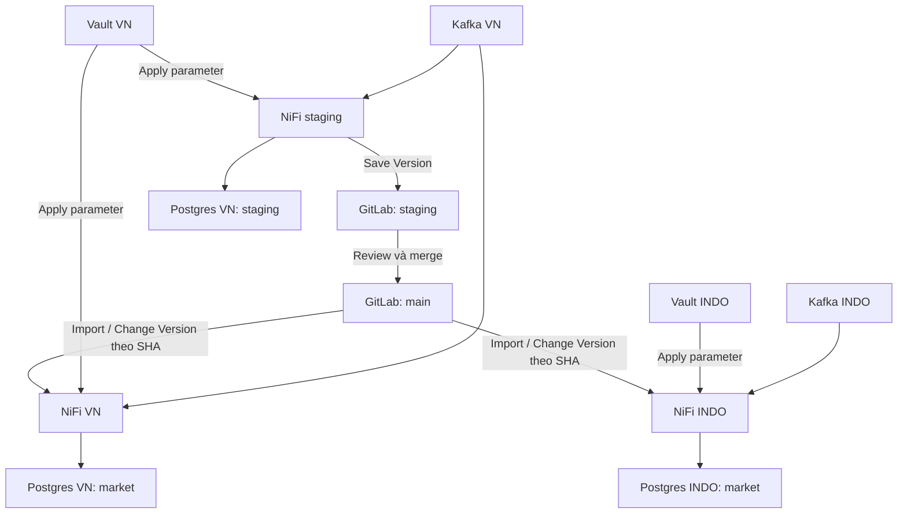
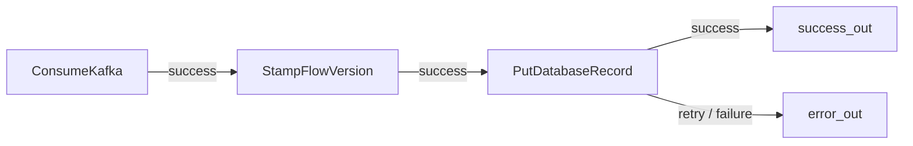

# Hướng dẫn lab từ đầu đến cuối

Nếu mới làm quen với NiFi, đọc [tài liệu giải thích các thành phần và cách phối hợp](NIFI_CONCEPTS_VI.md) ([PDF](../output/pdf/NIFI_CONCEPTS_VI.pdf)) trước hoặc mở song song khi thực hành.

## 0. Mở đúng ứng dụng và chọn điểm bắt đầu

Guide dùng giao diện tiếng Anh của **NiFi 2.6.0**, GitLab CE **18.2.1** và Vault **1.19.5**. Tên nút tiếng Anh được in đậm; nội dung trong code là giá trị cần nhập. Các lệnh Bash chạy trong SSH máy lab, không chạy ở ô Properties của NiFi.

### 0.1 Máy lab đã dựng sẵn: bắt đầu ở đâu?

Hạ tầng trên `192.168.102.4` đã có Kafka topics, bảng PostgreSQL, Vault secrets và ba Parameter Context. Nếu đang dùng máy lab này:

1. Mở `LAB_ACCESS.local.md` trong IDE để lấy credential hiện tại.
2. Mở các URL ở bảng 0.2 và đăng nhập.
3. Làm **mục 4** để chuẩn bị GitLab project/user/PAT; kiểm tra tài nguyên đã có trước khi tạo mới.
4. Làm **mục 5–6** để kiểm tra parameter và tạo Registry Client.
5. Làm **mục 7** trên staging, rồi **mục 8–11** để publish/import/rollout/rollback.
6. Mục 2–3 dành cho dựng lại trên host mới; không copy đè `.env` hoặc xóa volumes trên host hiện tại.

| Giai đoạn | Ứng dụng/tab cần mở | Kết quả trước khi chuyển bước |
|---|---|---|
| [4. GitLab](#4-tạo-gitlab-project-và-quyền) | GitLab root + writer/reader | project, branch, protected main, 2 PAT |
| [5. Parameters](#5-parameter-và-vault-theo-từng-thị-trường) | Vault VN/INDO + 3 NiFi | 8 parameter đúng mỗi môi trường |
| [6. Registry](#6-cấu-hình-registry-client-trên-từng-nifi) | 3 NiFi | staging dùng writer/staging; markets dùng reader/main |
| [7. Dựng flow](#7-dựng-flow-trên-nifi-staging-từng-thao-tác) | Chỉ NiFi staging + SSH | test staging vào đúng schema, audit v1/STAG |
| [8. Publish](#8-publish-v1-review-và-merge-trên-gitlab) | Staging + GitLab | snapshot sạch trên main, ghi M1 |
| [9. Import](#9-import-v1-vào-vn-sau-đó-indo) | VN rồi INDO | cùng M1, endpoint/local audit riêng |
| 10–11 | Staging/GitLab rồi từng market | rollout/rollback có bằng chứng theo SHA |

### 0.2 URL dùng trong trình duyệt

| Tab | URL | Tài khoản |
|---|---|---|
| NiFi staging | <https://nifi-stag.192.168.102.4.sslip.io:18443/nifi/> | `admin`, password NiFi trong file local |
| NiFi VN | <https://nifi-vn.192.168.102.4.sslip.io:28443/nifi/> | như staging |
| NiFi INDO | <https://nifi-indo.192.168.102.4.sslip.io:38443/nifi/> | như staging |
| GitLab | <http://192.168.102.4:18080/users/sign_in> | `root`, password GitLab trong file local |
| Vault VN | <http://192.168.102.4:18200/ui/> | Method `Token`, token VN trong file local |
| Vault INDO | <http://192.168.102.4:28200/ui/> | Method `Token`, token INDO trong file local |

1. Mở lần lượt ba NiFi bằng **ba hostname khác nhau ở bảng trên**; đóng các tab NiFi cũ cùng dùng IP.
2. Với cảnh báo certificate tự ký của lab, mở **Advanced** và chọn tiếp tục đến đúng hostname lab; Firefox dùng **Accept the Risk and Continue**.
3. Nhập Username = `admin`, Password lấy từ file local; bấm **Log In**.
4. Kiểm tra góc trên có user admin và đã vào canvas.
5. Giữ ba tab với hostname rõ môi trường để tránh thao tác nhầm VN/INDO.

Các hostname `sslip.io` phân giải về IP LAN nằm trong tên. Máy hiện tại và máy lab đã phân giải được; kết nối ứng dụng đi tới `192.168.102.4`. Nếu mạng chặn kiểu DNS này, thêm đúng các tên sau vào `/etc/hosts` của máy mở trình duyệt (Windows: file hosts tương ứng):

```text
192.168.102.4 nifi-stag.192.168.102.4.sslip.io nifi-vn.192.168.102.4.sslip.io nifi-indo.192.168.102.4.sslip.io
```

Giữ nguyên hostname trong dòng này để khớp certificate và allowlist đã cấu hình. API/script trên máy lab vẫn có thể dùng IP trực tiếp.

### 0.3 Vì sao trước đây hay báo Session expired?

Cookie đăng nhập NiFi có cùng tên và path `/`. Trình duyệt phân biệt cookie theo hostname, không theo port. Dùng cùng IP ở cổng 18443/28443/38443 khiến lần đăng nhập sau ghi đè cookie của instance trước; instance trước trả 401 và UI báo hết phiên.

Bản lab đã thêm hostname riêng và certificate có SAN tương ứng. **Single User của NiFi 2.6 cấp JWT 8 giờ**; đây là thời hạn token từ lúc đăng nhập, không phải cấu hình idle timeout vài phút. Không có property Single User hợp lệ để đổi thành vô hạn bằng cách thêm `Authentication Expiration` vào XML; property đó thuộc provider khác. Đăng xuất, đóng phiên trình duyệt hoặc restart NiFi có thể yêu cầu đăng nhập lại.

Chỉ cần đăng nhập lại một lần bằng các URL mới. Kiểm tra ba phiên cùng tồn tại bằng:

```bash
cd ~/github/nifi-multi-market-lab
python3 scripts/check-nifi-sessions.py
```

Script đăng nhập ba hostname trong cùng cookie jar, kiểm tra cả ba không dùng Authorization header, rồi đăng nhập lại staging để phát hiện lỗi ghi đè cookie. Nó không sửa flow.

### 0.4 Những thao tác NiFi sẽ dùng nhiều

- **Menu ba gạch góc phải**: Canvas, Controller Settings, Parameter Contexts, Data Provenance.
- **Breadcrumb phía canvas**: bấm tên PG cha để quay lên; double-click PG để đi vào.
- **Kéo component từ toolbar xuống canvas**: tạo Processor, Process Group, Input Port, Output Port, Funnel hoặc Import from Registry.
- **Chuột phải component → Configure**: sửa Settings/Properties/Scheduling/Relationships của component được chọn.
- **Chuột phải chỗ trống hoặc một PG → Controller Services**: mở danh sách service của đúng scope.
- **Apply**: lưu cấu hình runtime trong dialog; **Start**: chạy component; **Version → Commit Local Changes**: tạo snapshot/commit. Đây là các thao tác riêng.

Sau mỗi dialog, đọc lại breadcrumb và hostname trước khi tiếp tục. Tên menu/dialog trong guide đã đối chiếu source đúng bản 2.6; trạng thái chạy/API đã kiểm tra trên lab, còn toàn bộ chuỗi click dựng flow sẽ được thực hiện khi làm bài (xem `VALIDATION.md`).

## 1. Hiểu đúng mô hình trước khi chạy



- Flow cấu trúc giống nhau, nguồn Kafka/đích DB khác nhau theo parameter.
- Registry client không phải deploy agent. Kiểm tra version mới chỉ báo trạng thái, không Change Version tự động.
- `Save Version` tạo commit. Chỉnh processor hoặc Apply property chỉ thay đổi runtime NiFi, chưa commit Git.
- SHA của version là commit trong lịch sử **đường dẫn snapshot** trên branch được chọn. Không dùng branch HEAD tùy tiện.
- Nhận định “mọi commit Git đều sinh version mới cho NiFi” quá rộng: sửa file khác không tạo version flow. Squash/rebase/revert làm thay đổi lịch sử snapshot có thể sinh SHA mới. Merge commit giữ nguyên snapshot chưa chắc xuất hiện thành version mới trong danh sách NiFi. Dùng API path-scoped và danh sách version NiFi để xác minh.

### Ranh giới snapshot

| Thành phần | Nơi lưu | Theo Change Version? |
|---|---|---|
| Processor, connection, port, Controller Service nằm trong shared PG | flows/shared/kafka-to-postgres.json | Có |
| Tên context, tên parameter, metadata như sensitivity/description | Snapshot | Có |
| Giá trị parameter | Vault và Parameter Context local | Không, khi client đặt Remove |
| Literal viết thẳng vào property | Snapshot | Có — nên phải thay bằng parameter nếu phụ thuộc môi trường |
| Client GitLab, token GitLab; Vault endpoint/token | NiFi cấu hình local / script local | Không đưa vào shared PG |
| PG LOCAL_*, connection nối các PG trên canvas cha | NiFi local | Không |
| Queue, Kafka offsets, dữ liệu DB, runtime state | Hệ lưu trữ tương ứng | Không phải flow version |

`Remove` không biến snapshot thành file “chỉ có tên”: snapshot vẫn chứa cấu trúc flow, properties chung và metadata. Nó loại **giá trị parameter**; không xóa credential vô tình hard-code ở chỗ khác.

## 2. Chuẩn bị máy RHEL 9

Khuyến nghị cho toàn bộ stack: 8 vCPU, 24–32 GB RAM, 100 GB SSD trống. Đây là dự trù lab, phụ thuộc lượng queue/log. Đăng nhập shell trên máy RHEL; giải nén bộ lab vào một thư mục riêng.

Nếu Docker Engine/Compose đã có thì bỏ qua bước cài. Nếu chưa có, theo hướng dẫn RHEL chính thức tại https://docs.docker.com/engine/install/rhel/; các lệnh cơ bản:

```bash
sudo dnf install -y dnf-plugins-core
sudo dnf config-manager --add-repo https://download.docker.com/linux/rhel/docker-ce.repo
sudo dnf install -y docker-ce docker-ce-cli containerd.io docker-buildx-plugin docker-compose-plugin
sudo systemctl enable --now docker
sudo usermod -aG docker "$USER"
```

Đăng xuất/đăng nhập lại để nhận group docker. Không xóa Podman/runc đang dùng trên host một cách máy móc nếu package conflict; xử lý theo tài liệu Docker trước.

```bash
sudo dnf install -y python3 git curl unzip
cd ~/github/nifi-multi-market-lab
# Chỉ tạo .env nếu chưa có; giữ credential/cấu hình của host đã triển khai.
test -f .env || cp .env.example .env
vi .env
# Đổi HOST_IP và IP nằm trong ba NIFI_*_HOST theo host mới.
bash scripts/preflight.sh
```

`.env` dùng cú pháp KEY=value đơn giản, không dấu nháy, không space quanh `=`. Các script Python đọc trực tiếp định dạng này. Không dùng IP public, 127.0.0.1 hay 0.0.0.0 làm HOST_IP.

Máy lab dùng chung với dịch vụ khác có thể bật profile giảm RAM bằng cách thêm
`COMPOSE_FILE=compose.yaml:compose.lab.yaml` vào `.env`. Profile đặt heap NiFi
256 MB–1 GB mỗi instance và GitLab Puma chạy một process. Đây là cấu hình cho
bài thực hành nhỏ; theo dõi `free -h` và `docker stats --no-stream` khi tăng tải.

### Cổng

| Dịch vụ | Endpoint trên host |
|---|---|
| GitLab web/API | http://HOST_IP:18080 |
| GitLab SSH | HOST_IP:18022 |
| NiFi staging (browser) | https://nifi-stag.HOST_IP.sslip.io:18443/nifi/ |
| NiFi VN (browser) | https://nifi-vn.HOST_IP.sslip.io:28443/nifi/ |
| NiFi INDO (browser) | https://nifi-indo.HOST_IP.sslip.io:38443/nifi/ |
| Kafka VN broker / controller | HOST_IP:19092 / 19093 |
| Kafka INDO broker / controller | HOST_IP:29092 / 29093 |
| PostgreSQL VN / INDO | HOST_IP:15432 / 25432 |
| Vault VN / INDO UI/API | http://HOST_IP:18200/ui / http://HOST_IP:28200/ui |
| NiFi Site-to-Site reserved | 18000 / 28000 / 38000 |
| NiFi management nội bộ staging / VN / INDO | 127.0.0.1:52020 / 52021 / 52022 |

Compose dùng `network_mode: host`, vì vậy **không có `ports:`**: service bind trực tiếp lên host, không qua NAT/publish. Listener ứng dụng đặt 0.0.0.0; địa chỉ client và Kafka advertised listener phải là IP LAN. Host mode ở đây chỉ dành cho Linux, không dùng nguyên cấu hình cho Docker Desktop.

Mở firewall trong zone chứa NIC LAN (xem `firewall-cmd --get-active-zones`; thay public nếu zone khác):

```bash
sudo firewall-cmd --permanent --zone=public --add-port={18080,18022,18443,28443,38443,19092,19093,29092,29093,15432,25432,18200,28200,18000,28000,38000}/tcp
sudo firewall-cmd --reload
```

Nếu có Security Group/network ACL, mở các cổng cần truy cập từ subnet LAN tin cậy. Không cần tắt SELinux: bind mount có `:Z`, dữ liệu dùng named volumes. Local IPC trong một service, ví dụ GitLab bundled Redis/DB, vẫn là nội bộ; không expose các dependency đóng gói bên trong GitLab.

## 3. Khởi động và seed hạ tầng

```bash
docker compose pull kafka-vn kafka-indo postgres-vn postgres-indo vault-vn vault-indo gitlab
docker compose build nifi-stag
docker compose up -d
docker compose ps
docker compose logs --tail=80 nifi-stag gitlab kafka-vn
```

Lần đầu có thể mất 5–15 phút, nhất là GitLab. `running` chưa có nghĩa ứng dụng đã sẵn sàng. Kiểm tra đến khi các bước sau thành công:

```bash
set -a
source .env
set +a
curl -k "https://$HOST_IP:18443/nifi/"
curl "http://127.0.0.1:18080/-/readiness?all=1"
bash scripts/init-topics.sh
python3 scripts/init-vault.py
bash scripts/query.sh stag
bash scripts/query.sh vn
bash scripts/query.sh indo
```

- Nếu init-topics connection refused, chờ Kafka sẵn sàng rồi chạy lại; script tạo topic idempotent.
- SQL init chạy khi volume Postgres rỗng lần đầu. Kết quả query là bảng rỗng, không phải “relation does not exist”.
- GitLab giới hạn endpoint readiness ở loopback theo mặc định; chạy lệnh trên tại máy Docker host. Trang đăng nhập vẫn truy cập từ LAN qua `http://HOST_IP:18080/users/sign_in`.
- Vault chạy server persistent, không dev mode; secret không mất khi restart. Sau restart Vault bị sealed: chạy lại `init-vault.py` để unseal. Script không overwrite secret đã có.
- Root token/unseal key trong `.private/vault-*-init.json`; bảo quản cùng backup. Có thể lấy root token để đăng nhập UI bằng `python3 -c 'import json; print(json.load(open(".private/vault-vn-init.json"))["root_token"])'`. Không paste token này vào GitLab.

## 4. Tạo GitLab project và quyền

Thực hiện phần này trên **GitLab**, không phải canvas NiFi. Giữ một cửa sổ đăng nhập root để quản trị/review; dùng profile trình duyệt khác hoặc một cửa sổ ẩn danh khi đăng nhập writer/reader. Nếu project hoặc user đã tồn tại, mở lại để kiểm tra cấu hình, không tạo bản trùng.

### 4.1 Đăng nhập và tạo group

1. Mở <http://192.168.102.4:18080/users/sign_in>.
2. Điền **Username or primary email** = `root`; lấy password GitLab trong `LAB_ACCESS.local.md`; bấm **Sign in**.
3. Mở <http://192.168.102.4:18080/groups/new>. Đây là màn hình tạo group.
4. Chọn **Create group** để tự tạo group mới.
5. Điền **Group name** = `data360`; kiểm tra **Group URL** có slug `data360`.
6. Trong **Visibility level**, chọn **Private**. Không bật tạo một project khác kèm group.
7. Bấm **Create group** ở cuối form.
8. Kiểm tra trang group hiển thị `data360` và URL kết thúc bằng `/data360`.

### 4.2 Tạo project flows-nifi

1. Tại trang group `data360`, chọn **New project**; chọn **Create blank project**.
2. Điền **Project name** = `flows-nifi`; **Project slug** = `flows-nifi`.
3. Kiểm tra namespace/owner là `data360`, không phải namespace cá nhân `root`.
4. Chọn **Private**.
5. Đánh dấu **Initialize repository with a README** để project có commit và branch đầu tiên.
6. Bấm **Create project**.
7. Mở project, chọn **Code → Repository**; kiểm tra dropdown branch đang là `main` và thấy README.
8. Nếu branch mặc định có tên khác: vào **Code → Branches → New branch**, tạo `main` từ branch hiện tại; sau đó vào **Settings → Repository → Branch defaults**, đặt default branch = `main`, bấm **Save changes**. Giữ nguyên dữ liệu ở branch cũ.

**Đạt:** project ở `http://192.168.102.4:18080/data360/flows-nifi`, default branch `main`, đã có README.

### 4.3 Tạo bucket shared và branch staging

1. Trong **Code → Repository**, chọn branch `main`.
2. Mở menu dấu `+` của danh sách file, chọn **New file**.
3. Ô **File name**, nhập `flows/shared/.keep`.
4. Phần nội dung có thể để rỗng; ô **Commit message**, nhập `Initialize shared flow bucket`.
5. Kiểm tra đích commit là `main`; bấm **Commit changes**.
6. Trong danh sách file, mở `flows`, rồi `shared`; phải thấy `.keep`.
7. Chọn **Code → Branches → New branch**.
8. Điền **Branch name** = `staging`; **Create from** = `main`; bấm **Create branch**.
9. Chuyển dropdown branch sang `staging`, mở lại `flows/shared/.keep` để kiểm tra.

Thư mục `flows/shared` là bucket `shared` mà NiFi đọc khi Registry Client có **Repository Path = flows**. Không dùng tên bucket `flows/shared` trong dialog NiFi.

### 4.4 Tạo hai tài khoản không phụ thuộc email lab

Lab chưa cấu hình SMTP, vì vậy không chờ email reset password. Dùng root tạo user, rồi đặt password trong màn hình Edit của từng user.

1. Mở <http://192.168.102.4:18080/admin/users> bằng phiên root (**Admin → Overview → Users**).
2. Bấm **New user**.
3. Nhập hàng thứ nhất trong bảng dưới. Giữ loại tài khoản **Regular**, không cấp Administrator.
4. Bấm **Create user**. Thông báo gửi link reset không có nghĩa máy lab đã gửi được email.
5. Ở trang chi tiết user vừa tạo, bấm **Edit**.
6. Tìm phần **Password**, nhập cùng một password riêng cho lab vào **Password** và **Password confirmation**.
7. Bấm **Save changes**. Ghi password vào `LAB_ACCESS.local.md`, không thêm vào repo snapshot.
8. Kiểm tra user ở trạng thái active. Nếu trang Admin hiển thị yêu cầu xác nhận email, dùng thao tác **Confirm user** tại user đó trước khi đăng nhập.
9. Lặp lại cho hàng thứ hai.

| Name | Username | Email dùng trong lab | Quyền hệ thống |
|---|---|---|---|
| NiFi Writer | `nifi-writer` | `nifi-writer@example.test` | Regular |
| NiFi Reader | `nifi-reader` | `nifi-reader@example.test` | Regular |

Nếu lần đăng nhập đầu yêu cầu đổi password, hoàn tất form password mới rồi ghi lại giá trị mới vào file local.

### 4.5 Mời user vào project

1. Quay về project `data360/flows-nifi` bằng phiên root.
2. Chọn **Manage → Members → Invite members**.
3. Ô chọn user, tìm và chọn `nifi-writer`.
4. **Select a role** = **Developer**; bấm **Invite**.
5. Lặp lại cho `nifi-reader`, nhưng chọn **Reporter**.
6. Trong bảng members, kiểm tra đúng username và role. User reader không cần quyền Developer.

### 4.6 Tạo PAT của đúng tài khoản

1. Mở một profile trình duyệt khác hoặc cửa sổ ẩn danh, đăng nhập `nifi-writer` bằng password vừa đặt.
2. Bấm avatar → **Edit profile** → **Access tokens**. Có thể mở thẳng đường dẫn `/-/user_settings/personal_access_tokens` trên GitLab lab.
3. Bấm **Add new token**.
4. **Token name** = `nifi-staging-api`; đặt **Expiration date** sau ngày dự kiến hoàn thành lab.
5. Trong scopes, chọn **api**; bấm **Create personal access token**.
6. Copy token vừa hiện vào file local; ghi rõ đó là PAT writer. Token chỉ được hiển thị lúc tạo, không dùng password tài khoản thay cho PAT.
7. Đăng xuất writer trong cửa sổ đó; đăng nhập `nifi-reader`.
8. Tạo token `nifi-market-read`, chọn scope **read_api**, lưu riêng làm PAT reader.
9. Quay lại cửa sổ root để tiếp tục quản trị project.

**Đạt:** có hai PAT phân biệt. Staging dùng PAT writer; VN và INDO dùng PAT reader. `read_repository` đơn thuần không thay thế `read_api` cho GitLab Registry Client.

### 4.7 Bảo vệ main và cấu hình merge

1. Trong project, mở **Settings → Repository**, mở rộng **Protected branches**.
2. Tìm rule cho `main`. Nếu rule đã có, sửa rule hiện tại; nếu chưa có, chọn branch `main` rồi tạo rule bằng **Protect**.
3. **Allowed to merge** = **Maintainers**.
4. **Allowed to push and merge** = **No one**. Đây là quyền push trực tiếp, không phải dropdown cho phép merge MR phía trên.
5. Giữ force push tắt. Lưu thay đổi nếu form đang có nút lưu.
6. Kiểm tra `staging` không bị rule wildcard bảo vệ đến mức Developer không thể ghi snapshot.
7. Mở **Settings → Merge requests**.
8. **Merge method** = **Merge commit**; phần squash chọn **Do not allow** cho bài lab này.
9. Bỏ chọn mặc định xóa source branch sau merge; bấm **Save changes** của phần vừa sửa.
10. Khi merge từng MR, vẫn kiểm tra checkbox **Delete source branch** đang bỏ chọn.

Không cần GitLab Runner để lưu snapshot hoặc tạo MR. File CI mẫu trong `repo-template` là tùy chọn; chỉ sử dụng sau khi có Runner và đã review cấu hình.

## 5. Parameter và Vault theo từng thị trường

Mục tiêu: mỗi instance có context **`shared-runtime`**, nhưng giá trị của staging, VN và INDO khác nhau. Hạ tầng đã seed context này; ưu tiên kiểm tra lại, không tạo thêm context trùng tên.

### 5.1 Xem secrets trên Vault UI

1. Mở Vault VN: <http://192.168.102.4:18200/ui/>.
2. Ở màn hình đăng nhập, chọn **Method = Token**.
3. Dán **root token Vault VN** từ `LAB_ACCESS.local.md`; bấm **Sign in**. Root token là token quản trị được sinh riêng, không phải password GitLab.
4. Chọn **Secrets**, mở mount `kv/`.
5. Mở secret `runtime`; xem danh sách key/value. Đây là cấu hình dành cho NiFi VN.
6. Quay lại danh sách secret, mở `staging`; đây là cấu hình dành cho NiFi staging.
7. Mở Vault INDO ở <http://192.168.102.4:28200/ui/> trong cửa sổ/tab riêng; đăng nhập bằng root token INDO.
8. Vào **Secrets → kv/ → runtime**. Vault INDO không dùng secret `staging` của VN.

| Parameter | Staging | VN | INDO |
|---|---|---|---|
| `kafka.bootstrap` | `192.168.102.4:19092` | `192.168.102.4:19092` | `192.168.102.4:29092` |
| `kafka.topic` | `trips-staging` | `trips` | `trips` |
| `kafka.group` | `nifi-staging` | `nifi-vn` | `nifi-indo` |
| `db.url` | `jdbc:postgresql://192.168.102.4:15432/market` | như staging | `jdbc:postgresql://192.168.102.4:25432/market` |
| `db.username` | `admin` | `admin` | `admin` |
| `db.password` | password PostgreSQL VN | password PostgreSQL VN | password PostgreSQL INDO |
| `db.schema` | `staging` | `market` | `market` |
| `db.table` | `trip_events` | `trip_events` | `trip_events` |

### 5.2 Sửa một secret bằng UI khi cần

1. Đảm bảo đang ở đúng Vault và đúng secret của môi trường cần sửa.
2. Bấm **Edit secret**.
3. Sửa ô Value của key cần đổi; giữ đủ 8 key trong bảng trên. Không đổi kiểu thành object/array.
4. Bấm **Save** ở cuối form; mở lại secret để đối chiếu.
5. Ghi nhận môi trường đã thay đổi, rồi apply sang NiFi theo mục 5.3.

Lab dùng **KV v1**, nên không có lịch sử version secret như KV v2. Thay password trong Vault không tự thay password PostgreSQL; bài lab mặc định giữ nguyên credential DB.

### 5.3 Apply từ Vault sang NiFi bằng bridge

Nếu flow đã chạy, vào đúng NiFi, stop nguồn ConsumeKafka, đợi queues drain, rồi stop shared PG trước khi cập nhật parameter. Nếu đang bắt đầu trên canvas rỗng, chạy trực tiếp các lệnh sau trên máy lab:

```bash
cd ~/github/nifi-multi-market-lab
python3 scripts/sync-params.py stag
python3 scripts/sync-params.py vn
python3 scripts/sync-params.py indo
```

Mỗi lệnh phải báo `Created shared-runtime` hoặc `Updated shared-runtime`. Script không commit Git, không deploy flow, không polling secret theo mỗi record. Nó đọc Vault bằng token chỉ đọc và apply vào context local qua API NiFi.

### 5.4 Kiểm tra context trong NiFi UI

Làm lần lượt trên staging, VN, INDO; đối chiếu tên tab/hostname trước mỗi lần:

1. Mở menu ba gạch góc phải trên NiFi → **Parameter Contexts**.
2. Trong bảng, tìm dòng **shared-runtime**. Nếu không thấy, chạy lại đúng lệnh `sync-params.py` cho instance đó rồi refresh.
3. Mở menu thao tác của dòng → **Edit**. Hộp thoại **Edit Parameter Context** xuất hiện.
4. Tab **Settings**: Name phải là `shared-runtime`.
5. Tab **Parameters**: kiểm tra đủ 8 dòng theo bảng 5.1.
6. Kiểm tra `db.password` là Sensitive; giá trị bị che là bình thường. Các key còn lại không đánh dấu Sensitive.
7. Đối chiếu `kafka.topic`, `kafka.group`, `db.schema` để phát hiện đang mở nhầm môi trường.
8. Nếu chỉ xem, bấm **Cancel** hoặc **Close**; không tạo thêm context.
9. Nếu cần sửa qua UI, mở dòng parameter, nhập giá trị, xác nhận rồi bấm **Apply** ở dialog context; đợi update hoàn tất và bấm **Close**. Lần sync sau sẽ áp dụng lại giá trị từ Vault, vì vậy ưu tiên sửa tại Vault.
10. Dùng menu → **Canvas** để quay về flow.

**Đạt:** ba context cùng tên nhưng staging dùng topic `trips-staging`/schema `staging`; VN/INDO dùng endpoint và consumer group riêng. Mục 7 mới bind context này vào shared PG.

Chạy kiểm tra hạ tầng trên máy Docker host:

```bash
python3 scripts/check-infra.py
python3 scripts/check-nifi-sessions.py
```

### 5.5 Làm hoàn toàn trên UI thay cho sync-params.py

Có hai cách khác nhau: **nhập tay Parameter Context** để thay đúng công việc của
bridge, hoặc dùng **Parameter Provider** để NiFi tự đọc Vault bằng Fetch/Apply.
Các bước dưới là cách nhập tay, giữ cùng thiết kế snapshot của bài chính.

**Chọn đúng cặp Vault / NiFi trước khi copy:**

| NiFi cần cấu hình | Vault UI | Secret chứa 8 giá trị |
|---|---|---|
| staging | `http://192.168.102.4:18200/ui/` | `kv/staging` |
| VN | `http://192.168.102.4:18200/ui/` | `kv/runtime` |
| INDO | `http://192.168.102.4:28200/ui/` | `kv/runtime` |

1. Nếu shared PG đang chạy, **Stop ConsumeKafka**, đợi queues downstream drain,
   rồi **Stop shared PG** và đợi active threads = 0. Giữ lại các record lỗi để xử lý.
2. Mở đúng Vault trong bảng, đăng nhập bằng Method = Token theo mục 5.1, mở
   `kv/` và secret tương ứng. Dùng các giá trị thực tế đang lưu trong secret.
3. Mở NiFi tương ứng bằng hostname riêng → menu ba gạch → **Parameter Contexts**.
4. Nếu `shared-runtime` đã có, mở **Edit** ở dòng đó. Nếu chưa có, bấm **+** ở
   trang Parameter Contexts để tạo; tab **Settings**, Name = `shared-runtime`.
   Không tạo bản thứ hai khi context cũ đã tồn tại.
5. Chọn tab **Parameters**. Để thêm parameter mới, bấm **+** trong tab này.
   Để sửa parameter đã có, mở thao tác **Edit** ở dòng parameter đó.
6. Dialog **Add Parameter** hoặc **Edit Parameter**: điền **Name**, **Value**,
   chọn **Sensitive Value = Yes/No**, rồi bấm **Ok** theo bảng dưới.

| Name | Value lấy từ Vault | Sensitive Value |
|---|---|---|
| `kafka.bootstrap` | Giá trị key `kafka.bootstrap` | No |
| `kafka.topic` | Giá trị key `kafka.topic` | No |
| `kafka.group` | Giá trị key `kafka.group` | No |
| `db.url` | Giá trị key `db.url` | No |
| `db.username` | Giá trị key `db.username` | No |
| `db.password` | Password DB trong key `db.password` | **Yes** |
| `db.schema` | Giá trị key `db.schema` | No |
| `db.table` | Giá trị key `db.table` | No |

7. Value là giá trị thật, ví dụ `kafka.topic=trips` trên VN, không phải
   `#{kafka.topic}`. Cú pháp `#{...}` được dùng trong property của processor/service.
8. Sau khi đủ 8 parameter, bấm **Apply** ở dialog **Edit Parameter Context**;
   chỉ bấm Ok ở từng parameter chưa hoàn tất lưu cả context. Đợi tiến trình update
   xong rồi bấm **Close**.
9. Mở lại context để đối chiếu topic/group/schema theo bảng 5.1. `db.password`
   hiện **Sensitive value set** là bình thường. Nếu cần đổi password, nhập lại
   giá trị từ Vault; nếu chỉ xem, đóng dialog mà không sửa.
10. Menu → **Canvas**, về `MARKET_RUNTIME`, chuột phải `kafka-to-postgres` →
    **Configure → Settings → Parameter Context = shared-runtime** → **Apply**
    nếu PG chưa bind context này.
11. Kiểm tra Controller Services Enabled, validation không lỗi; start downstream
    trước, ConsumeKafka sau cùng. Test bằng produce/query như mục 7.9.

Nhập tay trên UI không tạo liên kết tự động với Vault. Mỗi lần Vault đổi, phải
copy lại giá trị cần đổi vào NiFi; nếu chạy lại bridge, giá trị trong Vault sẽ được
apply lại. Với context đã có Sensitivity sai, không chuyển đổi/xóa parameter đang
được sử dụng tùy tiện; dừng flow và xử lý binding trước khi tạo lại parameter đúng.

Nếu muốn **NiFi tự đọc Vault qua UI**, xem **mục 13**: tạo Vault client tại
Management Controller Services, tạo HashiCorpVaultParameterProvider, rồi
**Fetch Parameters → Apply** vào `vault-preview`. Context đó do provider quản lý;
bài mở rộng dùng secret/context riêng để tránh trộn hai cơ chế quản lý shared-runtime.

## 6. Cấu hình Registry Client trên từng NiFi

Registry Client là cấu hình của instance, nằm ngoài shared PG. Tạo một client trên staging, một trên VN và một trên INDO.

### 6.1 Tạo client trên staging

1. Mở tab NiFi **staging** bằng hostname riêng ở mục 0.
2. Menu ba gạch → **Controller Settings**.
3. Chọn tab **Registry Clients**.
4. Bấm dấu **+** để thêm Registry Client.
5. Trong hộp chọn type, nhập `GitLabFlowRegistryClient` vào ô lọc.
6. Chọn đúng type `GitLabFlowRegistryClient`, bundle version `2.6.0`; bấm **Add**.
7. Trong bảng Registry Clients, mở thao tác **Edit** của dòng mới tạo.
8. Hộp thoại **Edit Registry Client**, tab **Settings**: đổi **Name** thành `gitlab-staging`.
9. Tab **Properties**: sửa từng dòng theo cột staging trong bảng dưới. Mở ô Value của property, nhập/chọn giá trị, xác nhận trình sửa giá trị rồi chuyển sang dòng kế tiếp.
10. Sau khi nhập hết, bấm **Apply** ở cuối dialog.
11. Quay về bảng, mở lại client để kiểm tra Name, Repository Path, Default Branch và Parameter Context Values.
12. Menu → **Canvas** để quay về flow.

| Property | Staging | VN và INDO |
|---|---|---|
| Name, tab Settings | `gitlab-staging` | `gitlab-main` |
| GitLab API URL | `http://192.168.102.4:18080/` | giống staging |
| GitLab API Version | `V4` | `V4` |
| Repository Namespace | `data360` | `data360` |
| Repository Name | `flows-nifi` | `flows-nifi` |
| Repository Path | `flows` | `flows` |
| Default Branch | `staging` | `main` |
| Authentication Type | `Access Token` | `Access Token` |
| Access Token | PAT của `nifi-writer` | PAT của `nifi-reader` |
| Parameter Context Values | **Remove** | **Remove** |

### 6.2 Lặp lại trên VN và INDO

1. Chuyển sang tab **VN**, kiểm tra hostname có `nifi-vn`.
2. Lặp lại các bước 6.1 nhưng dùng cột **VN và INDO**: Name `gitlab-main`, branch `main`, PAT reader.
3. Làm tương tự ở tab **INDO**.
4. Ghi lại bảng kiểm: staging = writer/staging; VN = reader/main; INDO = reader/main.

URL API là base URL, không thêm `/api/v4`. Path là `flows`, không phải `flows/shared`. Client không tự đổi version khi GitLab có commit mới. Đặt **Remove** để snapshot không lưu giá trị parameter; literal hard-code ở property vẫn có thể bị commit nên phải review snapshot ở mục 8.

## 7. Dựng flow trên NiFi staging, từng thao tác

Toàn bộ mục 7 thực hiện ở tab **staging**. Thao tác kéo/thả: giữ chuột ở icon component trên toolbar trên cùng, kéo xuống chỗ trống của canvas, rồi thả. Di chuột lên icon để xem tooltip trước khi kéo.

### 7.1 Tạo cây Process Group đúng phạm vi

1. Menu → **Canvas**; kiểm tra breadcrumb đang ở root của NiFi staging.
2. Kéo icon **Process Group** từ toolbar xuống canvas.
3. Dialog **Create Process Group**: Name = `MARKET_RUNTIME`; Parameter Context = **No parameter context**; bấm **Add**.
4. Double-click PG `MARKET_RUNTIME` để vào bên trong. Breadcrumb phải có tên này.
5. Kéo thêm **Process Group** vào trong `MARKET_RUNTIME`.
6. Name = `kafka-to-postgres`; Parameter Context = **shared-runtime**; bấm **Add**.
7. Kéo thêm một **Process Group** ở bên cạnh: Name = `LOCAL_AUDIT`; Parameter Context = **No parameter context**; bấm **Add**.
8. Chuột phải `kafka-to-postgres` → **Configure**. Tab **Settings**, kiểm tra Parameter Context = `shared-runtime`; bấm **Cancel** nếu không sửa, **Apply** nếu đã sửa.
9. Double-click `kafka-to-postgres` để vào shared PG.

Cây phải là:

```text
Root
└── MARKET_RUNTIME                 không version control
    ├── kafka-to-postgres          shared PG sẽ version control
    └── LOCAL_AUDIT                PG local, không version control
```

Không đặt `LOCAL_AUDIT` bên trong `kafka-to-postgres`. Không Start Version Control cho `MARKET_RUNTIME`.

### 7.2 Thêm ba Controller Service tại shared PG

**Controller Services là một menu riêng trong NiFi 2.6**, không phải một tab trong dialog Configure Process Group.

1. Khi breadcrumb đang ở `MARKET_RUNTIME / kafka-to-postgres`, chuột phải chỗ trống canvas → **Controller Services**.
2. Bấm **+** ở danh sách services.
3. Lọc tên `Kafka3ConnectionService`, chọn type đúng bundle `2.6.0`, bấm **Add**.
4. Tại dòng service vừa thêm, chọn **Edit**.
5. Tab **Settings**: Name = `KafkaConnection`.
6. Tab **Properties**: nhập hai property ở bảng Kafka bên dưới; bấm **Apply**.
7. Lặp lại thao tác thêm service với `DBCPConnectionPool`, đặt tên `PostgresPool`, điền bảng PostgreSQL.
8. Thêm `JsonTreeReader`, đặt tên `TripJsonReader`, điền bảng reader và schema bên dưới.

| KafkaConnection — property | Value |
|---|---|
| Bootstrap Servers | `#{kafka.bootstrap}` |
| Security Protocol | `PLAINTEXT` |

| PostgresPool — property | Value |
|---|---|
| Database Connection URL | `#{db.url}` |
| Database Driver Class Name | `org.postgresql.Driver` |
| Database Driver Location(s) | `/opt/nifi/drivers/postgresql.jar` |
| Database User | `#{db.username}` |
| Password | `#{db.password}` |

| TripJsonReader — property | Value |
|---|---|
| Schema Access Strategy | `Use 'Schema Text' Property` |
| Schema Text | Toàn bộ JSON Avro dưới đây |

```json
{
  "type": "record",
  "name": "TripEvent",
  "fields": [
    {"name": "event_id", "type": "string"},
    {"name": "customer_id", "type": "string"},
    {"name": "amount", "type": "double"},
    {"name": "event_time", "type": "string"}
  ]
}
```

9. Ở bảng Controller Services, kiểm tra cột trạng thái của ba dòng không còn báo cấu hình thiếu/invalid.
10. Mở thao tác **Enable** ở dòng `KafkaConnection`.
11. Trong dialog **Enable Controller Service**, bấm **Enable**, đợi xong rồi **Close**. Chưa chọn start các processor tham chiếu vì flow đang dựng.
12. Lặp lại cho `PostgresPool` và `TripJsonReader`; mỗi service phải hiện **Enabled**.
13. Bấm liên kết **Back to ...** trên trang settings hoặc menu → **Canvas** để quay lại đúng shared PG.

Nếu service invalid, mở Edit và xem lỗi tại dialog trước khi enable. Không nhập literal endpoint/password thay cho parameter để làm mất cảnh báo. Service phải được tạo ở shared PG để đi theo snapshot; ba resource mạng vẫn lấy giá trị local từ context.

`amount` dùng double chỉ để minh họa; `event_time` dùng string để tập trung bài promotion. Tiền thực tế cần thiết kế decimal/precision riêng.

### 7.3 Thêm ConsumeKafka và cấu hình

1. Tại canvas shared PG, kéo icon **Processor** xuống vị trí bên trái.
2. Ô lọc type, nhập `ConsumeKafka`; chọn type **ConsumeKafka** bundle Kafka `2.6.0`, bấm **Add**.
3. Double-click processor hoặc chuột phải → **Configure**.
4. Tab **Settings**, Name giữ `ConsumeKafka`.
5. Tab **Properties**, điền lần lượt:

| Property | Value |
|---|---|
| Kafka Connection Service | chọn `KafkaConnection` |
| Topic Format | giữ lựa chọn danh sách tên topic, không dùng regex |
| Topics | `#{kafka.topic}` |
| Group ID | `#{kafka.group}` |
| Auto Offset Reset | `earliest` |
| Commit Offsets | `true` |
| Processing Strategy | `FLOW_FILE` — mô tả ghi một FlowFile cho mỗi Kafka Record |

6. Tab **Scheduling**, đặt **Concurrent Tasks** = `1`; giữ scheduling mặc định còn lại.
7. Bấm **Apply**. Processor có thể còn invalid do chưa nối relationship; bước 7.6 sẽ xử lý.

Không chọn processor đời NiFi 1.x có tên `ConsumeKafka_2_6`. Với `FLOW_FILE`, không cấu hình Record Reader/Writer tại ConsumeKafka; JsonTreeReader dùng cho PutDatabaseRecord. Vì không có reader ở ConsumeKafka, bản 2.6 này chỉ cần nối relationship `success`; `parse failure` xuất hiện khi dùng Record Reader.

### 7.4 Thêm StampFlowVersion và PutDatabaseRecord

**StampFlowVersion:**

1. Kéo **Processor**, lọc `UpdateAttribute`, chọn và bấm **Add**.
2. Mở Configure, tab **Settings**, Name = `StampFlowVersion`.
3. Tab **Properties**, bấm **+** để thêm dynamic property.
4. Trong dialog **Add Property**, **Property Name** = `flow.release`; bấm **Ok** để tạo property.
5. Nhập Value = `v1` cho dòng `flow.release` vừa có; giữ non-sensitive.
6. Bấm **Apply**.

**PutDatabaseRecord:**

1. Thêm Processor type `PutDatabaseRecord`; mở Configure.
2. Tab **Properties**, điền bảng dưới. Chọn service đã tạo, không tạo service mới từ dropdown để tránh sai scope.
3. Bấm **Apply**.

| Property | Value |
|---|---|
| Record Reader | `TripJsonReader` |
| Database Connection Pooling Service | `PostgresPool` |
| Database Type | `PostgreSQL` |
| Statement Type | `UPSERT` |
| Schema Name | `#{db.schema}` |
| Table Name | `#{db.table}` |
| Update Keys | `event_id` |
| Translate Field Names | `false` |
| Unmatched Field Behavior | `Fail on Unmatched Fields` |
| Rollback On Failure | `false` |

Nếu một property phụ thuộc lựa chọn khác chưa hiện, chọn Statement Type/Database Type trước rồi tìm lại. Không điền **Database Name** bằng `market` để thay cho Schema Name; database đã nằm trong JDBC URL.

Sau khi Apply, mở lại Configure → Properties để xác nhận **Statement Type vẫn là UPSERT**,
Update Keys = `event_id`. Nếu chọn nhầm **UPDATE**, một event ID mới chưa có trong bảng
sẽ không tạo row. PostgreSQL có thể hoàn tất UPDATE với 0 row mà không báo lỗi, nên
FlowFile vẫn đi nhánh success; đây chưa phải bằng chứng dữ liệu đã được ghi.

### 7.5 Tạo Output Port và nối connection

1. Kéo icon **Output Port** vào bên phải PutDatabaseRecord.
2. Điền tên `success_out`; bấm **Add**.
3. Kéo thêm Output Port, tên `error_out`; bấm **Add**.
4. Di chuột lên ConsumeKafka. Kéo mũi tên kết nối xuất hiện trên component sang StampFlowVersion.
5. Dialog **Create Connection**, tab **Details**: chọn relationship **success**.
6. Tab **Settings**: Name = `KAFKA_TO_STAMP`; FlowFile Expiration = `0 sec`; giữ Back Pressure Object Threshold `10000` và Data Size Threshold `1 GB` nếu đây là các giá trị đang có.
7. Bấm **Add** để tạo connection.
8. Lặp lại theo bảng; tên connection dùng để tìm nhanh khi kiểm tra queue.

| Source | Destination | Relationships chọn | Tên connection |
|---|---|---|---|
| ConsumeKafka | StampFlowVersion | `success` | `KAFKA_TO_STAMP` |
| StampFlowVersion | PutDatabaseRecord | `success` | `STAMP_TO_DB` |
| PutDatabaseRecord | success_out | `success` | `DB_SUCCESS` |
| PutDatabaseRecord | error_out | **cả `retry` và `failure`** | `DB_ERROR` |

Ở connection `DB_ERROR`, chọn cả hai checkbox `retry` và `failure` trong cùng dialog. Không auto-terminate hai relationship này. Double-click connection để mở lại và kiểm tra selected relationships.



Chưa Start flow. Hai Output Port còn cần connection ở canvas cha; thực hiện phần local tiếp theo.

### 7.6 Tạo LOCAL_AUDIT

1. Bấm breadcrumb **MARKET_RUNTIME** để ra canvas cha. Phải thấy hai PG anh em.
2. Double-click **LOCAL_AUDIT**.
3. Kéo icon **Input Port**, tạo `in_success`.
4. Tạo Input Port thứ hai `in_error`.
5. Thêm Processor **UpdateAttribute**, đổi Name = `LocalMarketTag`.
6. Trong Properties, bấm **+**, **Add Property → Property Name** = `local.market` → **Ok**; nhập Value = `STAG`; bấm **Apply**.
7. Thêm Processor **LogAttribute**, đổi Name = `AuditSuccess`.
8. Properties của AuditSuccess: **Log Payload** = `false`.
9. Tab **Relationships**: đánh dấu **terminate** cho relationship `success`; bấm **Apply**. Đây là điểm kết thúc hợp lệ của nhánh audit thành công.
10. Tạo connection `in_success` → `LocalMarketTag`; input port không cần chọn relationship processor.
11. Tạo connection `LocalMarketTag` → `AuditSuccess`, chọn `success`.
12. Kéo icon **Funnel** vào gần `in_error`. Funnel không có Name để đổi như processor; trong guide gọi nó là điểm `ERROR_HOLD` theo vai trò.
13. Tạo connection `in_error` → Funnel; tab Settings, Name = **FAILED_RECORDS**, FlowFile Expiration = `0 sec`.
14. Giữ Funnel không có output để queue **FAILED_RECORDS** giữ lỗi cho điều tra/replay. Không nối nhánh lỗi vào AuditSuccess hoặc auto-terminate lỗi.

Funnel giữ lỗi có thể báo thiếu outgoing connection; đây là điểm giữ có chủ đích và không cần chạy để tiêu thụ dữ liệu lỗi. Khi khởi động local, start hai Input Port và hai processor thành công; không cố làm queue lỗi biến mất bằng cách nối vào nhánh terminate.

### 7.7 Nối hai PG ở canvas cha

1. Bấm breadcrumb **MARKET_RUNTIME**.
2. Kéo mũi tên kết nối từ PG `kafka-to-postgres` sang PG `LOCAL_AUDIT`.
3. Dialog **Create Connection**, phía Source chọn Output Port **success_out**.
4. Phía Destination chọn Input Port **in_success**; tab Settings đặt Name = `SHARED_SUCCESS_TO_LOCAL`; bấm **Add**.
5. Kéo thêm một connection giữa hai PG.
6. Source = **error_out**, Destination = **in_error**; Name = `SHARED_ERROR_TO_LOCAL`; bấm **Add**.
7. Double-click lại từng connection để đối chiếu tên port, tránh nối nhầm success vào in_error.

Các connection này nằm trên `MARKET_RUNTIME`, vì thế nằm ngoài shared snapshot. Giữ ID và tên port ổn định ở v2; xóa/tạo lại port cùng tên vẫn làm đổi ID và có thể phá connection ngoài PG.

### 7.8 Kiểm tra valid và start đúng thứ tự

1. Vào `LOCAL_AUDIT`, chuột phải từng `in_success`, `in_error` → **Start**.
2. Start `LocalMarketTag`, rồi `AuditSuccess`. Nhánh thành công phải có biểu tượng đang chạy.
3. Quay lại shared PG; xác nhận ba Controller Service Enabled.
4. Kiểm tra bulletin/biểu tượng invalid của ba processor. Với processor invalid, mở Configure để đọc validation error; sửa đúng property hoặc connection còn thiếu.
5. Start `success_out` và `error_out`.
6. Start `PutDatabaseRecord`, rồi `StampFlowVersion`, cuối cùng mới Start `ConsumeKafka`.
7. Đợi vài giây, refresh canvas. Queues ban đầu phải là `0`; không có lỗi kết nối Kafka/DB liên tục.

### 7.9 Gửi dữ liệu và xem bằng chứng trên UI

Trên máy lab:

```bash
cd ~/github/nifi-multi-market-lab
bash scripts/produce.sh stag stag-v1-001
bash scripts/query.sh stag
bash scripts/query.sh vn
bash scripts/query.sh indo
```

1. Query staging phải có `event_id=stag-v1-001`; bản tin này không xuất hiện trong schema market của VN/INDO.
2. Trên NiFi staging, nhìn lần lượt các queue `KAFKA_TO_STAMP`, `STAMP_TO_DB`, `DB_SUCCESS`. Chúng có thể lên rồi xuống rất nhanh; không kịp thấy queue tăng không có nghĩa mất bản tin.
3. Vào LOCAL_AUDIT, chuột phải **AuditSuccess → View data provenance** để xem events của processor đó.
4. Ở event mới, mở chi tiết, tab **Attributes**, tìm `flow.release=v1` và `local.market=STAG`. Ghi lại event ID và thời gian làm bằng chứng. Event **DROP** tại AuditSuccess với Details **Auto-Terminated by success Relationship** là kết quả đã cấu hình ở mục 7.6; nó cho biết nhánh audit kết thúc, không thay thế kiểm tra row trong database.
5. Có thể xem log riêng mà không in payload:

```bash
docker compose logs --since=5m nifi-stag | grep -E 'flow.release|local.market'
```

6. Nếu queue lỗi tăng: về LOCAL_AUDIT, chuột phải connection **FAILED_RECORDS → List queue**; mở một FlowFile để xem Attributes/Content và `putdatabaserecord.error` nếu có. Không chọn **Empty queue** để bỏ lỗi.
7. Gửi lại cùng event ID, query staging vẫn chỉ một row theo khóa chính. Đây là UPSERT idempotent ở sink mẫu, chưa chứng minh distributed exactly-once.

Nếu thấy AuditSuccess/DROP nhưng query staging vẫn rỗng:

1. Vào shared PG, chuột phải **PutDatabaseRecord → Stop**; đợi active threads = 0.
2. Configure → Properties: kiểm tra **Statement Type = UPSERT**, **Update Keys = event_id**,
   Schema Name = `#{db.schema}`, Table Name = `#{db.table}`; bấm **Apply** nếu đã sửa.
3. Mở Parameter Context để đối chiếu `db.schema=staging` và PostgresPool dùng JDBC URL VN cổng 15432.
4. Start lại PutDatabaseRecord.
5. Gửi lại `bash scripts/produce.sh stag stag-v1-001`, rồi chạy `bash scripts/query.sh stag`.
   Kafka đã commit offset của lần trước nên đổi processor không tự đọc lại bản tin cũ.
6. Chỉ tiếp tục publish khi query thấy đúng row; không dùng một event SEND/DROP làm tiêu chí duy nhất.

**Đạt trước mục 8:** row staging đúng, audit v1/STAG, nhánh success drain về 0, nhánh lỗi không còn record chưa giải thích.

## 8. Publish v1, review và merge trên GitLab

### 8.1 Dừng nguồn và lưu version lần đầu

1. Trên shared PG staging, chuột phải **ConsumeKafka → Stop** trước để ngừng nhận thêm.
2. Giữ các processor downstream chạy đến khi queues shared và success path local về `0`. Kiểm tra cả canvas cha.
3. Nếu FAILED_RECORDS còn dữ liệu, điều tra và ghi nhận; không Empty queue để ép deploy.
4. Quay về MARKET_RUNTIME, chuột phải PG **kafka-to-postgres → Stop**; đợi số active threads về `0`.
5. Chuột phải **đúng PG kafka-to-postgres → Version → Start Version Control**.
6. Dialog **Save Flow Version**, nhập bảng dưới rồi bấm **Save**.

| Field | Value |
|---|---|
| Registry | `gitlab-staging` |
| Branch | `staging` |
| Bucket | `shared` |
| Flow Name | `kafka-to-postgres` |
| Flow Description | `Shared Kafka to PostgreSQL flow` |
| Version Comments | `v1: kafka to postgres` |

7. Đợi thao tác lưu kết thúc; nếu lỗi 403, kiểm tra đang dùng PAT writer và branch staging, không đổi sang root PAT để bỏ qua phân quyền.
8. PG phải có thông tin version control. Ghi SHA version đang hiển thị là **S1**; copy đầy đủ 40 ký tự khi dialog hiển thị giá trị đầy đủ.

### 8.2 Review snapshot trên GitLab

1. Chuyển tab GitLab, vào project `data360/flows-nifi` → **Code → Repository**.
2. Chọn branch **staging**, mở `flows/shared`.
3. Mở file JSON mới của flow. Với tên lab, dự kiến `kafka-to-postgres.json`; nếu registry sinh identifier khác, dùng đúng filename thực tế cho mọi lệnh sau.
4. Tìm `parameterContexts`: tên/metadata parameter được phép có, nhưng field `value` phải null hoặc không tồn tại.
5. Tìm `LOCAL_AUDIT`, `LocalMarketTag`, `local.market`: không được có các component local trong shared snapshot.
6. Các property môi trường phải là `#{...}`; không có endpoint, password hoặc PAT hard-code.
7. Dùng **History** của chính file để xem commit đã thay đổi file; phân biệt với HEAD của branch ở trang project.

Kiểm tra máy móc trên máy lab; clone vào thư mục riêng ngoài repo hạ tầng. Nếu đã clone thì fetch/switch thay vì clone lại:

```bash
cd ~/github
git clone http://192.168.102.4:18080/data360/flows-nifi.git
cd flows-nifi
git fetch origin
git switch staging
python3 ~/github/nifi-multi-market-lab/repo-template/scripts/check_snapshot.py flows/shared
```

Khi Git hỏi username, nhập `nifi-writer`; khi hỏi password, dán PAT writer có scope `api` đã tạo ở mục 4.6. PAT reader chỉ có `read_api` dành cho NiFi REST và không đủ scope cho Git clone qua HTTP. Không nhét PAT vào URL hoặc commit file chứa token. Script kiểm tra snapshot vẫn cần review diff thủ công; lịch sử cũ cũng phải được xử lý nếu từng commit secret.

### 8.3 Tạo và merge MR

1. Trong project, chọn **Code → Merge requests → New merge request**.
2. **Source branch** = `staging`, **Target branch** = `main`.
3. Bấm **Compare branches and continue**.
4. Title = `Promote kafka-to-postgres v1`.
5. Description ghi test ID `stag-v1-001`, kết quả query/audit, SHA S1, kết quả snapshot check. Không ghi credential.
6. Bỏ chọn **Delete source branch when merge request is accepted**; giữ squash tắt.
7. Bấm **Create merge request**.
8. Bằng phiên root/reviewer, mở MR → tab **Changes**, xem diff file JSON. Xác nhận chỉ shared PG và không có parameter values/local PG.
9. Khi diff và test đạt, bấm **Merge**. Nếu checkbox xóa branch xuất hiện tại merge widget, bỏ chọn trước khi merge.
10. Sau merge, vào Repository, branch **main**, mở đúng file snapshot; kiểm tra nội dung v1 đã có.

Merge chỉ cập nhật Git; VN và INDO chưa có flow mới chỉ vì MR đã merge.

### 8.4 Chốt SHA trên main để rollout

Trên máy lab, từ thư mục hạ tầng:

```bash
cd ~/github/nifi-multi-market-lab
set -a
source .env
set +a
read -rsp 'GitLab read_api PAT: ' GITLAB_TOKEN
printf '\n'
export GITLAB_TOKEN
python3 scripts/release-sha.py flows/shared/kafka-to-postgres.json
unset GITLAB_TOKEN
```

Ghi SHA ứng viên của file trên main là **M1**. Đối chiếu M1 với danh sách version trong dialog import NiFi ở mục 9. Không lấy SHA của merge commit hoặc branch HEAD làm version khi chưa đối chiếu; S1 và M1 có thể giống hoặc khác nhau.

## 9. Import v1 vào VN, sau đó INDO

### 9.1 Chuẩn bị VN

1. Chuyển sang tab **NiFi VN**, kiểm tra hostname `nifi-vn...`.
2. Menu → Parameter Contexts, kiểm tra `shared-runtime`: topic `trips`, group `nifi-vn`, schema `market`, endpoint VN.
3. Menu → Controller Settings → Registry Clients, kiểm tra `gitlab-main` dùng PAT reader, Default Branch `main`, Remove parameter values.
4. Quay về root Canvas. Tạo PG **MARKET_RUNTIME** như bước 7.1, không version control.
5. Double-click MARKET_RUNTIME để vào canvas cha còn rỗng.

### 9.2 Import bằng đúng công cụ Flow

Trong NiFi 2.6, nút **Browse** của dialog Create Process Group tải file JSON từ máy tính. Import từ Registry dùng công cụ **Flow** riêng trên toolbar.

1. Trên toolbar, tìm icon có tooltip **Import from Registry** (kiểu component Flow); kéo thả vào chỗ trống bên trong MARKET_RUNTIME để mở dialog **Import From Registry**.
2. Chọn **Registry = gitlab-main**.
3. Chọn **Branch = main**.
4. Chọn **Bucket = shared**.
5. Chọn **Flow = kafka-to-postgres**.
6. Đánh dấu **Keep existing Parameter Contexts**.
7. Trong bảng **Version**, chọn dòng có đúng SHA **M1** đã duyệt. Đừng chọn dòng mới nhất chỉ theo thời gian nếu chưa đối chiếu SHA.
8. Bấm **Import**, đợi PG xuất hiện. Giữ flow stopped.
9. Chuột phải PG vừa import → **Configure → Settings**; kiểm tra/bind **Parameter Context = shared-runtime** của VN; bấm **Apply** nếu đổi.
10. Nếu import sinh thêm context suffixed/trống, không xóa context đang có binding. Bind PG vào context VN đúng rồi kiểm tra nguyên nhân trùng trước khi tiếp tục.
11. Vào shared PG, mở Configure của từng processor/service để kiểm tra property vẫn là `#{...}` và service đúng scope. Enable ba Controller Services như mục 7.2.

### 9.3 Tạo phần local tại VN và chạy thử

1. Quay lại MARKET_RUNTIME. Tạo PG **LOCAL_AUDIT** ngang hàng với shared PG.
2. Làm toàn bộ mục 7.6 nhưng đặt **local.market = VN** ở LocalMarketTag.
3. Nối hai PG theo mục 7.7, đối chiếu success_out → in_success và error_out → in_error.
4. Start local Input Ports/processor, rồi Output Ports/shared downstream, cuối cùng ConsumeKafka theo mục 7.8.
5. Chạy trên máy lab:

```bash
cd ~/github/nifi-multi-market-lab
bash scripts/produce.sh vn vn-v1-001
bash scripts/query.sh vn
bash scripts/query.sh indo
```

6. VN market có `vn-v1-001`, INDO không có ID đó.
7. View data provenance của AuditSuccess: Attributes có `flow.release=v1`, `local.market=VN`.
8. Mở thông tin version của shared PG; ghi branch main và SHA M1 vào biên bản `CASES.md`.

### 9.4 Lặp lại ở INDO

Làm mục 9.1–9.3 trên tab INDO với các giá trị sau:

| Mục | Giá trị INDO |
|---|---|
| Registry / branch / version | `gitlab-main` / `main` / **cùng M1** |
| Context | `shared-runtime` của INDO |
| Kafka group | `nifi-indo` |
| Kafka / DB | cổng `29092` / `25432` |
| local.market | `INDO` |
| Test ID | `indo-v1-001` |

```bash
bash scripts/produce.sh indo indo-v1-001
bash scripts/query.sh indo
bash scripts/query.sh vn
```

**Đạt:** VN/INDO cùng SHA M1; mỗi ID chỉ vào DB tương ứng và mỗi audit có local.market riêng. Không import shared PG thứ hai để cập nhật version.

## 10. Publish v2 và Change Version từng thị trường

### 10.1 Tạo thay đổi nhỏ trên staging

1. Mở staging shared PG. Stop ConsumeKafka, đợi queue drain, stop StampFlowVersion trước khi sửa.
2. Configure **StampFlowVersion → Properties → flow.release**: đổi `v1` thành `v2`; bấm **Apply**.
3. Start lại downstream và ConsumeKafka, gửi `stag-v2-001` bằng produce.sh; query staging và kiểm tra provenance có marker v2.
4. Dừng nguồn, drain queues, stop shared PG; đợi active threads = 0.
5. Ở canvas cha, chuột phải shared PG → **Version → Show Local Changes**. Diff phải chỉ phản ánh property marker đã đổi.
6. Đóng bảng diff; chọn **Version → Commit Local Changes**.
7. Dialog **Save Flow Version**: kiểm tra Registry `gitlab-staging`, Branch `staging`; điền **Version Comments** = `v2: release marker`; bấm **Save**.
8. Ghi SHA staging mới **S2**.
9. Kiểm tra snapshot, tạo MR staging → main, review/merge theo mục 8.2–8.3. Giữ branch staging.
10. Chạy release-sha.py và đối chiếu danh sách version NiFi để ghi SHA main mới **M2**.

Nếu báo local changes/out-of-date do lịch sử Git bị sửa, xem diff và điều chỉnh qua review; không dùng force overwrite. Giữ một staging NiFi làm writer, không squash/rebase trong bài chính.

### 10.2 Drain VN và chọn version mới

1. Ghi version VN hiện tại **M1**, marker v1, context VN và trạng thái LOCAL_AUDIT.
2. Tạm ngừng gửi dữ liệu test vào VN.
3. Vào VN shared PG → chuột phải ConsumeKafka → **Stop**.
4. Giữ downstream chạy đến khi các queue shared, canvas cha và nhánh audit thành công về 0.
5. Nếu nhánh lỗi còn record, điều tra/ghi nhận; không chọn Empty queue để ép rollout.
6. Ra MARKET_RUNTIME, chuột phải shared PG → **Stop**; đợi active threads = 0.
7. Chuột phải shared PG → **Version → Change Version**.
8. Dialog **Change Version** hiển thị Registry/Bucket/Flow/Branch hiện tại. **Branch là thông tin chỉ đọc trong dialog này**, phải đang là `main` từ lần import đầu.
9. Trong bảng versions, chọn đúng dòng **M2**. Đối chiếu SHA, comment, thời gian; không chỉ chọn theo thứ tự dòng.
10. Bấm **Change**. Theo dõi dialog tiến trình đến khi hoàn tất rồi đóng.
11. Nếu có thông báo/diff chứa thay đổi ngoài release đã review, dừng xử lý và đối chiếu snapshot trước khi start.

### 10.3 Kiểm tra sau Change Version

1. Mở Configure shared PG: context vẫn là **shared-runtime** của VN.
2. Mở Controller Services: cấu hình/JDBC path đúng; enable lại service nếu update đã disable.
3. Vào shared PG, Configure StampFlowVersion: `flow.release=v2`.
4. Ra canvas cha: hai connection local vẫn tồn tại và đúng port.
5. Vào LOCAL_AUDIT: `local.market=VN` vẫn giữ nguyên.
6. Nếu context thiếu giá trị, giữ shared PG stopped, sửa Vault/sync đúng môi trường rồi kiểm tra lại.
7. Start theo thứ tự mục 7.8; gửi `vn-v2-001`, query DB và xem provenance marker v2/VN.
8. Ghi VN after SHA = M2, kết quả kiểm tra và thời gian vào biên bản.

### 10.4 Chứng minh merge không tự rollout INDO

1. Chưa Change Version trên INDO.
2. Trên INDO, xem version vẫn **M1**, StampFlowVersion vẫn `v1`.
3. Gửi `indo-still-v1-001`; query INDO và provenance phải thể hiện `v1`, `local.market=INDO`.
4. Sau khi có bằng chứng này và VN đạt, lặp lại mục 10.2–10.3 cho INDO, chọn cùng M2.
5. Gửi `indo-v2-001`; kiểm tra marker v2/INDO.

Nếu shared PG thị trường có local modifications, mở Show Local Changes và backup/review trước. Không dùng Revert Local Changes khi chưa biết phần nào sẽ mất; thay đổi riêng thị trường nên nằm LOCAL_AUDIT.

## 11. Rollback và lần phát hành tiếp theo

### 11.1 Rollback riêng VN bằng NiFi UI

1. Ghi version hiện tại VN M2 và đích rollback M1 đã duyệt.
2. Stop nguồn, drain queues, stop shared PG, đợi active threads = 0 như mục 10.2.
3. Chuột phải shared PG → **Version → Change Version**.
4. Trong bảng versions của branch main, chọn đúng SHA **M1**; bấm **Change**, đợi hoàn tất.
5. Kiểm tra StampFlowVersion = v1, context VN còn đúng và connection/local.market không đổi.
6. Enable service/start theo thứ tự đã hướng dẫn; gửi `vn-rollback-v1-001`.
7. Query VN và provenance: marker v1/VN; kiểm tra INDO vẫn M2/v2.
8. Ghi trước/sau và bằng chứng rollback vào biên bản.

Rollback flow không quay lại Kafka offsets, DB rows, queue hoặc external side effects. Không reset consumer offsets trong thao tác rollback này. Bản v2 chỉ đổi marker nên không có migration schema DB.

### 11.2 Rollback chung qua Git

1. Trong GitLab, mở MR/commit đã đưa marker v2 lên main.
2. Dùng thao tác **Revert** và tạo merge request cho thay đổi revert; kiểm tra target branch `main`.
3. Review tab Changes: chỉ revert nội dung dự kiến, không thêm parameter values hoặc local PG.
4. Merge MR revert, dùng file history/release-sha.py lấy SHA snapshot mới **M3**.
5. M3 có thể có nội dung giống M1 nhưng là SHA khác; đối chiếu nó trong danh sách versions NiFi.
6. Change Version VN rồi INDO sang M3 theo quy trình drain/check/test riêng từng instance.
7. Không reset/force-push main để làm rollback lab.

## 12. Backup, restart và phục hồi

PG local không được registry giữ. Cách đơn giản đủ cho lab là backup offline toàn bộ named volumes NiFi, DB, Kafka, Vault, GitLab:

```bash
bash scripts/backup.sh
python3 scripts/init-vault.py
```

Script có downtime, stop stack rồi start lại; Vault phải unseal. Nó bao gồm NiFi conf/flow, sensitive props key (trong .env và conf), state, repositories và local PG. Backup có secret, chỉ giữ ở nơi hạn chế truy cập. Không commit backup vào Git.

Ngoài full backup có thể download flow definition của local PG qua UI để review cấu trúc, nhưng đó **không phải backup đầy đủ**: sensitive values, queue/state và liên kết trên parent cần quản lý riêng.

Restore toàn bộ lab vào **host lab mới hoặc volumes rỗng**, dùng cùng compose project name/image tags:

1. Chép bộ triển khai và `.env` phù hợp. Khôi phục `.private` từ backup; nếu IP đổi, cập nhật Vault secrets/parameters/registry URLs sau restore.
2. `docker compose create` tạo named volumes rồi `docker compose stop`.
3. Với từng archive, tên archive bỏ `.tgz` là tên volume. Chỉ restore vào volume rỗng, xác minh tên bằng `docker volume ls`; ví dụ:

```bash
docker run --rm -v nifi-market-lab_nifi-vn-conf:/data \
 -v /ABS/PATH/BACKUP:/backup:ro,Z alpine:3.21 \
 tar xzf /backup/nifi-market-lab_nifi-vn-conf.tgz -C /data
```

4. Lặp lại đủ volumes; không trộn conf mới với repositories cũ. Chạy `docker compose up -d`, unseal Vault, kiểm tra local PG/connections/version/context và test từng thị trường.
5. Không chạy `docker compose down -v` trừ khi chủ đích xóa toàn bộ dữ liệu lab. `docker compose down` không có `-v` giữ named volumes.

## 13. Bài mở rộng: NiFi native HashiCorpVaultParameterProvider

Bài chính dùng bridge để `shared-runtime` không mang provider association vào snapshot. Bài mở rộng thực hiện trên **NiFi VN**, dùng secret **kv/preview** và context **vault-preview** riêng, chưa bind vào PG xử lý dữ liệu.

### 13.1 Tạo secret preview trên Vault VN

1. Đăng nhập Vault VN bằng root token từ file local.
2. Mở **Secrets → kv/ → runtime**, xem đủ 8 key/value hiện tại.
3. Quay lại `kv/`, bấm **Create secret**.
4. **Path for this secret** = `preview`.
5. Thêm 8 key/value như runtime; đặt riêng `kafka.group=nifi-vn-preview` để phân biệt bài mở rộng.
6. Bấm **Save**, mở lại secret `preview` để kiểm tra. Main runtime vẫn dùng secret `runtime`.

### 13.2 Tạo Vault client ở scope quản lý

1. Trên NiFi VN, menu → **Controller Settings → Management Controller Services**.
2. Bấm **+**, lọc `StandardHashiCorpVaultClientService`, chọn type bản 2.6.0 → **Add**.
3. Mở **Edit**, tab Settings: Name = `VaultPreviewClient`.
4. Tab Properties, nhập:

| Property | Value |
|---|---|
| Configuration Strategy | `Direct Properties` |
| Vault URI | `http://192.168.102.4:18200` |
| Vault Authentication | `TOKEN` |

5. Trong Properties, bấm **+**. Dialog **Add Property**: **Property Name** = `vault.token`; **Sensitive Value** = **Yes**; bấm **Ok**.
6. Nhập value của property `vault.token` = `nifi-vn-lab-token` (token chỉ đọc), không dùng root token.
7. Bấm **Apply**. Ở dòng service, chọn **Enable**, bấm Enable trong dialog rồi Close khi xong.
8. Kiểm tra service Enabled ở Management Controller Services. Không tạo nó bên trong shared PG.

### 13.3 Tạo provider và fetch parameters

1. Vẫn ở Controller Settings, chọn tab **Parameter Providers**.
2. Bấm **+**, chọn `HashiCorpVaultParameterProvider` bản 2.6.0 → **Add**.
3. Edit provider; Settings → Name = `VaultPreviewProvider`.
4. Properties, điền:

| Property | Value |
|---|---|
| HashiCorp Vault Client Service | `VaultPreviewClient` |
| Key/Value Path | `kv` |
| Key/Value Version | **KV_1** |
| Secret Name Pattern | `^preview$` |

5. Bấm **Apply**.
6. Ở dòng provider, mở thao tác **Fetch Parameters**.
7. Trong dialog **Fetch Parameters**, đợi danh sách Parameter Groups tải xong; chọn dòng **preview**.
8. Đánh dấu **Create Parameter Context**; **Parameter Context Name** = `vault-preview`.
9. Ở phần **Select Parameters To Be Set As Sensitive**, chỉ chọn `db.password`.
10. Bấm **Apply**, đợi update hoàn tất, rồi **Close**.
11. Menu → **Parameter Contexts**, mở `vault-preview` → Parameters: đủ 8 key, `kafka.group=nifi-vn-preview`, password Sensitive.
12. Kiểm tra Settings/metadata của context có provider association. Không chạy `sync-params.py` lên context do provider quản lý.

NiFi 2.6 có lựa chọn KV_1 và KV_2; lab chọn **KV_1 vì mount đã tạo là KV v1**. Không chọn KV_2 chỉ vì nghĩ đó là phiên bản NiFi mới hơn.

### 13.4 Thử cập nhật có kiểm soát

1. Trên Vault VN, mở `kv/preview` → **Edit secret**.
2. Đổi `kafka.group` thành `nifi-vn-preview-2`; bấm **Save**.
3. Quay lại NiFi VN → Controller Settings → Parameter Providers.
4. Tại VaultPreviewProvider, chọn **Fetch Parameters** → group preview → **Apply**, đợi xong → Close.
5. Vào Parameter Contexts → vault-preview → Parameters; giá trị phải là `nifi-vn-preview-2`.
6. Kiểm tra shared-runtime vẫn dùng group `nifi-vn`; shared PG vẫn bind shared-runtime.

Nếu sau này chuyển shared PG sang provider-managed context, cần review metadata/provider mapping trong snapshot theo đúng version. Remove loại parameter values, không tự xóa mọi provider association.

## 14. Troubleshooting

| Hiện tượng | Kiểm tra / xử lý |
|---|---|
| Session expired ngay sau khi đăng nhập NiFi khác | Đóng tab IP cũ, mở ba hostname riêng ở mục 0.2; chạy check-nifi-sessions.py để kiểm tra cookie isolation |
| NiFi hostname mới báo Invalid SNI | Rebuild image từ repo hiện tại và recreate NiFi; wrapper cấu hình certificate SAN cho NIFI_BROWSER_HOST, không tắt TLS |
| Hostname NiFi không phân giải được | Dùng dòng hosts ở mục 0.2 hoặc DNS có hỗ trợ sslip.io; giữ nguyên ba tên riêng |
| NiFi dùng credential ngẫu nhiên | Password dưới 12 ký tự; xem startup log và đặt lại NIFI_PASSWORD |
| NiFi UI HTTP 400/Host header | URL IP:port đúng với NIFI_WEB_PROXY_HOST; không dùng service hostname |
| Một NiFi không start, Address already in use | Kiểm tra HTTPS/Site-to-Site ports bằng ss; host mode dùng chung port namespace |
| NiFi bật UI rồi tắt, Management Server start failed | Rebuild image và dùng `NIFI_MANAGEMENT_PORT` riêng cho từng instance; wrapper ghi `management.server.address` vào bootstrap.conf, tránh race khi tự chọn cổng |
| Kafka bootstrap được nhưng consume fail | advertised.listeners phải HOST_IP:19092 hoặc 29092; kiểm tra firewall và metadata |
| Kafka data permission denied | Kiểm tra UID image và quyền named volume; không chmod 777 cả host; đọc logs để sửa đúng volume |
| Vault 503 / sealed | Chạy init-vault.py với đúng .private; không init lại volume đã có |
| Vault báo address already in use nhưng cổng host đang trống | Image tự thêm `-config=/vault/config`; chỉ dùng command `server`, không truyền lại file trong thư mục này vì listener sẽ được đọc hai lần |
| Vault 403 sau thời gian dài | Token hết TTL; init-vault.py tạo lại token lab nếu token cũ không còn hợp lệ; kiểm tra policy |
| GitLab 401/403 | PAT scope api/read_api, role Developer/Reporter, token hết hạn, protected branch |
| Không thấy bucket shared | flows/shared/.keep tồn tại đúng branch; Repository Path=flows |
| Không thấy flow trên main | MR chưa merge hoặc chọn sai branch/path/namespace |
| SHA trên NiFi khác MR | Lấy file-scoped commit history, không dùng MR merge SHA/branch HEAD tùy ý |
| Parameter missing sau import/update | Bind context local, sync khi stopped; kiểm tra sensitive flag |
| No suitable JDBC driver | JAR có trong /opt/nifi/drivers; class org.postgresql.Driver; build custom image trên cả 3 NiFi |
| relation does not exist | Schema parameter sai hoặc volume PG có sẵn nên init SQL không chạy; apply SQL đúng DB có kiểm soát |
| Kafka có message nhưng không thêm row | Same event_id UPSERT, group offsets đã đọc, processor invalid, pool disabled hoặc error queue |
| Error queue tăng | Inspect content + putdatabaserecord.error; sửa nguyên nhân rồi replay, không terminate lỗi |
| Local PG xuất hiện trong snapshot | Đã version parent hoặc đặt local PG dưới shared; sửa ranh giới, review version mới |
| GitLab chậm/502 | Chờ readiness, xem logs gitlab và RAM; tăng tài nguyên |
| GitLab Nginx không lên, bind cổng 8060 lỗi | Nginx status mặc định trùng dịch vụ khác; Compose tắt `nginx['status']['enable']` vì lab không dùng metrics này |
| GitLab SSH vẫn cố bind 22 | Image chạy sshd với `/assets/sshd_config`; kiểm tra bind mount đúng đường dẫn này và cổng trong file là 18022 |

## 15. Nguồn kỹ thuật

Các link tài liệu web có thể hiển thị phiên bản mới hơn; bộ lab pin NiFi 2.6.0 và đối chiếu source tag cho hành vi registry/processor.

- GitLab registry: https://nifi.apache.org/components/org.apache.nifi.gitlab.GitLabFlowRegistryClient/
- Registry implementation 2.6.0 (REMOVE, getFlowVersions/getLatestVersion): https://github.com/apache/nifi/blob/rel/nifi-2.6.0/nifi-extension-bundles/nifi-extension-utils/nifi-git-flow-registry/src/main/java/org/apache/nifi/registry/flow/git/AbstractGitFlowRegistryClient.java
- GitLab path-scoped commits: https://github.com/apache/nifi/blob/rel/nifi-2.6.0/nifi-extension-bundles/nifi-gitlab-bundle/nifi-gitlab-extensions/src/main/java/org/apache/nifi/gitlab/GitLabRepositoryClient.java
- NiFi Docker: https://github.com/apache/nifi/blob/rel/nifi-2.6.0/nifi-docker/dockerhub/README.md
- ConsumeKafka: https://nifi.apache.org/components/org.apache.nifi.kafka.processors.ConsumeKafka/
- PutDatabaseRecord: https://nifi.apache.org/components/org.apache.nifi.processors.standard.PutDatabaseRecord/
- Vault client: https://nifi.apache.org/components/org.apache.nifi.vault.hashicorp.StandardHashiCorpVaultClientService/
- Vault provider: https://nifi.apache.org/components/org.apache.nifi.vault.hashicorp.HashiCorpVaultParameterProvider/
- Docker host network: https://docs.docker.com/engine/network/drivers/host/
- GitLab Docker: https://docs.gitlab.com/install/docker/installation/
- Vault init/unseal: https://developer.hashicorp.com/vault/docs/concepts/seal
- Kafka Docker: https://kafka.apache.org/39/getting-started/docker/

### Source giao diện và phiên đăng nhập đúng bản 2.6

- [Single User: thời hạn JWT 8 giờ](https://github.com/apache/nifi/blob/rel/nifi-2.6.0/nifi-framework-bundle/nifi-framework-extensions/nifi-single-user-iaa-providers-bundle/nifi-single-user-iaa-providers/src/main/java/org/apache/nifi/authentication/single/user/SingleUserLoginIdentityProvider.java).
- [Cookie theo hostname/path](https://github.com/apache/nifi/blob/rel/nifi-2.6.0/nifi-framework-bundle/nifi-framework/nifi-web/nifi-web-security/src/main/java/org/apache/nifi/web/security/cookie/StandardApplicationCookieService.java), [RFC 6265: cookie không cô lập theo port](https://www.rfc-editor.org/rfc/rfc6265.html#section-8.5).
- [Menu canvas: Controller Services, Commit Local Changes, Change Version](https://github.com/apache/nifi/blob/rel/nifi-2.6.0/nifi-frontend/src/main/frontend/apps/nifi/src/app/pages/flow-designer/service/canvas-context-menu.service.ts).
- [Toolbar Import from Registry](https://github.com/apache/nifi/blob/rel/nifi-2.6.0/nifi-frontend/src/main/frontend/apps/nifi/src/app/pages/flow-designer/ui/canvas/header/header.component.html), [dialog import](https://github.com/apache/nifi/blob/rel/nifi-2.6.0/nifi-frontend/src/main/frontend/apps/nifi/src/app/pages/flow-designer/ui/canvas/items/flow/import-from-registry/import-from-registry.component.html).
- [Dialog Save Flow Version](https://github.com/apache/nifi/blob/rel/nifi-2.6.0/nifi-frontend/src/main/frontend/apps/nifi/src/app/pages/flow-designer/ui/canvas/items/flow/save-version-dialog/save-version-dialog.component.html), [dialog Change Version](https://github.com/apache/nifi/blob/rel/nifi-2.6.0/nifi-frontend/src/main/frontend/apps/nifi/src/app/pages/flow-designer/ui/canvas/items/flow/change-version-dialog/change-version-dialog.html).
- [GitLab 18.2.1 form tạo/sửa user](https://gitlab.com/gitlab-org/gitlab/-/blob/v18.2.1/app/views/admin/users/_form.html.haml), [PAT](https://docs.gitlab.com/user/profile/personal_access_tokens/), [protected branches](https://docs.gitlab.com/user/project/repository/branches/protected/).
