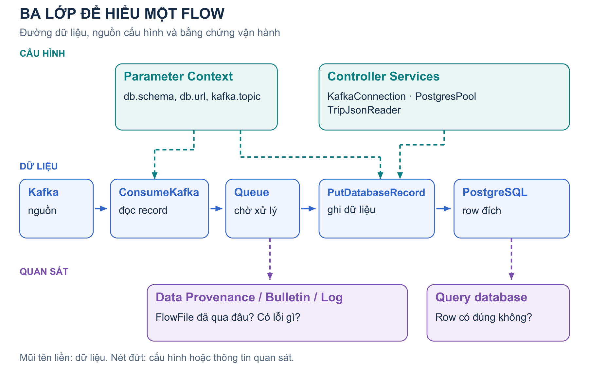
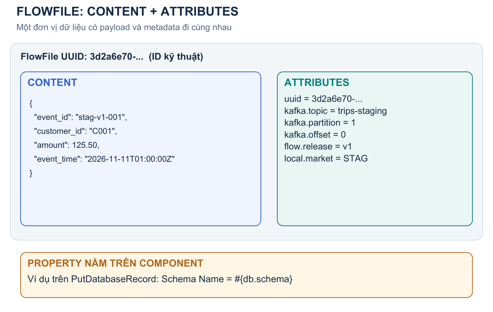
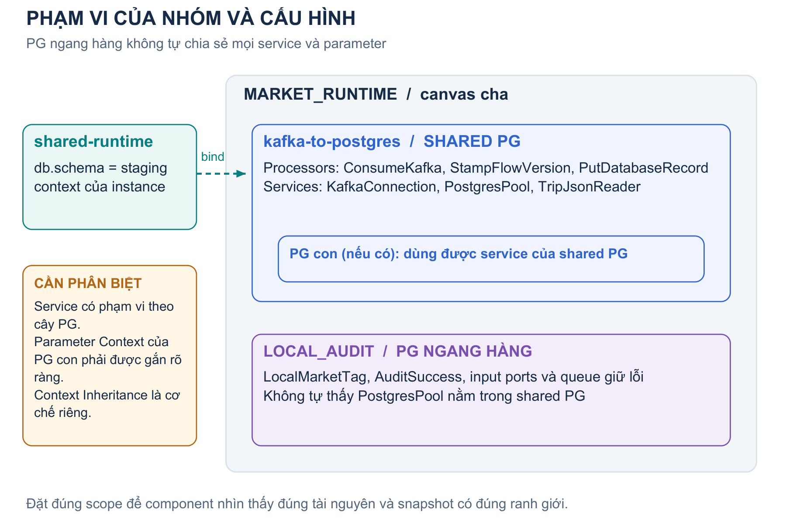
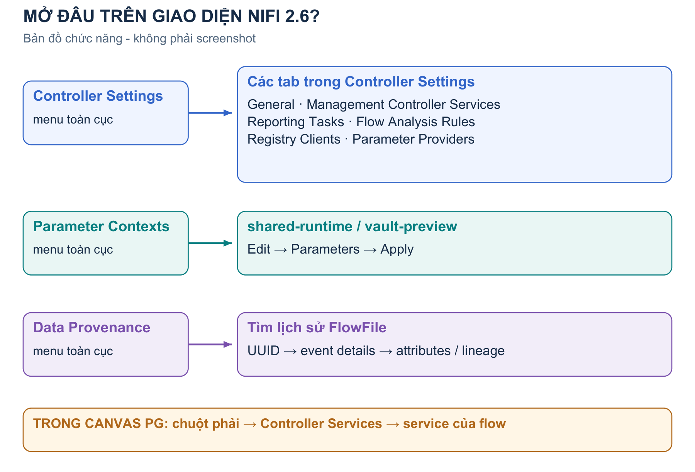
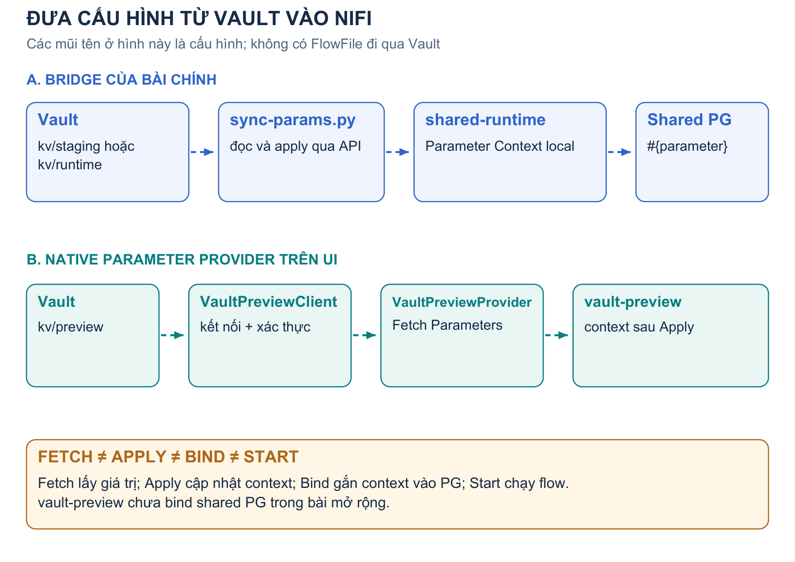
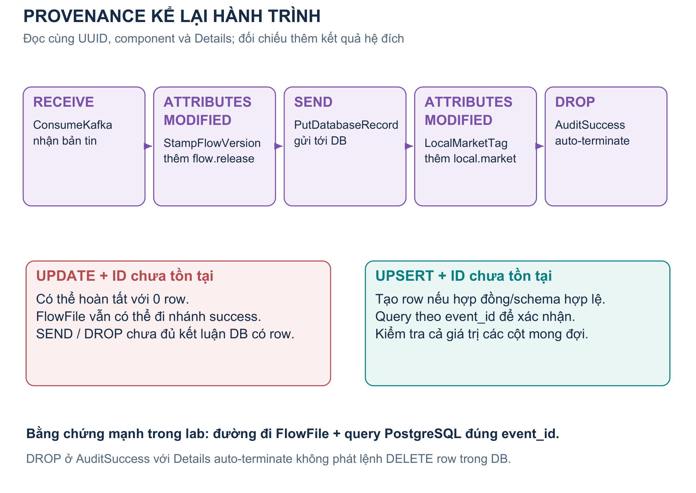
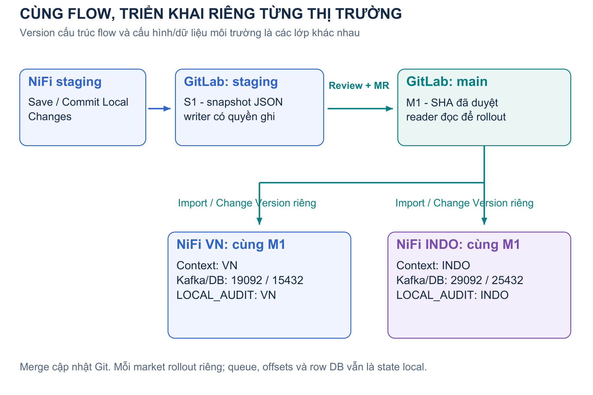

# Hiểu NiFi từ những thành phần đầu tiên

**Tài liệu nhập môn tiếng Việt - áp dụng cho NiFi 2.6.0 trong lab VN / INDO.**

Cập nhật ngày 11/11/2026. Đọc bản [PDF có sơ đồ](../output/pdf/NIFI_CONCEPTS_VI.pdf) hoặc đọc ngay trong Markdown Preview của IDE. Các hình dưới là sơ đồ khái niệm được vẽ riêng cho lab, không phải screenshot giao diện.

Bạn không cần nhớ hết menu ngay lần đầu. Sau khi đọc, mục tiêu là trả lời được: bản tin đang ở đâu, processor lấy cấu hình từ đâu, và cần mở màn hình nào để tìm lỗi. Khi cần thao tác từng nút, dùng [GUIDE_VI.md](GUIDE_VI.md); khi cần URL/password, dùng file local `LAB_ACCESS.local.md`.

## 1. NiFi làm công việc gì?

NiFi là công cụ thiết kế và vận hành luồng dữ liệu. Trong lab, nó nhận dữ liệu từ Kafka, gắn thêm thông tin theo dõi, đọc JSON, ghi PostgreSQL và để lại lịch sử xử lý. Bạn nối các bước bằng giao diện thay vì viết toàn bộ vòng lặp đọc Kafka, quản lý queue, kết nối database và theo dõi bản tin bằng code riêng.

Hãy hình dung một trung tâm xử lý bưu kiện. Bưu kiện mang dữ liệu; từng quầy thực hiện một công việc; khu chờ giữ hàng; nhãn trên kiện giúp phân loại; nhật ký cho biết kiện đã qua quầy nào. Đây chỉ là phép so sánh để nhớ vai trò. Phần dưới sẽ dùng tên thật của NiFi.

| Hình dung | Thành phần NiFi | Ví dụ trong lab |
|---|---|---|
| Bưu kiện | FlowFile | JSON của `stag-v1-001` cùng các attributes |
| Quầy làm việc | Processor | ConsumeKafka, PutDatabaseRecord |
| Đường chuyển và khu chờ | Connection + Queue | STAMP_TO_DB |
| Cửa ra theo kết quả | Relationship | success, retry, failure |
| Bộ dụng cụ dùng chung | Controller Service | PostgresPool, TripJsonReader |
| Bộ cấu hình của nơi nhận | Parameter Context | shared-runtime của VN |
| Nhật ký hành trình | Data Provenance | RECEIVE, SEND, DROP |

Kafka vẫn là nguồn dữ liệu bên ngoài. PostgreSQL vẫn là nơi lưu row đích. Vault vẫn là nơi quản lý secret. GitLab vẫn là nơi lưu snapshot đã version. NiFi điều phối việc sử dụng những hệ thống đó; tạo một Controller Service trong NiFi không tự tạo Kafka broker hay database mới.

**Điều cần nhớ:** một flow chạy được là sự phối hợp giữa đường dữ liệu, cấu hình hợp lệ và tài nguyên bên ngoài đang hoạt động.

## 2. Nhìn toàn bộ NiFi theo ba lớp



*Hình 1. Mũi tên liền biểu diễn dữ liệu. Mũi tên nét đứt biểu diễn tham chiếu cấu hình hoặc việc ghi nhận lịch sử.*

**Lớp dữ liệu** là phần bạn nhìn thấy trên canvas: processor, connection, queue, input/output port và Process Group. Đây là nơi FlowFile được nhận, chờ, xử lý và chuyển tiếp.

**Lớp cấu hình** cung cấp giá trị và tài nguyên cho lớp dữ liệu: Parameter Context chứa tên/giá trị; Controller Service cung cấp chức năng dùng chung; Parameter Provider lấy giá trị từ hệ ngoài; Registry Client kết nối kho version. Các đối tượng này không phải là những hộp xử lý mà bạn nối tiếp vào đường FlowFile.

**Lớp quan sát** giúp trả lời chuyện đã xảy ra: trạng thái component, queue, bulletin, log và Data Provenance. Những màn hình này nhìn vào hoạt động của flow từ các góc khác nhau.

Ví dụ PutDatabaseRecord cần đủ ba lớp:

1. Nó phải nhận FlowFile qua connection STAMP_TO_DB.
2. Nó cần TripJsonReader, PostgresPool và parameter đúng môi trường.
3. Khi kiểm tra, bạn xem queue/bulletin/provenance rồi query database để đối chiếu kết quả.

Chỉ bấm Start ở lớp dữ liệu không sửa được một password sai ở lớp cấu hình. Chỉ nhìn thấy provenance cũng chưa đủ kết luận hệ đích có dữ liệu đúng nghiệp vụ.

## 3. FlowFile: thứ thực sự đi qua flow



*Hình 2. Content là payload; Attributes là metadata gắn với FlowFile. Property là cấu hình của processor/service, không nằm cùng chỗ với hai phần đó.*

### 3.1 Content là nội dung dữ liệu

Content có thể là JSON, CSV, ảnh, PDF, dữ liệu nhị phân hoặc một tập record. Trong lab, một content mẫu là:

```json
{
  "event_id": "stag-v1-001",
  "customer_id": "C001",
  "amount": 125.50,
  "event_time": "2026-11-11T01:00:00Z"
}
```

`event_id` ở đây là trường trong JSON nghiệp vụ. Nó chưa tự trở thành một attribute NiFi có cùng tên. Muốn dùng trường JSON để route theo attribute, thường cần processor trích xuất trước, chẳng hạn EvaluateJsonPath.

### 3.2 Attributes là metadata dạng key/value

Attributes nằm ngoài content. NiFi có các attribute chuẩn như `uuid`, `filename`, `path`. ConsumeKafka có thể thêm metadata như topic, partition và offset. UpdateAttribute trong lab thêm `flow.release=v1`; LocalMarketTag thêm `local.market=STAG`.

| Attribute minh họa | Ý nghĩa |
|---|---|
| `uuid=3d2a6e70-...` | ID kỹ thuật của FlowFile trong NiFi |
| `kafka.topic=trips-staging` | Topic nguồn |
| `kafka.partition=1` | Partition đã đọc |
| `kafka.offset=0` | Vị trí bản tin trong partition đó |
| `flow.release=v1` | Marker do StampFlowVersion thêm |
| `local.market=STAG` | Marker do LocalMarketTag thêm |

Các giá trị attributes được biểu diễn dưới dạng chuỗi. Thêm `local.market=STAG` bằng UpdateAttribute không tự chèn field `local.market` vào JSON content và cũng không tự tạo cột trong PostgreSQL.

### 3.3 Một FlowFile có bằng một row không?

Trong cấu hình lab này, ConsumeKafka dùng `FLOW_FILE`, nên mỗi Kafka record trở thành một FlowFile. JSON mẫu chứa một record; PutDatabaseRecord dùng record đó để thực hiện UPSERT.

Đây là lựa chọn của lab. Ở flow khác, một FlowFile có thể chứa cả file CSV với hàng nghìn record. Vì vậy `1 FlowFile`, `1 Kafka record`, `1 JSON record` và `1 database row` là các đơn vị cần phân biệt. Con số `117 bytes` trên provenance là kích thước content, không phải số row đã ghi.

`uuid` cũng khác `event_id`: gửi lại cùng `event_id` qua Kafka thường tạo FlowFile mới với UUID mới; UPSERT theo `event_id` vẫn có thể giữ một row nghiệp vụ.

## 4. Processor và Property: làm gì, cấu hình ra sao?

Processor là một bước xử lý hoặc giao tiếp cụ thể. Trong lab:

- **ConsumeKafka** đọc bản tin từ Kafka và tạo FlowFile.
- **StampFlowVersion** là một instance của type UpdateAttribute, thêm marker vào attributes.
- **PutDatabaseRecord** đọc record từ content, tạo/thực thi lệnh SQL qua một connection pool.
- **AuditSuccess** là một instance của type LogAttribute, ghi thông tin FlowFile ra log.

Tên type và tên instance không giống nhau. `LogAttribute` là loại component; `AuditSuccess` là tên bạn đặt cho một đối tượng cụ thể của loại đó. Có thể tạo nhiều LogAttribute với tên và cấu hình khác nhau. UUID component giúp NiFi phân biệt chúng ngay cả khi tên trùng.

### 4.1 Property là một ô cấu hình của component

Trong PutDatabaseRecord, các property quan trọng gồm Record Reader, Database Connection Pooling Service, Statement Type, Schema Name, Table Name và Update Keys.

| Property | Giá trị mẫu | Cách hiểu |
|---|---|---|
| Record Reader | chọn TripJsonReader | Tham chiếu một Controller Service |
| Database Connection Pooling Service | chọn PostgresPool | Tham chiếu một Controller Service |
| Statement Type | `UPSERT` | Một lựa chọn cấu hình |
| Schema Name | `#{db.schema}` | Tham chiếu một Parameter |
| Table Name | `#{db.table}` | Tham chiếu một Parameter |
| Update Keys | `event_id` | Tên cột nghiệp vụ dùng làm khóa |

Một property có thể nhận literal, parameter hoặc Expression Language nếu property đó hỗ trợ. Dropdown chọn Controller Service là tham chiếu đối tượng, không phải chỗ gõ `#{PostgresPool}`.

### 4.2 Những tab thường thấy

**Settings** đặt tên và cấu hình chung. **Properties** khai báo công việc cần làm. **Scheduling** quyết định cách processor được lên lịch, gồm Concurrent Tasks. **Relationships** cho biết các kết quả cần nối đi đâu hoặc được terminate. **Comments** giúp ghi chú mục đích.

Trong lab, Concurrent Tasks = 1 giúp luồng dễ quan sát. Một task có thể xử lý nhiều record tùy processor; số task không đồng nghĩa số row DB.

### 4.3 Apply, valid và running là những việc riêng

Apply lưu cấu hình runtime. Sau đó NiFi kiểm tra validation: service đã chọn chưa, parameter có tồn tại không, relationship đã được xử lý chưa. Valid nghĩa cấu hình thỏa các điều kiện kiểm tra; nó chưa chứng minh DB đích đang có đúng schema hoặc mọi thao tác mạng sẽ thành công.

Start cho phép processor được lên lịch chạy. Một processor Running nhưng input queue rỗng có thể không xử lý FlowFile nào. Với processor nguồn như ConsumeKafka, nó có thể đang chờ bản tin mới.

## 5. Relationship, Connection và Queue

Relationship là tên một kết quả do processor cung cấp. Connection là đường nối từ nguồn đến đích, có thể nhận một hoặc nhiều relationship. Queue là nơi các FlowFile chờ trên connection đó.

Trong PutDatabaseRecord, `success`, `retry`, `failure` là relationship. `DB_ERROR` là connection bạn đặt tên, nhận cả retry và failure rồi chuyển tới error_out. Ba tên này không thay thế cho nhau.

### 5.1 Khi nào cần terminate?

Mỗi relationship phải được xử lý bằng connection hoặc auto-terminate theo cấu hình hợp lệ. Với AuditSuccess, auto-terminate success là điểm kết thúc nhánh thành công. Với lỗi DB, lab giữ FlowFile để xem và xử lý; không auto-terminate failure/retry chỉ để xóa cảnh báo invalid.

Nếu lỡ nối thêm nhiều đường từ cùng relationship, flow có thể chuyển dữ liệu tới nhiều đích. Luôn kiểm tra cả Source, Destination và selected relationships của connection.

### 5.2 Back pressure bảo vệ downstream

Giả sử Kafka đọc nhanh hơn database ghi. Queue STAMP_TO_DB sẽ tăng. Khi đạt ngưỡng back pressure cấu hình, NiFi hạn chế lên lịch upstream để tránh dồn thêm dữ liệu không kiểm soát.

Lab thường để ngưỡng 10.000 FlowFiles hoặc 1 GB. Đây là ngưỡng điều tiết, không phải chứng minh rằng queue sẽ tuyệt đối không vượt số đó trong mọi tình huống xử lý theo batch.

Khi queue đầy, câu hỏi đầu tiên là vì sao downstream không thoát được dữ liệu: processor stopped/invalid, DB chậm, pool lỗi hay nhánh đích chưa start. Tăng ngưỡng queue không sửa những nguyên nhân đó.

### 5.3 Expiration và lỗi đang được giữ

FlowFile Expiration = `0 sec` nghĩa không tự hết hạn do thiết lập expiration của connection. Nó không biến queue thành một hệ backup độc lập; dữ liệu vẫn phụ thuộc repository, disk và cách vận hành NiFi.

Trong LOCAL_AUDIT, queue FAILED_RECORDS đi vào Funnel không có output để giữ lỗi có chủ đích. Funnel gộp/định tuyến đường nối; nó không đọc JSON hoặc ghi DB. Queue còn lỗi cần được điều tra, không được Empty Queue chỉ để làm canvas trông sạch.

## 6. Process Group và phạm vi cấu hình



*Hình 3. Shared PG và LOCAL_AUDIT là hai nhóm ngang hàng. Controller Services trong shared PG không tự trở thành service dùng chung cho nhóm bên cạnh.*

Process Group, viết tắt PG, gom các component có cùng trách nhiệm. Nó giúp canvas dễ đọc, quản lý phạm vi service, gắn Parameter Context và xác định ranh giới version control.

Cây trong lab:

```text
Root
└── MARKET_RUNTIME
    ├── kafka-to-postgres
    │   ├── ConsumeKafka / StampFlowVersion / PutDatabaseRecord
    │   ├── KafkaConnection / PostgresPool / TripJsonReader
    │   └── success_out / error_out
    └── LOCAL_AUDIT
        ├── in_success / in_error
        ├── LocalMarketTag / AuditSuccess
        └── FAILED_RECORDS / Funnel
```

### 6.1 Vì sao cần Input Port và Output Port?

Port trên PG là cửa giao tiếp của flow qua ranh giới nhóm. Shared PG phát qua success_out; connection trên MARKET_RUNTIME nối tới in_success của LOCAL_AUDIT.

Input Port/Output Port trên canvas không đồng nghĩa cổng TCP. `in_success` là component của flow; `15432` là port mạng PostgreSQL. Site-to-Site có thể dùng port của NiFi theo cơ chế riêng, nhưng hai local PG trong lab không cần thêm một dịch vụ TCP cho mỗi input port.

### 6.2 Controller Service có phạm vi theo cây PG

Service khai báo trong một PG có thể được component trong PG và các PG con sử dụng, theo quyền và kiểu service được hỗ trợ. Nó không tự hiển thị cho PG cha hoặc PG ngang hàng. Đó là lý do PostgresPool trong shared PG không phải một service của LOCAL_AUDIT.

Đặt service ở PG cha có thể mở rộng phạm vi tái sử dụng, nhưng trong lab ba service nằm trong shared PG để snapshot mang theo cấu trúc và các tham chiếu cần thiết. Endpoint/password vẫn lấy từ parameter local.

### 6.3 Parameter Context không tự kế thừa theo cây PG

Một PG gắn một Parameter Context; một context có thể được nhiều PG sử dụng. Nếu PG con không được gắn context, nó không tự nhận context của PG cha. Tùy chọn apply recursively trên UI là thao tác gắn cho nhiều nhóm, không phải một quy tắc tự động kế thừa mỗi khi tạo PG con.

Parameter Context có cơ chế **Inheritance giữa các context** riêng. Đây là quan hệ giữa những bộ parameter, khác với việc PG nằm bên trong PG khác. Với bài cơ bản, gắn trực tiếp shared-runtime vào kafka-to-postgres là đủ.

## 7. Controller Settings và Controller Services khác nhau thế nào?



*Hình 4. Đây là bản đồ vị trí chức năng theo source giao diện NiFi 2.6, không phải ảnh chụp màn hình.*

**Controller Settings là một màn hình quản trị của instance.** Bạn mở nó từ menu toàn cục để tìm các cấu hình ở cấp instance. Nó không phải một processor và không phải nơi FlowFile xếp hàng.

Trong NiFi 2.6 của lab, màn hình có các tab:

| Tab | Dùng khi nào? |
|---|---|
| General | Xem/cấu hình giới hạn thread chung của instance |
| Management Controller Services | Tạo service phục vụ các component quản lý |
| Reporting Tasks | Cấu hình tác vụ báo cáo/giám sát tùy loại |
| Flow Analysis Rules | Cấu hình quy tắc phân tích flow |
| Registry Clients | Kết nối tới kho lưu version flow |
| Parameter Providers | Cấu hình đối tượng lấy parameter từ hệ ngoài |

**Controller Service là một đối tượng cung cấp chức năng dùng lại được.** Nó có type, tên instance, properties, UUID và vòng đời Enabled/Disabled.

### 7.1 Ba Controller Service của đường dữ liệu

KafkaConnection có type Kafka3ConnectionService, giữ cấu hình kết nối Kafka. PostgresPool có type DBCPConnectionPool, cung cấp các JDBC connection được quản lý/tái sử dụng. TripJsonReader có type JsonTreeReader, giải mã JSON theo schema để processor làm việc với records.

PutDatabaseRecord sử dụng cả reader lẫn pool. Bạn không nối mũi tên FlowFile từ PutDatabaseRecord sang PostgresPool. Trong Properties, bạn chọn service phù hợp ở dropdown; processor gọi chức năng của service khi xử lý dữ liệu.

Enabled có nghĩa service đã được enable theo vòng đời của NiFi. Một số service có thể chỉ mở kết nối thật khi được sử dụng; vì vậy Enabled chưa thay thế test Kafka/DB thực tế.

### 7.2 Management Controller Services là phạm vi khác

VaultPreviewClient cũng là Controller Service, nhưng nó phục vụ Parameter Provider ở cấp quản lý. Trong lab, nó nằm ở Controller Settings → Management Controller Services. PostgresPool của shared flow nằm ở danh sách Controller Services của PG.

Vị trí tạo service ảnh hưởng component nào có thể tham chiếu nó. Đừng tạo DBCPConnectionPool trong Management Controller Services rồi mong dropdown của PutDatabaseRecord trong shared PG tự thấy nó.

### 7.3 Tìm lại đúng dòng đối tượng

Ở tab Parameter Providers, dòng có Name = VaultPreviewProvider là một đối tượng provider. Dấu ba chấm của **hàng đó** chứa Fetch Parameters. Ở tab Management Controller Services, dòng VaultPreviewClient là service để provider kết nối Vault.

Type, tên instance và vị trí trong UI cần được đọc cùng nhau. Hai đối tượng đều có từ Vault nhưng đảm nhiệm hai công việc khác nhau.

## 8. Parameter và Parameter Context

Parameter là một giá trị cấu hình được đặt tên. Parameter Context là một bộ chứa các parameter có liên quan. Trong lab, context shared-runtime có các key như kafka.topic, db.url, db.schema và db.password.

Một context được định nghĩa trong phạm vi instance NiFi và sau đó được gắn vào PG cần dùng. Ba instance staging/VN/INDO đều có context tên shared-runtime nhưng đó là ba đối tượng độc lập; tên giống nhau không tạo kết nối đồng bộ giữa chúng.

### 8.1 Từ tên đến giá trị thực tế

PutDatabaseRecord có property Schema Name = `#{db.schema}`. PG của nó gắn shared-runtime. NiFi dùng parameter db.schema của context đó để xác định schema đích.

Trên staging, db.schema = staging. Trên VN và INDO, db.schema = market. Cấu trúc property giữ nguyên khi chuyển flow; giá trị môi trường được cung cấp ở instance nhận.

| Parameter | Staging | VN | INDO |
|---|---|---|---|
| kafka.topic | trips-staging | trips | trips |
| kafka.group | nifi-staging | nifi-vn | nifi-indo |
| db.schema | staging | market | market |
| db.url dùng port | 15432 | 15432 | 25432 |

### 8.2 Sensitive là một phần của hợp đồng cấu hình

`db.password` phải là Sensitive Parameter vì nó được dùng trong Password của PostgresPool, một sensitive property. Những parameter dùng ở non-sensitive property như db.schema phải được tạo non-sensitive.

Sensitive giúp NiFi xử lý/che giá trị theo cơ chế dành cho dữ liệu nhạy cảm; nó không phải phép biến đổi mọi giá trị hard-code ở nơi khác thành an toàn. Khi đã tạo parameter, sensitivity không phải cờ nên bật/tắt tùy tiện trong một flow đang dùng nó.

Khi nhập tay trên UI: Name là `db.schema`, Value là `staging`. Cú pháp `#{db.schema}` nằm ở property của component, không phải value để parameter tự tham chiếu chính nó.

### 8.3 Phân biệt ba chỗ dễ nhầm

| Khái niệm | Nằm ở đâu? | Ví dụ |
|---|---|---|
| Parameter | Trong Parameter Context | db.schema = staging |
| Property | Trên Processor/Controller Service | Schema Name = #{db.schema} |
| Attribute | Trên một FlowFile | local.market = STAG |

`#{db.schema}` là cú pháp tham chiếu parameter. `${filename}` là ví dụ Expression Language, có thể đọc attribute nếu property hỗ trợ scope đó. Hai cú pháp giải quyết hai nhu cầu khác nhau; không đổi dấu # thành $ để sửa lỗi parameter thiếu.

Không phải mọi property đều hỗ trợ parameter hoặc mọi scope Expression Language. Xem biểu tượng trợ giúp và description của chính property đó.

## 9. Vault, Parameter Provider và bridge phối hợp ra sao?



*Hình 5. Bài chính dùng shared-runtime qua bridge; bài native dùng secret preview và vault-preview riêng. Mỗi context có một cách quản lý rõ ràng.*

Vault là hệ thống bên ngoài NiFi lưu các secret/cấu hình. NiFi không tự biết một key có tên db.password đang nằm ở Vault nào. Nó cần một cơ chế lấy dữ liệu, xác thực và đưa giá trị vào context đúng nơi.

### 9.1 Cách A: nhập tay hoặc chạy sync-params.py

Nhập tay nghĩa bạn mở Vault, đọc giá trị rồi gõ vào Parameter Context qua UI. Script sync-params.py tự động thực hiện cầu nối đó bằng API: đọc secret, đăng nhập NiFi, tạo/update shared-runtime, đặt sensitivity và chờ apply hoàn tất.

Script không tạo kết nối polling liên tục. Nó cũng không gửi FlowFile qua Vault, không đổi password PostgreSQL thật và không commit Git. Vault đổi sau lần sync thì context chưa tự thay đổi cho đến lần apply tiếp theo.

### 9.2 Cách B: native Parameter Provider trên UI

Với cách native, VaultPreviewClient chứa cấu hình để nói chuyện với Vault: URI, phương thức xác thực và token chỉ đọc. VaultPreviewProvider dùng client đó để tìm đúng secret và lấy các nhóm parameter. Người vận hành map nhóm preview sang context vault-preview và Apply.

Quan hệ đúng là:

```text
Vault secret
  -> VaultPreviewClient        kết nối và xác thực
  -> VaultPreviewProvider      fetch nhóm parameter
  -> vault-preview             giữ parameter đã apply
  -> Process Group             chỉ sử dụng sau khi được bind context
```

Trong bài mở rộng, vault-preview chưa gắn vào shared PG. Fetch thành công không có nghĩa PutDatabaseRecord đã đổi cấu hình sang context mới.

### 9.3 Bốn động từ phải tách bạch

- **Fetch**: lấy ứng viên giá trị từ hệ nguồn và hiển thị các parameter group.
- **Apply**: đưa lựa chọn vào context của NiFi; có thể kéo theo validate/cập nhật component đang tham chiếu.
- **Bind**: gắn context vào Process Group để các tham chiếu parameter được giải quyết.
- **Start**: chạy component/flow sau khi cấu hình và tài nguyên đã sẵn sàng.

Bấm Fetch mà chưa Apply thì chưa hoàn tất cập nhật context. Apply vào vault-preview mà PG vẫn gắn shared-runtime thì flow vẫn dùng shared-runtime.

Context do provider quản lý có metadata association với provider. Bài chính giữ context bridge riêng để flow promotion dễ kiểm soát; không để script và native provider cùng tranh quản lý một context.

## 10. Data Provenance: điều tra đường đi của một FlowFile



*Hình 6. Cùng đi tới AuditSuccess không có nghĩa mọi cấu hình SQL đều tạo row. Cần nối bằng chứng provenance với query hệ đích.*

Data Provenance ghi nhận các sự kiện xử lý của FlowFile: được nhận ở đâu, component nào đã sửa attributes/content, gửi ra đâu, hoặc kết thúc lúc nào. Bạn có thể mở từ menu Data Provenance để tìm trên instance, hoặc View data provenance của một processor để thu hẹp phạm vi.

### 10.1 Đọc các event thường gặp

| Event | Cách hiểu |
|---|---|
| RECEIVE | Dữ liệu được nhận vào flow, ví dụ ConsumeKafka |
| ATTRIBUTES_MODIFIED | Attributes thay đổi, ví dụ thêm flow.release |
| CONTENT_MODIFIED | Content được thay đổi bởi một bước xử lý |
| SEND | NiFi ghi nhận hành động gửi ra hệ khác |
| FORK / JOIN | FlowFile được tách/ghép theo hoạt động xử lý |
| DROP | FlowFile rời/kết thúc ở flow theo sự kiện được ghi nhận |

DROP cần đọc cùng Details. Với AuditSuccess trong lab, Details = Auto-Terminated by success Relationship là kết thúc đã cấu hình. Nếu thao tác Empty Queue tạo ra sự kiện loại bỏ dữ liệu thì nguyên nhân và ý nghĩa lại khác.

Provenance không phải chỗ chứa một bản backup vô hạn của mọi payload. Việc xem content hoặc Replay phụ thuộc quyền truy cập, repository, retention và content còn khả dụng. Replay cũng có thể tạo side effect lần nữa ở hệ đích.

### 10.2 Cách điều tra một bản tin

1. Lấy FlowFile UUID từ event hoặc queue. Đừng dùng event_id nghiệp vụ thay cho UUID mà chưa trích xuất/đánh chỉ mục phù hợp.
2. Tìm UUID trong Data Provenance để xem các event liên quan.
3. Mở event details, đọc Component, Event Type, Details và thời gian/timezone hiển thị.
4. Ở Attributes, tìm topic/partition/offset, flow.release, local.market và thuộc tính lỗi nếu có.
5. Xem lineage khi cần hiểu nhiều nhánh hoặc quan hệ tách/ghép.
6. Query hệ đích bằng event_id để đối chiếu kết quả nghiệp vụ.

### 10.3 Tình huống đã gặp trong lab: SEND rồi DROP nhưng DB rỗng

PutDatabaseRecord từng được đặt Statement Type = UPDATE. Với event_id chưa tồn tại, câu UPDATE hoàn tất với 0 row; PostgreSQL không coi đó là lỗi. FlowFile vẫn có thể đi nhánh success, qua AuditSuccess và kết thúc bằng DROP.

Sau khi đổi về UPSERT và gửi lại event, bảng staging.trip_events có row mong đợi. Chỉ đổi processor không tự đưa lại bản tin cũ đã commit offset về đầu Kafka.

Kết luận đúng từ event SEND là đã có một hành động gửi theo cách component ghi nhận. Kết luận đúng từ DROP ở AuditSuccess là FlowFile kết thúc nhánh đó. Muốn nói row đã tồn tại đúng giá trị, cần query DB hoặc cơ chế xác nhận tương ứng của hệ đích.

## 11. Trạng thái, log và màn hình cần mở khi có lỗi

### 11.1 Valid, Enabled và Running

**Invalid** báo có điều kiện cấu hình chưa thỏa, như parameter thiếu, service chưa hợp lệ hoặc relationship chưa được xử lý. **Stopped** là processor không được chạy. **Running** là được lên lịch và có thể đang xử lý/chờ việc. **Disabled** là component bị vô hiệu hóa theo vòng đời cấu hình.

Với Controller Service, Enabled/Disabled là vòng đời riêng. Enable service không tự Start tất cả processor dùng nó. Start processor cũng không bảo đảm một kết nối ngoại vi sẽ luôn thành công.

Bulletin là thông báo gắn với component, thường giúp thấy lỗi gần thời điểm hiện tại. Log nifi-app.log/container log chứa thông tin vận hành chi tiết hơn. Provenance trả lời đường đi của FlowFile; chúng bổ sung cho nhau.

### 11.2 Chọn đúng công cụ theo câu hỏi

| Câu hỏi | Mở ở đâu trước? | Bằng chứng cần lấy |
|---|---|---|
| FlowFile đang bị kẹt ở đâu? | Connection → List queue | UUID, content/attributes nếu có quyền |
| Vì sao processor invalid? | Configure / validation message | Tên property hoặc relationship thiếu |
| Vì sao DB connection lỗi? | Bulletin, log, cấu hình PostgresPool | Lỗi JDBC và endpoint thực tế |
| Một FlowFile đã đi qua đâu? | Data Provenance | Chuỗi event cùng UUID |
| Giá trị db.schema đang là gì? | PG binding → Parameter Context | Context ID/name và value |
| Row đã ghi đúng chưa? | PostgreSQL query | event_id, số row, giá trị cột |
| Đang dùng version nào? | Thông tin version của shared PG | Branch, flow và SHA |

### 11.3 Thứ tự chạy và dừng trong lab

Khi start, chuẩn bị services và downstream trước: Controller Services, nhánh audit/ports, PutDatabaseRecord, StampFlowVersion, cuối cùng ConsumeKafka. Cách này giảm tình trạng nguồn đẩy dữ liệu khi đường nhận chưa sẵn sàng.

Khi sửa flow/rollout, dừng nguồn ConsumeKafka trước, để downstream drain queue, rồi stop shared PG và đợi active threads = 0. Nếu queue lỗi không drain vì đang giữ để điều tra, phải xử lý/ghi nhận nguyên nhân; không xóa dữ liệu để giả vờ rollout sạch.

## 12. Registry Client, GitLab và version flow



*Hình 7. Registry Client trao đổi snapshot với GitLab; việc import/change version của từng NiFi là một thao tác rollout riêng.*

Registry Client là cấu hình kết nối tới kho version flow. Trong lab, GitLabFlowRegistryClient đọc/ghi snapshot JSON trong project GitLab. Nó không phải Controller Service kết nối PostgreSQL và không nhận FlowFile trên canvas.

### 12.1 Thứ gì được lưu thành version?

Shared PG kafka-to-postgres được version control. Processor, connection, output port và Controller Services bên trong phạm vi đó là cấu trúc flow cần quản lý. Parameter names/metadata cũng có thể đi theo snapshot.

Registry Client được đặt Parameter Context Values = Remove để loại giá trị parameter khỏi snapshot. Điều đó không tự xóa literal password/endpoint đã hard-code ở một property khác, cũng không tự xóa mọi metadata association của provider. Cần review file snapshot thực tế.

LOCAL_AUDIT là PG ngang hàng bên ngoài shared PG. Connection nối hai PG ở canvas cha và cấu hình local.market của local PG được vận hành riêng từng nơi.

### 12.2 Vì sao cần chốt SHA M1?

Main là branch có thể tiếp tục thay đổi; SHA chỉ đúng một commit cụ thể. M1 là tên gọi trong guide cho SHA snapshot đã duyệt trên main, không phải một loại đối tượng NiFi mới.

VN và INDO cùng import M1 để dùng cùng cấu trúc flow, nhưng context local của chúng trỏ tới Kafka/DB khác nhau. Khi có M2, có thể rollout VN trước, còn INDO giữ M1 để kiểm chứng phát hành từng thị trường.

Commit main mới không tự đổi flow đang chạy. Phải thực hiện Import lần đầu hoặc Change Version cho PG đã được version control. Apply property trên canvas cũng chưa tạo commit; Commit Local Changes mới lưu bản sửa vào kho version.

### 12.3 Rollback flow không phải quay ngược toàn bộ hệ thống

Change Version về M1 thay cấu trúc/configuration được quản lý bởi flow version theo nội dung và tùy chọn cập nhật. Nó không tự xóa row PostgreSQL đã ghi, đưa Kafka offsets về trước, khôi phục queue theo thời điểm cũ hoặc hoàn tác side effect bên ngoài.

Giữ lại giá trị parameter local và kiểm tra chúng sau import/update là một phần của rollout. Cùng SHA không có nghĩa cùng dữ liệu, cùng offset hoặc cùng password giữa các thị trường.

## 13. Dữ liệu và trạng thái NiFi được giữ ở đâu?

Ở mức khái niệm, cần phân biệt bốn nhóm:

| Nơi lưu | Vai trò | Không nên nhầm với |
|---|---|---|
| Content Repository | Lưu các content claim/bytes của FlowFile | PostgreSQL đích chứa row nghiệp vụ |
| FlowFile Repository | Theo dõi FlowFile metadata, vị trí/claim để khôi phục trạng thái flow | Git snapshot định nghĩa flow |
| Provenance Repository | Lưu sự kiện/lịch sử xử lý để truy vấn | Kho payload vô hạn |
| Component State / cấu hình | State theo component, flow definition, contexts, service configuration | Một bản backup đầy đủ mọi hệ ngoài |

Đây là các lớp logic, không phải mỗi khái niệm luôn chỉ có đúng một file trên disk. Lab mount các repository/conf/state bằng named volumes để tồn tại qua recreate container theo thiết kế.

Restart NiFi không có nghĩa flow, context và row DB bị xóa. Tuy nhiên việc phục hồi, content retention và availability vẫn phụ thuộc volume/backup/cấu hình thực tế. Xóa volumes là hành động khác với restart.

Riêng Vault persistent của lab cần unseal sau restart; NiFi restart không tự thay thao tác unseal đó. GitLab giữ flow snapshot, không giữ toàn bộ queue/offset/state/secret của môi trường. Vì vậy hướng dẫn backup offline trong GUIDE_VI.md bao gồm nhiều volume, không chỉ file JSON trên Git.

## 14. Theo dõi trọn một bản tin của lab

Giả sử context staging đúng, services Enabled, flow Running và Statement Type = UPSERT. Khi gửi event stag-v1-001, hành trình kỳ vọng là:

1. Producer gửi JSON lên topic trips-staging của Kafka VN.
2. ConsumeKafka dùng KafkaConnection và parameter kafka.topic/kafka.group để đọc record, tạo FlowFile.
3. FlowFile đi vào queue KAFKA_TO_STAMP.
4. StampFlowVersion thêm attribute flow.release=v1; JSON content vẫn giữ dữ liệu nghiệp vụ.
5. Queue STAMP_TO_DB đưa FlowFile tới PutDatabaseRecord.
6. TripJsonReader cung cấp cách đọc JSON thành record theo schema. PostgresPool cung cấp JDBC connection theo db.url/db.username/db.password.
7. PutDatabaseRecord thực hiện UPSERT vào staging.trip_events, dùng event_id làm khóa.
8. Relationship success đưa FlowFile ra success_out rồi qua connection trên MARKET_RUNTIME tới in_success.
9. LocalMarketTag thêm local.market=STAG; AuditSuccess log attributes, sau đó success được auto-terminate.
10. Dùng query.sh stag để xác nhận row và Data Provenance để kiểm tra đường đi/marker của FlowFile.

Trong quy trình này, Parameter Context cung cấp giá trị, Controller Services cung cấp chức năng, Processor thực hiện công việc, Connection giữ/chuyển dữ liệu, Provenance ghi lịch sử. Controller Settings là màn hình quản trị các đối tượng quản lý, không phải một bước thứ 11 mà FlowFile đi qua.

Một bản tin lỗi có thể chuyển qua error_out → in_error → FAILED_RECORDS. Cũng có lỗi khiến processor giữ FlowFile ở input và retry tùy cơ chế cụ thể. Hãy đọc queue, bulletin và provenance thực tế thay vì mặc định mọi lỗi đều xuất hiện ở cùng một chỗ.

## 15. Những câu hỏi người mới thường gặp

### Tôi tạo một service xong, sao canvas không có hộp mới?

Service là đối tượng cấu hình/chức năng, được quản lý trong danh sách của scope phù hợp. Nó không phải processor trên đường FlowFile. Mở Properties của processor để chọn service.

### Tôi đổi Vault rồi, sao NiFi vẫn dùng giá trị cũ?

Kiểm tra đang dùng bridge, nhập tay hay native provider. Bridge cần chạy lại; nhập tay cần copy lại; native cần Fetch rồi Apply. Sau đó đối chiếu context mà PG thực sự bind, không chỉ context vừa sửa.

### Tôi Fetch thành công nhưng không thấy FlowFile chạy?

Fetch làm việc với cấu hình parameter. Nó không đọc Kafka và không Start processor. Kiểm tra Bind, Enable, Start và dữ liệu nguồn riêng.

### Tôi đặt context ở MARKET_RUNTIME, sao shared PG vẫn thiếu parameter?

Parameter Context không tự kế thừa theo cây PG. Bind đúng context vào shared PG hoặc dùng thao tác apply recursively có kiểm soát. Đừng nhầm với phạm vi kế thừa Controller Service.

### Tôi thêm local.market, sao DB không có cột đó?

UpdateAttribute thêm metadata của FlowFile. Schema/bảng DB và record content là các lớp khác. Lab dùng local.market để audit/provenance, không đưa nó vào bảng trip_events.

### JsonTreeReader có giống database schema staging không?

Không. Avro schema của reader mô tả cấu trúc/kiểu record JSON. db.schema=staging chọn namespace bảng trong PostgreSQL. Hai chữ schema nói về hai hệ khác nhau.

### DROP tại AuditSuccess có xóa row PostgreSQL không?

Trong cấu hình lab, auto-terminate kết thúc FlowFile ở NiFi. Nó không phát một lệnh DELETE row ở PostgreSQL. Muốn xóa row phải có thao tác DB tương ứng.

### SEND hoặc success có bảo đảm đúng nghiệp vụ không?

Không phải tiêu chí duy nhất. UPDATE có thể tác động 0 row; UPSERT có thể cập nhật row đã có nên tổng số row không tăng. Đối chiếu event_id và giá trị cột mong đợi.

### Một FlowFile UUID có phải một Kafka offset không?

Không. UUID là ID FlowFile; offset là vị trí record trong một Kafka partition. Một Kafka record được xử lý/replay lại có thể gắn với FlowFile mới. Cần đọc cả topic, partition, offset và business ID khi điều tra.

### Ba NiFi trong lab có phải một cluster không?

Không. Chúng là ba single-node instance độc lập. Cùng tên context hoặc cùng flow SHA không biến chúng thành cluster và không tự đồng bộ thay đổi runtime.

## 16. Tự thực hành để kiểm tra đã hiểu

### Bài A: chỉ quan sát, không đổi cấu hình

1. Trên staging, mở shared PG, Configure PutDatabaseRecord và tìm ba thứ: Statement Type, Record Reader, Database Connection Pooling Service.
2. Ghi ra giấy đâu là literal, đâu là service reference, đâu là parameter reference.
3. Đóng dialog bằng Cancel nếu không sửa gì.
4. Xem PG đang bind context nào; mở context đó, tìm db.schema và kafka.group.
5. Mở danh sách Controller Services của shared PG; đối chiếu tên instance với type.

**Đạt:** bạn chỉ ra được nguồn của giá trị staging và vì sao chọn PostgresPool không phải nhập tên server PostgreSQL.

### Bài B: nối đường dữ liệu với bằng chứng

Khi đã dựng flow theo guide và sẵn sàng chạy test trên staging:

```bash
cd ~/github/nifi-multi-market-lab
bash scripts/produce.sh stag stag-concepts-001
bash scripts/query.sh stag
```

Tìm event mới của AuditSuccess, ghi FlowFile UUID rồi tìm UUID đó trong Data Provenance. Kiểm tra flow.release/local.market. Đối chiếu row có event_id=stag-concepts-001 trong query.

**Đạt:** bạn có hai loại bằng chứng riêng: đường đi của FlowFile và kết quả DB. Không cần dừng DB hoặc xóa queue cho bài này.

### Bài C: tự trả lời năm câu

1. PostgresPool là Processor, Parameter Context hay Controller Service?
2. Muốn đổi schema đích từ staging sang market cho một môi trường, cần lần theo những tham chiếu nào?
3. Bấm Fetch Parameters xong đã Start ConsumeKafka chưa?
4. GitLab có M2 thì INDO đang chạy M1 có tự đổi không?
5. DROP tại AuditSuccess có đủ chứng minh row đã được thêm không?

Đáp án: (1) Controller Service. (2) Property Schema Name → PG binding → context → db.schema; thay đổi cần theo quy trình dừng/apply/test. (3) Chưa. (4) Không, cần rollout riêng. (5) Chưa, cần query hệ đích và hiểu Statement Type.

## 17. Từ điển tra nhanh

| Thuật ngữ | Nhớ ngắn gọn |
|---|---|
| Instance | Một runtime NiFi đang hoạt động |
| Canvas | Nơi thiết kế đường dữ liệu |
| FlowFile | Đơn vị dữ liệu có content và attributes |
| Content | Bytes/payload của FlowFile |
| Attribute | Metadata key/value gắn với FlowFile |
| Processor | Bước xử lý/giao tiếp được lên lịch |
| Property | Ô cấu hình của một component |
| Relationship | Kết quả/cửa ra do processor cung cấp |
| Connection | Đường nối source đến destination |
| Queue | Nơi FlowFile chờ trên connection |
| Back pressure | Điều tiết upstream khi queue đạt ngưỡng |
| Process Group | Nhóm component và ranh giới cấu hình/version |
| Input/Output Port | Cửa flow qua ranh giới PG |
| Funnel | Điểm gom/điều phối connection, không biến đổi record |
| Controller Service | Chức năng/tài nguyên tái sử dụng |
| Controller Settings | Màn hình quản trị cấp instance |
| Parameter | Giá trị cấu hình có tên |
| Parameter Context | Bộ parameter được bind vào PG |
| Parameter Provider | Đối tượng lấy parameter từ hệ ngoài |
| Sensitive | Cách đánh dấu/xử lý giá trị nhạy cảm |
| Bulletin | Thông báo gắn với component |
| Data Provenance | Lịch sử sự kiện xử lý FlowFile |
| Lineage | Quan hệ/hành trình dữ liệu giữa các event |
| Replay | Đưa dữ liệu khả dụng từ provenance vào xử lý lại |
| Registry Client | Kết nối kho version flow |
| Snapshot | Bản mô tả cấu trúc flow được lưu |
| SHA | Mã commit cụ thể dùng đối chiếu version Git |
| Rollout | Áp dụng version đã duyệt vào runtime |
| Rollback | Chuyển về version trước theo kế hoạch |

## 18. Nguồn và cách đọc tiếp

Tài liệu này giải thích theo các đối tượng của repo lab; các payload/giá trị minh họa không phải credential. Sơ đồ là bản vẽ khái niệm. Vị trí menu dựa vào source NiFi 2.6; không coi ảnh của tài liệu NiFi đời khác là giao diện chính xác của lab.

- [NiFi User Guide, source đúng tag 2.6.0](https://github.com/apache/nifi/blob/rel/nifi-2.6.0/nifi-docs/src/main/asciidoc/user-guide.adoc): thuật ngữ, parameters, services, provenance.
- [NiFi In Depth](https://nifi.apache.org/nifi-docs/nifi-in-depth.html): kiến trúc FlowFile và repositories.
- [NiFi Developer Guide: Parameter Providers](https://nifi.apache.org/nifi-docs/developer-guide.html#parameter-providers): parameter groups, mapping và fetch.
- [Controller Settings source 2.6](https://github.com/apache/nifi/blob/rel/nifi-2.6.0/nifi-frontend/src/main/frontend/apps/nifi/src/app/pages/settings/feature/settings.component.ts): các tab cấp instance.
- [Canvas context menu source 2.6](https://github.com/apache/nifi/blob/rel/nifi-2.6.0/nifi-frontend/src/main/frontend/apps/nifi/src/app/pages/flow-designer/service/canvas-context-menu.service.ts): Controller Services và các thao tác version.
- [StandardProcessGroup source 2.6](https://github.com/apache/nifi/blob/rel/nifi-2.6.0/nifi-framework-bundle/nifi-framework/nifi-framework-components/src/main/java/org/apache/nifi/groups/StandardProcessGroup.java): binding Parameter Context theo PG.
- [HashiCorpVaultParameterProvider source 2.6](https://github.com/apache/nifi/blob/rel/nifi-2.6.0/nifi-extension-bundles/nifi-hashicorp-vault-bundle/nifi-hashicorp-vault-parameter-provider/src/main/java/org/apache/nifi/vault/hashicorp/HashiCorpVaultParameterProvider.java): các property của provider; đối chiếu type thực tế trong component Help.
- [GitLabFlowRegistryClient](https://nifi.apache.org/components/org.apache.nifi.gitlab.GitLabFlowRegistryClient/): cấu hình kho flow và tham chiếu implementation đúng version trong guide lab.
- [PostgreSQL 16: UPDATE](https://www.postgresql.org/docs/16/sql-update.html): trường hợp UPDATE 0 row không bị coi là lỗi.
- [GUIDE_VI.md](GUIDE_VI.md): hướng dẫn thao tác lab từng bước, gồm bridge thủ công và native provider.
- [CASES.md](CASES.md): tiêu chí nghiệm thu, test lỗi và mẫu biên bản release.
- [VALIDATION.md](VALIDATION.md): những phần đã kiểm tra và giới hạn kiểm chứng thực tế.
