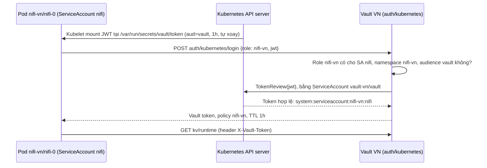

# NiFi đăng nhập Vault bằng ServiceAccount: giải thích chi tiết

Tài liệu này giải thích kỹ cơ chế mà [GUIDE_K8S_VI.md](GUIDE_K8S_VI.md) mục 5.1 tóm tắt: NiFi trên Kubernetes đọc Vault **không dùng token tĩnh**. Nó dùng token ServiceAccount do Kubernetes cấp, và Vault kiểm tra token đó bằng Kubernetes auth method.

Mọi kết quả trong tài liệu được chạy thật trên lab `192.168.102.4` ngày 2026-11-12. Token được che hoặc lược bỏ; các uid chỉ là định danh, không phải secret.

## 1. Bức tranh tổng thể



Có bốn mảnh, mỗi mảnh nằm ở một chỗ khác nhau:

| Mảnh | Vai trò | Định nghĩa ở |
|---|---|---|
| ServiceAccount `nifi` trong namespace `nifi-vn` | Danh tính của NiFi VN | [k8s/nifi/base/serviceaccount.yaml](../k8s/nifi/base/serviceaccount.yaml) + `namespace: nifi-vn` của overlay |
| JWT projected, audience `vault` | Bằng chứng danh tính mà pod trình ra | [k8s/nifi/base/statefulset.yaml](../k8s/nifi/base/statefulset.yaml#L136-L146), [sync-cronjobs.yaml](../k8s/nifi/base/sync-cronjobs.yaml) |
| Role `nifi-vn` + policy `nifi-vn` trong Vault | Danh tính nào được vào, và được đọc gì | [k8s/scripts/vault-init.py](../k8s/scripts/vault-init.py#L60-L88) |
| ClusterRoleBinding `vault-vn-tokenreview` | Cho Vault quyền hỏi Kubernetes "token này có thật không" | [k8s/vault/vn/tokenreview-rbac.yaml](../k8s/vault/vn/tokenreview-rbac.yaml) |

Phần còn lại giải thích lần lượt từng mảnh.

## 2. Token JWT ở đâu ra

Pod NiFi khai báo một volume kiểu *projected* ([statefulset.yaml:136-146](../k8s/nifi/base/statefulset.yaml#L136-L146)):

```yaml
volumes:
- name: vault-token
  projected:
    sources:
    - serviceAccountToken:
        audience: vault          # token chỉ dành cho bên nhận tên "vault"
        expirationSeconds: 3600  # sống 1 giờ
        path: token              # → /var/run/secrets/vault/token
```

- Kubelet thay pod xin token từ API server (TokenRequest API). Token gắn với ServiceAccount của pod (`serviceAccountName: nifi`) và gắn với **chính pod đó**. Kubelet xin token mới trước khi token cũ hết hạn rồi ghi đè lên file.
- Token mặc định để gọi Kubernetes API bị tắt (`automountServiceAccountToken: false`). Trong pod NiFi không có thư mục `/var/run/secrets/kubernetes.io/serviceaccount`. Pod chỉ có đúng một token, và token đó chỉ dành cho Vault.
- Job sync (`vault-param-sync`, `gitlab-registry-sync`) mount token cùng kiểu, nhưng chỉ sống 10 phút (`expirationSeconds: 600`).

### Bên trong JWT

JWT có ba phần ngăn bởi dấu chấm: `header.payload.chữ-ký`. Token của `nifi-vn/nifi-0` dài 1057 ký tự. Header là `{"alg": "RS256", "kid": "..."}`. Payload chỉ được mã hóa base64, không được mã hóa bí mật, nên giải mã ra đọc được ngay:

```json
{
  "iss": "https://kubernetes.default.svc.cluster.local",
  "sub": "system:serviceaccount:nifi-vn:nifi",
  "aud": ["vault"],
  "iat": "2026-11-12 22:38:23 +07",
  "nbf": "2026-11-12 22:38:23 +07",
  "exp": "2026-11-12 23:38:23 +07",
  "kubernetes.io": {
    "namespace": "nifi-vn",
    "serviceaccount": {"name": "nifi", "uid": "8a47cfec-d731-4e94-bc00-cad83c51a634"},
    "pod": {"name": "nifi-0", "uid": "b29ef7f6-085f-48d7-909c-880dd159adac"},
    "node": {"name": "lab-k8s", "uid": "1d009fc7-4086-4086-be42-1fbaaae75214"}
  }
}
```

| Claim | Ý nghĩa |
|---|---|
| `sub` | Danh tính: ServiceAccount `nifi` trong namespace `nifi-vn` |
| `aud` | Token chỉ dành cho bên nhận tên `vault` |
| `iat` / `nbf` / `exp` | Thời điểm cấp, bắt đầu hiệu lực và hết hạn; cách nhau đúng 1 giờ |
| `kubernetes.io.pod` | Token gắn với pod `nifi-0` có uid cụ thể. Pod bị xóa thì token mất hiệu lực, dù chưa tới `exp` |
| `iss` + chữ ký RS256 | Do API server của cụm ký. Sửa bất kỳ claim nào thì chữ ký không còn khớp |

Ai cũng đọc được payload, nhưng **không ai sửa được** payload mà giữ chữ ký hợp lệ. Thử nghiệm ở mục 7 cho thấy điều này.

## 3. NiFi gửi gì tới Vault

Có hai bên gửi, nhưng request giống hệt nhau:

```http
POST http://vault.vault-vn.svc.cluster.local:8200/v1/auth/kubernetes/login
Content-Type: application/json

{"role": "nifi-vn", "jwt": "eyJhbGciOiJSUzI1NiIs...(1057 ký tự)"}
```

- **Job sync**: [nifi_k8s_sync.py:96-104](../k8s/nifi/base/nifi_k8s_sync.py#L96-L104) đọc file `/var/run/secrets/vault/token`. `VAULT_ADDR` và `VAULT_ROLE=nifi-vn` lấy từ ConfigMap `nifi-sync-env` ở [k8s/nifi/vn/kustomization.yaml:17-18](../k8s/nifi/vn/kustomization.yaml#L17-L18).
- **NiFi tự đọc Vault** (bài Parameter Provider, GUIDE_K8S_VI mục 13): `StandardHashiCorpVaultClientService` có `Vault Authentication = KUBERNETES`, `vault.kubernetes.role = nifi-vn` và `vault.kubernetes.service-account-token-file = /var/run/secrets/vault/token`. Thư viện Spring Vault bên trong NiFi gửi đúng request trên.

Request không có header xác thực nào khác. Chính JWT là bằng chứng danh tính.

### Vì sao phải gửi kèm `role`

JWT trả lời câu hỏi **"tôi là ai"**; `role` trả lời **"tôi xin quyền nào"**.

- Vault không tự đoán role từ danh tính. Một ServiceAccount có thể được phép dùng nhiều role với policy khác nhau, nên bên đăng nhập phải nói rõ muốn role nào. Vault chỉ đối chiếu với điều kiện của đúng role đó.
- **Tên role không phải bí mật.** Biết tên `nifi-vn` cũng vô ích nếu JWT không khớp điều kiện của role (mục 7).

## 4. Role `nifi-vn` được tạo ở đâu

Role là object **bên trong Vault**, không phải object Kubernetes, nên không có manifest nào tạo ra nó. Script [k8s/scripts/vault-init.py](../k8s/scripts/vault-init.py) tạo role bằng cách gọi API của Vault.

**Khai báo:** dict `VAULTS` ([vault-init.py:69-77](../k8s/scripts/vault-init.py#L69-L77)):

```python
"instances": {
    "nifi-stag": {...},
    "nifi-vn": {
        "namespace": "nifi-vn",
        "read": ["kv/runtime", "kv/preview", "kv/gitlab-registry/vn"],
    },
},
```

Key `nifi-vn` vừa là tên role vừa là tên policy. `namespace` là namespace Kubernetes được phép đăng nhập. `read` là danh sách secret được đọc.

**Bật auth Kubernetes** ([vault-init.py:169-181](../k8s/scripts/vault-init.py#L169-L181)): bật `auth/kubernetes` nếu chưa có, rồi cấu hình `kubernetes_host` là địa chỉ API server mà Vault sẽ gọi TokenReview. Script không đặt `token_reviewer_jwt`, vì vậy Vault dùng token của chính pod Vault (mục 6).

**Tạo policy và role** ([vault-init.py:182-204](../k8s/scripts/vault-init.py#L182-L204)):

```python
# Policy: được đọc gì
req(base, f"sys/policies/acl/{name}", "PUT",
    {"policy": policy_text(instance["read"])}, token)

# Role: ai được đăng nhập, và nhận policy nào
req(base, f"auth/kubernetes/role/{name}", "POST", {
    "bound_service_account_names": ["nifi"],
    "bound_service_account_namespaces": [instance["namespace"]],
    "audience": "vault",
    "token_policies": [name],
    "token_no_default_policy": False,
    "token_ttl": "1h",
    "token_max_ttl": "4h",
}, token)
```

Đoạn này tương đương lệnh CLI `vault write auth/kubernetes/role/nifi-vn ...`. Nội dung policy do hàm `policy_text` sinh ra ([vault-init.py:112-118](../k8s/scripts/vault-init.py#L112-L118)).

Role và policy thật đang có trong Vault VN:

```text
bound_service_account_names:      [nifi]
bound_service_account_namespaces: [nifi-vn]
audience:                         vault
token_policies:                   [nifi-vn]
token_ttl / token_max_ttl:        3600 / 14400

path "kv/"                    { capabilities = ["list"] }
path "kv/runtime"             { capabilities = ["read"] }
path "kv/preview"             { capabilities = ["read"] }
path "kv/gitlab-registry/vn"  { capabilities = ["read"] }
```

Chạy lại script sẽ ghi đè role và policy bằng đúng giá trị trong code (idempotent). Muốn đổi quyền, sửa `VAULTS` rồi chạy `python3 k8s/scripts/vault-init.py`.

| Vault | Role | ServiceAccount được phép | Policy được đọc |
|---|---|---|---|
| VN | `nifi-stag` | `nifi-stag/nifi` | `kv/staging`, `kv/gitlab-registry/staging` |
| VN | `nifi-vn` | `nifi-vn/nifi` | `kv/runtime`, `kv/preview`, `kv/gitlab-registry/vn` |
| INDO | `nifi-indo` | `nifi-indo/nifi` | `kv/runtime`, `kv/gitlab-registry/indo` |

### Các mảnh nối với nhau chỉ bằng tên

| Mảnh | Nằm ở đâu | Giá trị phải khớp |
|---|---|---|
| Role trong Vault | `vault-init.py` | Cho phép SA `nifi`, namespace `nifi-vn`, audience `vault` |
| ServiceAccount | `serviceaccount.yaml` tạo SA `nifi`; overlay đặt `namespace: nifi-vn` | Danh tính trong JWT: `system:serviceaccount:nifi-vn:nifi` |
| Audience của JWT | `audience: vault` trong projected volume | `aud: ["vault"]` |
| Bên xin role | `VAULT_ROLE=nifi-vn` trong `nifi-sync-env`; property `vault.kubernetes.role` | Tên role gửi kèm khi login |

Không có reference kỹ thuật nào liên kết các mảnh này, chỉ có việc các tên trùng nhau. Đổi một chỗ mà quên chỗ khác thì đăng nhập thất bại:

- tên role không tồn tại → Vault báo không có role;
- sai namespace → `namespace not authorized`;
- sai tên SA → `service account name not authorized`;
- sai audience → `invalid audience (aud) claim`.

## 5. Vault kiểm tra như thế nào và trả về gì

Nhận `{"role": "nifi-vn", "jwt": "..."}`, Vault làm lần lượt:

1. **Tìm role `nifi-vn`** để lấy danh sách được phép.
2. **Đọc danh tính trong JWT** (`sub`, namespace, `aud`) và so với danh sách. Không khớp thì dừng ngay, với các lỗi ở bảng trên.
3. **Hỏi Kubernetes bằng TokenReview** xem token có thật hay không: đúng chữ ký, chưa hết hạn, pod còn tồn tại. Danh tính mà Kubernetes xác nhận phải trùng với danh tính trong token. Sai thì Vault trả `permission denied`.
4. **Cấp Vault token** mang policy của role.

Phản hồi thật, token đã che:

```json
{
  "client_token": "hvs....(ẩn)",
  "token_policies": ["default", "nifi-vn"],
  "metadata": {
    "role": "nifi-vn",
    "service_account_name": "nifi",
    "service_account_namespace": "nifi-vn",
    "service_account_secret_name": "",
    "service_account_uid": "8a47cfec-d731-4e94-bc00-cad83c51a634"
  },
  "lease_duration": 3600,
  "renewable": true
}
```

- Từ đây NiFi gọi Vault bằng header `X-Vault-Token: hvs...`, ví dụ `GET kv/runtime`. JWT không được dùng lại cho các request sau.
- Policy `default` chỉ cho token tự tra cứu, gia hạn và thu hồi chính nó. Quyền đọc secret đến từ policy `nifi-vn`.
- `metadata` ghi lại ai đã đăng nhập, phục vụ truy vết.
- Job xong việc thì gọi `auth/token/revoke-self` (trả `HTTP 204`), nên token Vault chết ngay chứ không sống hết 1 giờ.

## 6. Quyền TokenReview của Vault: ClusterRoleBinding `vault-vn-tokenreview`

Ở bước 3, chính Vault phải gọi API TokenReview của Kubernetes (`POST /apis/authentication.k8s.io/v1/tokenreviews`), và Kubernetes chỉ cho phép khi Vault có quyền. File [k8s/vault/vn/tokenreview-rbac.yaml](../k8s/vault/vn/tokenreview-rbac.yaml) cấp quyền đó:

```yaml
apiVersion: rbac.authorization.k8s.io/v1
kind: ClusterRoleBinding
metadata:
  name: vault-vn-tokenreview
  labels:
    app.kubernetes.io/part-of: nifi-market-lab
roleRef:
  apiGroup: rbac.authorization.k8s.io
  kind: ClusterRole
  name: system:auth-delegator
subjects:
- kind: ServiceAccount
  name: vault
  namespace: vault-vn
```

| Trường | Ý nghĩa |
|---|---|
| `kind: ClusterRoleBinding` | Gắn một bộ quyền cho một chủ thể ở phạm vi toàn cụm |
| `metadata.name` | Mỗi Vault một binding; Vault INDO có `vault-indo-tokenreview` |
| `labels` | Nhãn chung của lab, để lọc và gỡ cùng cả lab (`down.sh`) |
| `roleRef` → `system:auth-delegator` | Bộ quyền được cấp. Đây là role có sẵn của Kubernetes, không do lab tạo |
| `subjects` → SA `vault` trong `vault-vn` | SA mà pod `vault-0` của Vault VN đang chạy bằng |

Trên lab, `system:auth-delegator` chỉ có hai quyền:

```text
authentication.k8s.io  tokenreviews          create   → kiểm tra một token có hợp lệ không
authorization.k8s.io   subjectaccessreviews  create   → hỏi "chủ thể X có được làm Y không"
```

Vault chỉ dùng quyền thứ nhất. Đây là role chuẩn Kubernetes dành cho các thành phần "ủy quyền xác thực cho cụm", nên lab dùng lại thay vì tự viết role riêng.

**Vì sao là ClusterRoleBinding, không phải RoleBinding:** `tokenreviews` là resource không thuộc namespace nào (`kubectl` cảnh báo "not namespace scoped"). RoleBinding chỉ cấp quyền trong phạm vi một namespace, nên không cấp được quyền trên resource cấp cụm như thế này.

**Vault lấy token ở đâu để gọi TokenReview:** pod `vault-0` chạy bằng SA `vault`, và Kubernetes tự mount token của SA này vào pod. Vì `vault-init.py` không đặt `token_reviewer_jwt`, Vault dùng chính token đó và đọc lại khi Kubernetes xoay vòng nó. Không có token dài hạn nào phải tạo, lưu hay xoay bằng tay.

**Quyền này rộng đến đâu** (kiểm tra trên lab):

```text
vault-vn/vault  create tokenreviews  → yes
vault-vn/vault  get secrets (-A)     → no
nifi-vn/nifi    create tokenreviews  → no
```

- Vault chỉ được hỏi token có hợp lệ không. Nó không đọc được Secret, không xem được pod, không sửa được gì trong cụm.
- Vault kiểm tra được token của bất kỳ namespace nào, nhưng kiểm tra không có nghĩa là cấp quyền. Ai được đăng nhập vẫn do role trong Vault quyết định.

**Nếu thiếu binding này**, Kubernetes trả 403 khi Vault gọi TokenReview, nên mọi lần đăng nhập bằng ServiceAccount đều thất bại:
- Job sync báo `FAILED`;
- Parameter Provider `KUBERNETES` không fetch được;
- `check-k8s.py` báo FAIL ở các dòng login;
- log của `kubectl -n vault-vn logs vault-0` cho thấy Vault bị từ chối tạo `tokenreviews`.

## 7. NiFi INDO có mượn được role `nifi-vn` không?

Không. Role **có** gắn với ServiceAccount qua `bound_service_account_names` và `bound_service_account_namespaces`. Vault không tin bên gửi tự xưng là ai; nó so hai trường đó với danh tính **nằm trong JWT**, rồi hỏi Kubernetes xem JWT có thật không.

Kết quả thử trên lab:

| # | Thử | Vault VN trả về |
|---|---|---|
| 1 | Từ **bên trong pod `nifi-indo/nifi-0`**: JWT của chính pod INDO, kèm `role=nifi-vn` | `{"errors":["namespace not authorized"]}` |
| 2 | Lấy JWT của INDO, **sửa claim** `sub` và namespace thành `nifi-vn`, giữ nguyên chữ ký | `{"errors":["permission denied"]}` |
| 3 | SA `nifi-indo/nifi` có quyền xin token, hoặc `exec` vào pod, của `nifi-vn` không? | `no` / `no` |
| 4 | Đối chứng: JWT của pod VN, kèm `role=nifi-vn` | Đăng nhập OK, policy `nifi-vn` (token thu hồi ngay) |

- Thử nghiệm 1 bị chặn ở bước 2 của mục 5, vì danh tính trong JWT là `nifi-indo`.
- Thử nghiệm 2 qua được bước 2 nhờ claim đã bị sửa, nhưng bị chặn ở bước 3: chữ ký không khớp nên Kubernetes trả "không hợp lệ". Pod INDO không thể tự viết cho mình một JWT mang danh `nifi-vn`, vì chữ ký RS256 chỉ API server tạo được.

Vậy muốn đăng nhập role `nifi-vn` thì phải có **một JWT thật của SA `nifi-vn/nifi`**. Pod INDO không lấy được JWT đó, vì ba lẽ:

- Kubelet chỉ mount vào mỗi pod token của **chính SA của pod đó**. Pod INDO chỉ có token `nifi-indo/nifi`.
- SA `nifi` không có quyền gì với Kubernetes API, và cũng không được mount token API. Nó không xin được token cho SA khác, cũng không `exec` được sang pod VN để đọc file token (thử nghiệm 3).
- Kể cả admin trên UI NiFi INDO cấu hình Vault client với `vault.kubernetes.role=nifi-vn`, file token mà NiFi INDO đọc vẫn là token INDO, nên vẫn bị từ chối như thử nghiệm 1. Sự cô lập không phụ thuộc vào việc tin tưởng cấu hình NiFi.

### Ranh giới thật sự nằm ở đâu

- **Mạng không chặn.** Pod INDO gọi tới được Vault VN; câu trả lời ở thử nghiệm 1 chính là do Vault VN trả về. Flannel không thực thi NetworkPolicy (xem giới hạn trong [VALIDATION_K8S.md](VALIDATION_K8S.md)). Cô lập ở đây là cô lập theo **danh tính**, không phải theo mạng. Nếu cụm dùng CNI có NetworkPolicy, có thể chặn thêm ở tầng mạng như một lớp phòng thủ phụ.
- **Ai giả mạo được VN:**
  - người có quyền Kubernetes `kubectl exec` vào pod trong `nifi-vn`;
  - người được `create serviceaccounts/token` cho `nifi-vn/nifi` (tức `kubectl create token nifi -n nifi-vn`), ví dụ cluster-admin;
  - người giữ root token Vault, vì root token đọc được mọi thứ.

  Cần bảo vệ RBAC của cụm và root token, không phải bảo vệ cấu hình NiFi.
- **JWT là bearer token.** Ai đọc được file `/var/run/secrets/vault/token` trong thời hạn của nó thì đăng nhập được thành chủ của token. Thời hạn ngắn và việc gắn với pod giúp giới hạn thiệt hại, nhưng không thay được việc kiểm soát quyền `exec`.

## 8. So với token tĩnh của bản Docker Compose

| | Bản Compose | Bản K8s |
|---|---|---|
| Credential của NiFi | `nifi-vn-lab-token`, sống 30 ngày | JWT tự sinh, sống 1 giờ (Job: 10 phút), kubelet tự xoay |
| Lưu ở đâu | `.private/`, property của NiFi | Không lưu ở đâu cả: không có trong Git, `.env` hay Kubernetes Secret |
| Phạm vi đọc | `kv/*` trên Vault của thị trường | Chỉ secret của đúng instance; staging không đọc được `kv/runtime` của VN |
| Bị lộ thì sao | Dùng được ở mọi nơi tới khi hết 30 ngày hoặc bị thu hồi tay | Chỉ dùng được với Vault, trong thời hạn còn lại, khi pod còn sống |
| Dùng sai chỗ | Token Vault không liên quan tới Kubernetes | JWT `aud=vault` đem gọi Kubernetes API bị **401**; token audience mặc định đem tới Vault bị `invalid audience` |

## 9. Tự kiểm tra lại trên máy lab

Chạy trong `~/github/nifi-multi-market-lab`. Các lệnh dưới không in token đầy đủ.

**Xem claims trong JWT của pod NiFi VN:**

```bash
kubectl -n nifi-vn exec nifi-0 -c nifi -- cat /var/run/secrets/vault/token \
  | cut -d. -f2 \
  | python3 -c 'import sys,base64,json; s=sys.stdin.read().strip(); print(json.dumps(json.loads(base64.urlsafe_b64decode(s+"="*(-len(s)%4))), indent=2))'
```

**Xem role và policy trong Vault VN:**

```bash
VAULT_TOKEN=$(python3 -c 'import json; print(json.load(open(".private/k8s/vault-vn-init.json"))["root_token"])')
V=http://vault-vn.192.168.102.4.sslip.io:31080
curl -s -H "X-Vault-Token: $VAULT_TOKEN" "$V/v1/auth/kubernetes/role/nifi-vn" | python3 -m json.tool
curl -s -H "X-Vault-Token: $VAULT_TOKEN" "$V/v1/sys/policies/acl/nifi-vn" | python3 -c 'import json,sys; print(json.load(sys.stdin)["data"]["policy"])'
unset VAULT_TOKEN
```

**NiFi INDO thử dùng role `nifi-vn` từ bên trong pod của nó** (phải nhận `namespace not authorized`):

```bash
kubectl -n nifi-indo exec nifi-0 -c nifi -- sh -c \
  'curl -s -X POST http://vault.vault-vn.svc.cluster.local:8200/v1/auth/kubernetes/login -d "{\"role\":\"nifi-vn\",\"jwt\":\"$(cat /var/run/secrets/vault/token)\"}"'
```

**Quyền Kubernetes của Vault và của NiFi:**

```bash
kubectl get clusterrole system:auth-delegator -o yaml
kubectl auth can-i create tokenreviews.authentication.k8s.io --as=system:serviceaccount:vault-vn:vault   # yes
kubectl auth can-i get secrets -A --as=system:serviceaccount:vault-vn:vault                              # no
kubectl auth can-i create serviceaccounts/token -n nifi-vn --as=system:serviceaccount:nifi-indo:nifi    # no
kubectl auth can-i create pods/exec -n nifi-vn --as=system:serviceaccount:nifi-indo:nifi                # no
```

Các ca từ chối khác (sai SA, thiếu audience, đọc sai secret) nằm trong [GUIDE_K8S_VI.md](GUIDE_K8S_VI.md) mục 5.7. `python3 k8s/scripts/check-k8s.py` kiểm tra tự động toàn bộ các ca này.

## 10. Nguồn tham khảo

- Vault Kubernetes auth method: https://developer.hashicorp.com/vault/docs/auth/kubernetes
- Kubernetes TokenReview API: https://kubernetes.io/docs/reference/kubernetes-api/authentication-resources/token-review-v1/
- Projected ServiceAccount token: https://kubernetes.io/docs/concepts/storage/projected-volumes/#serviceaccounttoken
- ClusterRole `system:auth-delegator`: https://kubernetes.io/docs/reference/access-authn-authz/rbac/#other-component-roles
- NiFi StandardHashiCorpVaultClientService: https://nifi.apache.org/components/org.apache.nifi.vault.hashicorp.StandardHashiCorpVaultClientService/
